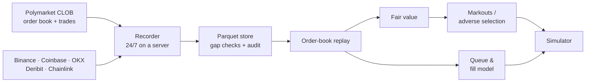
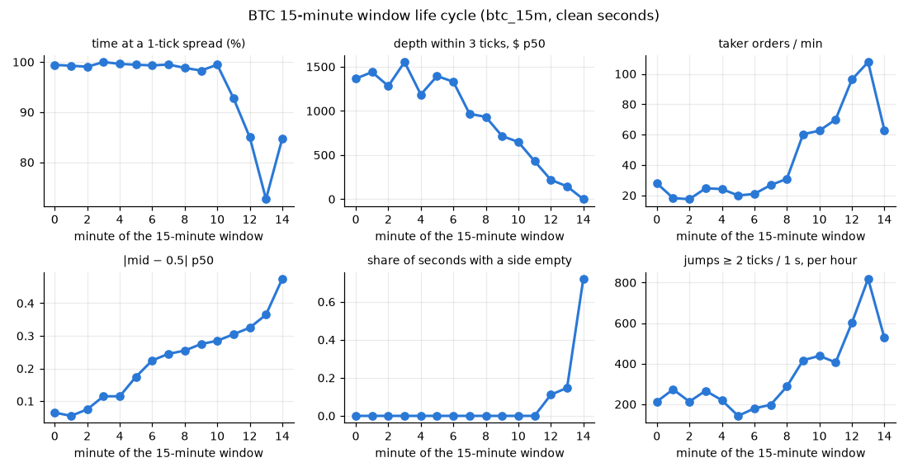
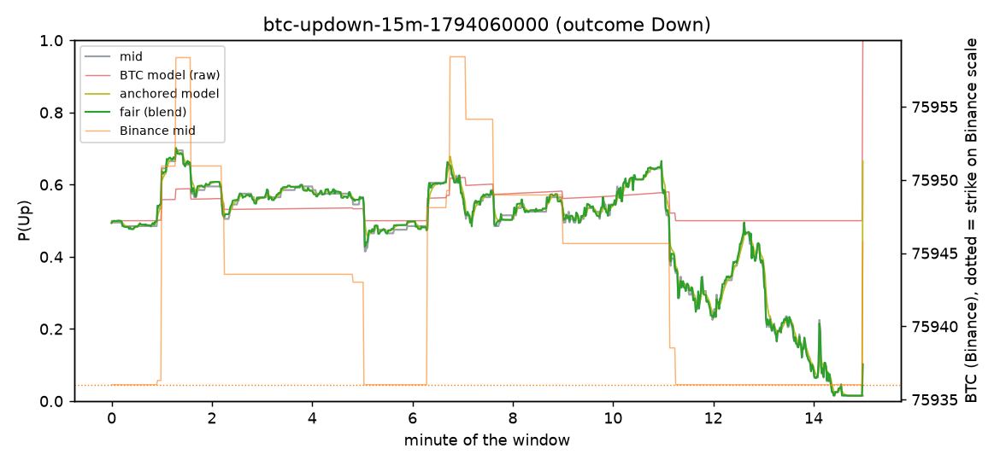
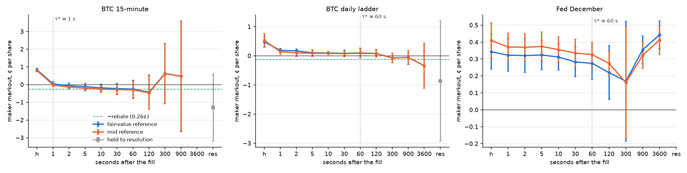
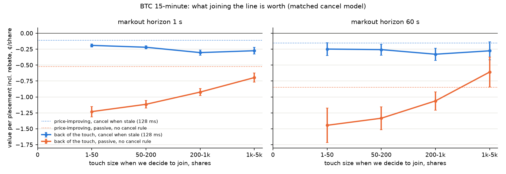

# polymm: Market Making on Polymarket

A market-making framework for Polymarket's prediction-market order book: a multi-venue data
pipeline, a fair-value model, and a measurement of what a liquidity provider actually earns
once adverse selection is paid for.

> **The question:** does quoting both sides of a Polymarket book earn more in spread and
> liquidity rewards than it loses to traders who know more?

---

## How it works



1. **Record**: Polymarket has no historical order-book API, so the book is recorded live from
   the WebSocket feed, alongside spot, perp and oracle prices from other venues on one clock.
2. **Replay**: books are rebuilt event by event and checked against REST snapshots.
3. **Fair value**: microprice and order-book signals blended with an external BTC model
   (the market as a digital option on BTC), walk-forward and out of sample.
4. **Adverse selection**: every fill is marked out against fair value at horizons from
   1 s to resolution.
5. **Queue & fills**: virtual orders placed in the replayed book give fill probability and
   toxicity by queue position.
6. **Simulator**: the strategy's own quotes in the replayed book, with latency, fees and rewards.

## The P&L, split into parts

Every fill $i$ (side $s_i$, price $P_i$, fair value $m_i$, fair value $\tau$ later $m_i^{\tau}$):

$$
\text{P\&L} = \underbrace{\sum s_i(m_i - P_i)}_{\text{spread}}
+ \underbrace{\sum s_i(m_i^{\tau} - m_i)}_{\text{adverse selection}}
+ \underbrace{\sum s_i(V_T - m_i^{\tau})}_{\text{inventory}}
+ \underbrace{R}_{\text{rewards}} - F
$$

Most of the difference between market makers is in the second term, and that is what this
project measures.

---

## A few charts

**A 15-minute BTC market, minute by minute.** The book is liquid early and thins out as the
outcome becomes clear: the spread widens, depth disappears and jumps spike near the close.



**Fair value vs. the mid.** The fair-value blend follows the Polymarket mid and the Binance
BTC price through one window.



**Markout signature.** A maker's edge per fill (¢/share) from the moment of the fill out to
resolution. The spread earned at the fill is quickly given back to informed flow.



**What a place in the queue is worth.** Value of joining the back of the book vs. improving the
price, with and without cancelling stale quotes.



---

## Layout

| Path | What |
|---|---|
| `src/polymm/recorder.py`, `feeds/` | Polymarket WebSocket + multi-venue recorders |
| `src/polymm/replay.py`, `book.py` | Order-book reconstruction and validation |
| `src/polymm/fair/` | Fair-value models and walk-forward blend |
| `src/polymm/markouts/` | Fill table, markouts, adverse-selection statistics |
| `src/polymm/queue/` | Queue position, fill probability, toxicity |
| `src/polymm/rewards/` | Liquidity rewards and maker rebates |
| `src/polymm/sim/` | Event-driven market-making simulator |
| `research/` | Write-ups and charts per stage |
| `docs/` | Data design and the decision log |

## Run

```bash
uv sync
uv run polymm universe     # markets the rules resolve to right now
uv run polymm record       # start the recorder
uv run polymm replay --help
```

Python 3.12 · polars · DuckDB · PyArrow · NumPy/Numba · websockets.
Read-only market data, no API keys needed for the core pipeline.

## Status

Research in progress. No live trading: quotes go live only if the data shows an edge after
adverse selection.
