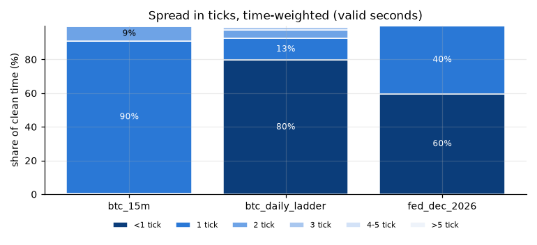
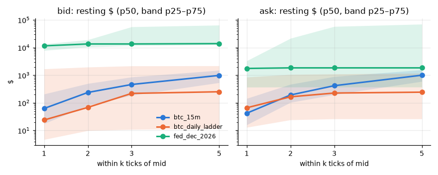
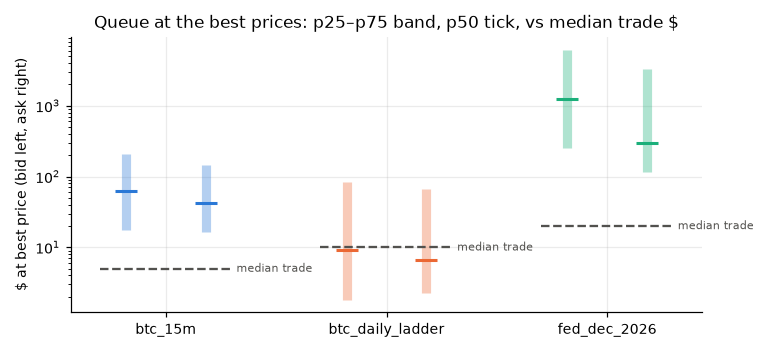
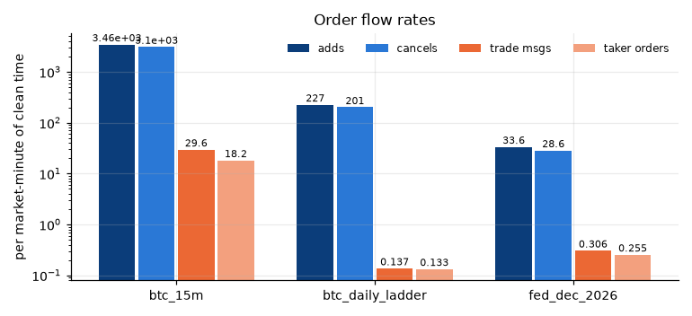
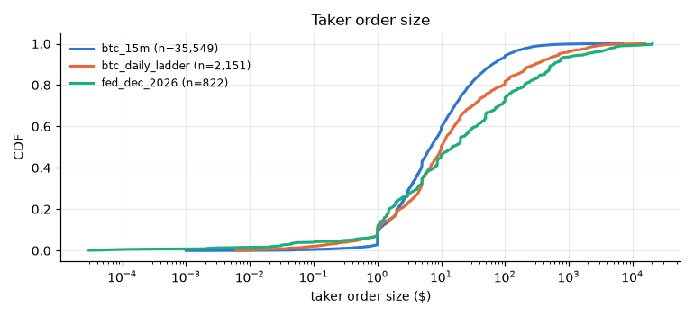
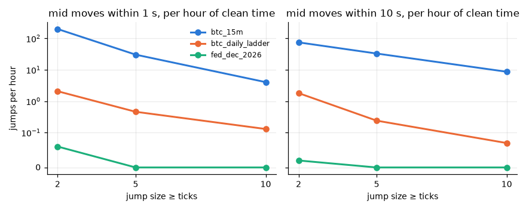
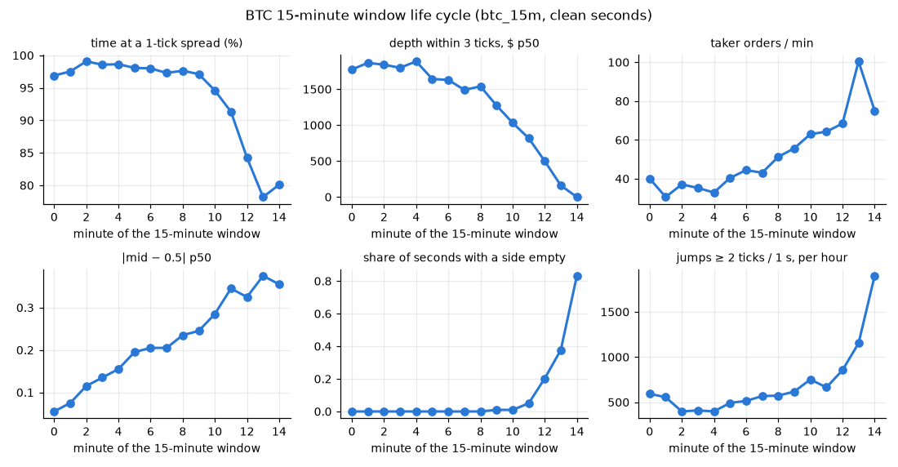
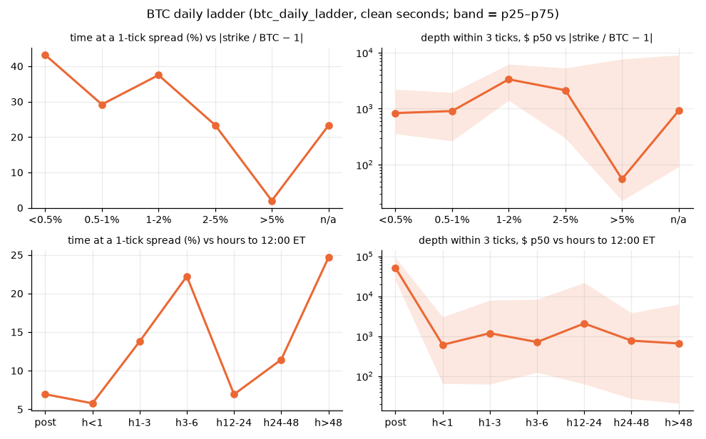

# Shape of the market — 2026-11-06

Data root `/Users/macbook/Desktop/POLY MM/data`; window 2026-11-06 13:10 → 2026-11-07 00:25 UTC; statistics only inside strict clean windows (`clean_windows_strict.parquet`), outcome-0 (Yes/Up) books, 1-second as-of grid (each second weighs the same). Ticks are cents. **All numbers are provisional: one day of data.** Ran in 1111 s.

- Replay reused from `/Users/macbook/Desktop/POLY MM/.claude/worktrees/quality-checks-5dddd8/reports/2026-11-06/replay`, strict windows from `reports/2026-11-06/clean_windows_strict.parquet`.
- Binance spot: absent; BTC reference minutes: 0 Binance, 665 ladder-implied.

## 1. Spread (time-weighted)

Share of valid seconds by spread bin, quantiles in ticks, and share of all clean seconds with one side empty. n_s = clean seconds, n_tokens = outcome-0 tokens.

| family | n_s | n_s (all) | n_tokens | <1 % | 1 % | 2 % | 3 % | 4-5 % | >5 % | p50_ticks | p90_ticks | mean_ticks | empty side % |
|---|---|---|---|---|---|---|---|---|---|---|---|---|---|
| btc_15m | 111,088 | 116,904 | 48 | 0.7 | 90.3 | 8.7 | 0.2 | 0.1 | 0 | 1 | 1 | 1.09 | 5 |
| btc_daily_ladder | 780,660 | 967,945 | 29 | 79.6 | 12.8 | 5.2 | 1.5 | 0.6 | 0.3 | 0.2 | 1.6 | 0.56 | 19.4 |
| fed_dec_2026 | 193,118 | 193,118 | 5 | 59.6 | 40.2 | 0.2 | 0 | 0 | 0 | 0.1 | 1 | 0.48 | 0 |

### Spread vs time to expiry

| family | bucket | n_s | n_tokens | <1 % | 1 tick % | >5 % | p50_ticks | p90_ticks | empty side % |
|---|---|---|---|---|---|---|---|---|---|
| btc_15m | pre | 74,733 | 47 | 0 | 87.9 | 0 | 1 | 2 | 0 |
| btc_15m | m00 | 2,698 | 45 | 0 | 96.9 | 0.1 | 1 | 1 | 0 |
| btc_15m | m01 | 2,697 | 45 | 0 | 97.5 | 0 | 1 | 1 | 0 |
| btc_15m | m02 | 2,700 | 45 | 0 | 99.1 | 0 | 1 | 1 | 0 |
| btc_15m | m03 | 2,699 | 45 | 0 | 98.6 | 0.1 | 1 | 1 | 0 |
| btc_15m | m04 | 2,696 | 45 | 0 | 98.6 | 0 | 1 | 1 | 0 |
| btc_15m | m05 | 2,700 | 45 | 0 | 98.1 | 0 | 1 | 1 | 0 |
| btc_15m | m06 | 2,688 | 45 | 0 | 98 | 0 | 1 | 1 | 0 |
| btc_15m | m07 | 2,698 | 45 | 0 | 97.3 | 0 | 1 | 1 | 0 |
| btc_15m | m08 | 2,695 | 45 | 0 | 97.6 | 0.1 | 1 | 1 | 0 |
| btc_15m | m09 | 2,662 | 45 | 1.2 | 97.1 | 0.1 | 1 | 1 | 1 |
| btc_15m | m10 | 2,642 | 45 | 2.8 | 94.6 | 0.1 | 1 | 1 | 1 |
| btc_15m | m11 | 2,561 | 45 | 5.6 | 91.3 | 0.2 | 1 | 1 | 5 |
| btc_15m | m12 | 2,153 | 42 | 11.3 | 84.2 | 0.1 | 1 | 1 | 20.3 |
| btc_15m | m13 | 1,674 | 37 | 14.9 | 78.2 | 0.7 | 1 | 1 | 37.8 |
| btc_15m | m14 | 392 | 18 | 1.8 | 80.1 | 3.8 | 1 | 2 | 83.2 |
| btc_daily_ladder | post | 273 | 2 | 80.6 | 7 | 8.8 | 0.8 | 4.7 | 92.2 |
| btc_daily_ladder | h<1 | 9,146 | 4 | 59 | 5.8 | 10.4 | 0.3 | 5.2 | 76.9 |
| btc_daily_ladder | h1-3 | 38,663 | 8 | 64.8 | 13.8 | 1.9 | 0.4 | 3.3 | 47.2 |
| btc_daily_ladder | h3-6 | 17,660 | 7 | 60.4 | 22.2 | 1.4 | 0.4 | 2.7 | 32.4 |
| btc_daily_ladder | h12-24 | 200,830 | 8 | 88.2 | 6.9 | 0.1 | 0.1 | 1.2 | 28.8 |
| btc_daily_ladder | h24-48 | 382,904 | 21 | 84.7 | 11.4 | 0 | 0.2 | 1 | 7.1 |
| btc_daily_ladder | h>48 | 131,184 | 11 | 60.1 | 24.6 | 0.2 | 0.5 | 2.2 | 0 |
| fed_dec_2026 | flat | 193,118 | 5 | 59.6 | 40.2 | 0 | 0.1 | 1 | 0 |

### Ladder: spread vs moneyness (|strike / BTC − 1|)

| mny | n_s | n_tokens | <1 % | 1 tick % | >5 % | p50_ticks | p90_ticks | empty side % |
|---|---|---|---|---|---|---|---|---|
| <0.5% | 63,384 | 3 | 18.8 | 43.2 | 2.5 | 1.6 | 3.3 | 0.4 |
| 0.5-1% | 22,473 | 3 | 15.2 | 29.2 | 2.9 | 2.1 | 4 | 0 |
| 1-2% | 18,463 | 6 | 21.9 | 37.5 | 0.7 | 1.7 | 3.4 | 0 |
| 2-5% | 211,216 | 12 | 71.1 | 23.4 | 0 | 0.5 | 1.4 | 2.4 |
| >5% | 464,269 | 21 | 97.2 | 2 | 0 | 0.1 | 0.5 | 28.1 |
| n/a | 855 | 11 | 75.8 | 23.3 | 0 | 0.4 | 1 | 34.4 |

## 2. Depth within k ticks of mid (time-weighted, valid seconds)

Cumulative resting size on each side whose price is within k ticks of the mid; $ = shares × price. 5 stored levels, so k = 5 is a lower bound in dense books.

| family | side | k | n_s | sh_p25 | sh_p50 | sh_p75 | usd_p25 | usd_p50 | usd_p75 |
|---|---|---|---|---|---|---|---|---|---|
| btc_15m | ask | 1 | 111,088 | 35 | 91.37 | 330 | 16 | 42.21 | 144 |
| btc_15m | ask | 2 | 111,088 | 204 | 404.5 | 961.3 | 103.7 | 192.9 | 470 |
| btc_15m | ask | 3 | 111,088 | 398.9 | 866.6 | 1,784 | 197.9 | 418.2 | 892.5 |
| btc_15m | ask | 5 | 111,088 | 1,193 | 1,998 | 3,124 | 597.2 | 1,002 | 1,564 |
| btc_15m | bid | 1 | 111,088 | 40 | 142 | 439.2 | 17.64 | 62.5 | 207.6 |
| btc_15m | bid | 2 | 111,088 | 195.1 | 556.3 | 1,084 | 80.46 | 237.8 | 500.6 |
| btc_15m | bid | 3 | 111,088 | 436.6 | 1,048 | 1,919 | 187.5 | 462.2 | 859.9 |
| btc_15m | bid | 5 | 111,088 | 1,227 | 2,196 | 3,427 | 537.3 | 985.6 | 1,507 |
| btc_daily_ladder | ask | 1 | 780,660 | 472.1 | 1,322 | 4,010 | 12.96 | 66.32 | 850.4 |
| btc_daily_ladder | ask | 2 | 780,660 | 670 | 1,770 | 5,470 | 24.25 | 165.7 | 1,064 |
| btc_daily_ladder | ask | 3 | 780,660 | 746.7 | 1,873 | 5,634 | 26.28 | 226.5 | 1,110 |
| btc_daily_ladder | ask | 5 | 780,660 | 756.7 | 1,938 | 5,698 | 26.29 | 243.7 | 1,176 |
| btc_daily_ladder | bid | 1 | 780,660 | 340 | 1,201 | 4,633 | 4.7 | 23.91 | 1,690 |
| btc_daily_ladder | bid | 2 | 780,660 | 478 | 1,819 | 6,103 | 9.88 | 68.54 | 1,967 |
| btc_daily_ladder | bid | 3 | 780,660 | 583 | 1,993 | 8,307 | 10.92 | 219.9 | 2,169 |
| btc_daily_ladder | bid | 5 | 780,660 | 608 | 2,063 | 8,615 | 11.7 | 252.1 | 2,187 |
| fed_dec_2026 | ask | 1 | 193,118 | 17,543 | 36,177 | 148,648 | 368.8 | 1,759 | 3,311 |
| fed_dec_2026 | ask | 2 | 193,118 | 39,427 | 68,275 | 212,348 | 371.7 | 1,846 | 21,615 |
| fed_dec_2026 | ask | 3 | 193,118 | 43,723 | 175,112 | 231,532 | 371.7 | 1,846 | 57,932 |
| fed_dec_2026 | ask | 5 | 193,118 | 43,723 | 199,565 | 263,474 | 371.7 | 1,846 | 70,369 |
| fed_dec_2026 | bid | 1 | 193,118 | 23,518 | 4,824,181 | 5,597,423 | 7,866 | 11,560 | 13,538 |
| fed_dec_2026 | bid | 2 | 193,118 | 90,096 | 4,824,181 | 5,597,423 | 10,520 | 13,537 | 19,140 |
| fed_dec_2026 | bid | 3 | 193,118 | 213,673 | 4,824,181 | 5,597,423 | 11,637 | 13,540 | 56,390 |
| fed_dec_2026 | bid | 5 | 193,118 | 240,390 | 4,824,181 | 5,597,423 | 12,623 | 13,923 | 64,819 |

### Depth within 3 ticks vs time to expiry (p50, bid + ask)

| family | bucket | n_s | sh_p50 | usd_p50 | usd_p25 | usd_p75 |
|---|---|---|---|---|---|---|
| btc_15m | pre | 74,733 | 1,579 | 775.1 | 402.9 | 1,534 |
| btc_15m | m00 | 2,698 | 3,647 | 1,774 | 1,278 | 2,344 |
| btc_15m | m01 | 2,697 | 4,142 | 1,867 | 1,397 | 2,582 |
| btc_15m | m02 | 2,700 | 4,238 | 1,840 | 1,369 | 2,730 |
| btc_15m | m03 | 2,699 | 4,350 | 1,799 | 1,300 | 2,609 |
| btc_15m | m04 | 2,696 | 4,549 | 1,887 | 1,334 | 2,844 |
| btc_15m | m05 | 2,700 | 4,406 | 1,642 | 1,101 | 2,902 |
| btc_15m | m06 | 2,688 | 4,231 | 1,629 | 994 | 3,052 |
| btc_15m | m07 | 2,698 | 3,803 | 1,490 | 880.3 | 2,837 |
| btc_15m | m08 | 2,695 | 3,903 | 1,540 | 847.1 | 2,919 |
| btc_15m | m09 | 2,662 | 3,674 | 1,291 | 725.4 | 2,829 |
| btc_15m | m10 | 2,642 | 3,036 | 1,042 | 515.9 | 2,525 |
| btc_15m | m11 | 2,561 | 3,307 | 882.5 | 346.5 | 2,427 |
| btc_15m | m12 | 2,153 | 2,302 | 766.8 | 326.8 | 2,283 |
| btc_15m | m13 | 1,674 | 1,682 | 625.4 | 211 | 1,850 |
| btc_15m | m14 | 392 | 750 | 226.1 | 68.53 | 1,201 |
| btc_daily_ladder | post | 273 | 52,063 | 51,783 | 25,013 | 92,930 |
| btc_daily_ladder | h<1 | 9,146 | 4,664 | 608.1 | 65.18 | 3,033 |
| btc_daily_ladder | h1-3 | 38,663 | 5,972 | 1,189 | 62.96 | 7,972 |
| btc_daily_ladder | h3-6 | 17,660 | 9,658 | 713.5 | 124.1 | 8,408 |
| btc_daily_ladder | h12-24 | 200,830 | 14,327 | 2,084 | 63.41 | 21,942 |
| btc_daily_ladder | h24-48 | 382,904 | 4,812 | 774.5 | 27.39 | 3,849 |
| btc_daily_ladder | h>48 | 131,184 | 8,708 | 657.7 | 20.87 | 6,350 |
| fed_dec_2026 | flat | 193,118 | 4,880,400 | 14,629 | 13,418 | 116,795 |

### Ladder: depth within 3 ticks vs moneyness (p50, bid + ask)

| mny | n_s | sh_p50 | usd_p50 | usd_p25 | usd_p75 |
|---|---|---|---|---|---|
| <0.5% | 63,384 | 1,787 | 834.4 | 356.5 | 2,220 |
| 0.5-1% | 22,473 | 3,670 | 906.4 | 265.6 | 1,950 |
| 1-2% | 18,463 | 4,729 | 3,345 | 1,409 | 6,222 |
| 2-5% | 211,216 | 5,885 | 2,135 | 297.2 | 5,321 |
| >5% | 464,269 | 7,849 | 55.3 | 22.77 | 7,684 |
| n/a | 855 | 8,108 | 918.5 | 92.03 | 9,108 |

### Depth imbalance (bid − ask) / (bid + ask) within 3 ticks

| family | n_s | imb_p10 | imb_p25 | imb_p50 | imb_p75 | imb_p90 | |imb| > 0.5 % |
|---|---|---|---|---|---|---|---|
| btc_15m | 111,058 | -0.52 | -0.26 | 0.02 | 0.36 | 0.53 | 23.2 |
| btc_daily_ladder | 779,575 | -0.84 | -0.68 | -0.01 | 0.72 | 0.86 | 67.8 |
| fed_dec_2026 | 193,118 | -0.19 | 0.06 | 0.92 | 0.98 | 0.99 | 63.3 |

## 3. Queue at the best prices

Size resting at the best bid / ask, time-weighted quantiles.

| family | side | n_s | sh_p10 | sh_p25 | sh_p50 | sh_p75 | sh_p90 | usd_p25 | usd_p50 | usd_p75 |
|---|---|---|---|---|---|---|---|---|---|---|
| btc_15m | ask | 111,088 | 17.63 | 35 | 91.02 | 325.2 | 841 | 16.4 | 42.5 | 144 |
| btc_15m | bid | 111,088 | 17.56 | 41 | 141 | 439.2 | 876.9 | 17.64 | 62.5 | 206.9 |
| btc_daily_ladder | ask | 780,660 | 5 | 14 | 102.9 | 440 | 1,355 | 2.28 | 6.64 | 67.08 |
| btc_daily_ladder | bid | 780,660 | 5 | 20 | 100 | 430 | 1,993 | 1.82 | 9.12 | 83.98 |
| fed_dec_2026 | ask | 193,118 | 589 | 8,091 | 17,496 | 47,262 | 61,571 | 115 | 299.9 | 3,319 |
| fed_dec_2026 | bid | 193,118 | 889 | 13,439 | 51,091 | 100,001 | 313,902 | 256.5 | 1,255 | 6,238 |

Trade vs queue: each trade message matched with the nearest size decrease at its price on the consumed side (±1 s); `frac` = trade size / queue at that level before the trade; `sh_level_wiped` = share of trades that took the whole level.

| family | n_trades | n_matched | matched % | queue_hit_p50_sh | frac_p25 | frac_p50 | frac_p75 | level wiped % |
|---|---|---|---|---|---|---|---|---|
| btc_15m | 57,713 | 57,677 | 99.9 | 98.5 | 0.03 | 0.151 | 1 | 25.6 |
| btc_daily_ladder | 2,206 | 2,108 | 95.6 | 214 | 0.084 | 0.662 | 1 | 42.3 |
| fed_dec_2026 | 986 | 978 | 99.2 | 18,941 | 0 | 0.003 | 0.025 | 7.3 |

## 4. Order flow (per market-minute of clean time)

| family | market_min | n_add | n_cancel | adds_per_min | cancels_per_min | add_sh_per_min | cancel_sh_per_min |
|---|---|---|---|---|---|---|---|
| btc_15m | 1,948 | 6,741,721 | 6,040,024 | 3,460 | 3,100 | 212,464 | 203,281 |
| btc_daily_ladder | 16,132 | 3,654,084 | 3,248,520 | 226.5 | 201.4 | 73,683 | 73,753 |
| fed_dec_2026 | 3,219 | 108,041 | 91,962 | 33.57 | 28.57 | 98,046 | 97,417 |

Taker orders per minute (trade messages grouped into orders by a 50 ms gap) and trade messages per minute:

| family | n_s | n_msgs | n_orders | msgs_per_min | orders_per_min |
|---|---|---|---|---|---|
| btc_15m | 116,904 | 57,713 | 35,549 | 29.62 | 18.25 |
| btc_daily_ladder | 967,945 | 2,206 | 2,151 | 0.137 | 0.133 |
| fed_dec_2026 | 193,118 | 986 | 822 | 0.306 | 0.255 |

Resting-time proxy (upper bound): share of added size cancelled at the same level within 1 / 10 / 60 s.

| family | n_adds | added_sh | ≤1 s % | ≤10 s % | ≤60 s % |
|---|---|---|---|---|---|
| btc_15m | 6,741,721 | 413,964,322 | 79.6 | 95.2 | 97.4 |
| btc_daily_ladder | 3,654,084 | 1,188,679,406 | 52.7 | 79.9 | 92.3 |
| fed_dec_2026 | 108,041 | 315,572,549 | 14.2 | 31.5 | 44.8 |

### Flow vs time to expiry

| family | bucket | market_min | adds_per_min | cancels_per_min | orders_per_min | order_usd_p50 | yes_buy_sh | sh_multi_level |
|---|---|---|---|---|---|---|---|---|
| btc_15m | pre | 1,246 | 89.83 | 76.57 | 0.649 | 7.18 | 0.59 | 0.01 |
| btc_15m | m00 | 45 | 10,637 | 9,239 | 40.1 | 6 | 0.46 | 0.054 |
| btc_15m | m01 | 45 | 10,104 | 9,445 | 30.59 | 5.8 | 0.487 | 0.04 |
| btc_15m | m02 | 45 | 10,024 | 9,232 | 37.11 | 5 | 0.535 | 0.045 |
| btc_15m | m03 | 45 | 9,858 | 9,101 | 35.27 | 5.09 | 0.493 | 0.036 |
| btc_15m | m04 | 44.9 | 10,436 | 9,672 | 32.91 | 5 | 0.498 | 0.034 |
| btc_15m | m05 | 45 | 9,826 | 9,000 | 40.4 | 6 | 0.51 | 0.05 |
| btc_15m | m06 | 44.8 | 10,244 | 9,241 | 44.46 | 6.54 | 0.505 | 0.043 |
| btc_15m | m07 | 45 | 10,794 | 9,905 | 43.1 | 5.2 | 0.487 | 0.04 |
| btc_15m | m08 | 44.9 | 11,336 | 10,240 | 51.27 | 7.35 | 0.502 | 0.051 |
| btc_15m | m09 | 44.8 | 12,292 | 11,102 | 55.69 | 7.2 | 0.499 | 0.076 |
| btc_15m | m10 | 44.5 | 11,130 | 9,883 | 62.97 | 6.86 | 0.52 | 0.055 |
| btc_15m | m11 | 44.9 | 9,783 | 8,594 | 64.25 | 7.8 | 0.488 | 0.043 |
| btc_15m | m12 | 45 | 9,287 | 8,134 | 68.44 | 7.47 | 0.495 | 0.088 |
| btc_15m | m13 | 44.9 | 9,087 | 7,553 | 100.5 | 9.5 | 0.49 | 0.13 |
| btc_15m | m14 | 39 | 3,177 | 2,290 | 75.07 | 9.18 | 0.56 | 0.21 |
| btc_15m | post | 35.3 | 89.91 | 93.26 | 2.297 | 0.89 | 0.827 | 0 |
| btc_daily_ladder | post | 58.4 | 122.6 | 13.28 | 0.96 | 14.57 | 0.393 | 0.071 |
| btc_daily_ladder | h<1 | 660 | 317 | 314.3 | 0.556 | 16 | 0.572 | 0.019 |
| btc_daily_ladder | h1-3 | 1,222 | 479.4 | 446.2 | 0.614 | 9.97 | 0.449 | 0 |
| btc_daily_ladder | h3-6 | 435.7 | 372.8 | 293.1 | 0.351 | 12.3 | 0.431 | 0.007 |
| btc_daily_ladder | h12-24 | 4,699 | 158.5 | 139.2 | 0.087 | 6.83 | 0.499 | 0.005 |
| btc_daily_ladder | h24-48 | 6,872 | 196.4 | 174.8 | 0.053 | 9.87 | 0.474 | 0 |
| btc_daily_ladder | h>48 | 2,186 | 272.3 | 234.5 | 0.024 | 9.2 | 0.566 | 0.019 |
| fed_dec_2026 | flat | 3,219 | 33.57 | 28.57 | 0.255 | 14.9 | 0.404 | 0.006 |

## 5. Trades

Per trade message (one per maker hit) and per taker order (messages of one token+side within 50 ms). `yes_buy` = taker bought the Yes/Up token (or sold the No/Down one). Sweep = order that walked ≥ 2 price levels; `sweep_ticks` = levels spanned.

| family | n_msgs | msg_sh_p25 | msg_sh_p50 | msg_sh_p75 | msg_sh_p90 | msg_usd_p50 | msg_usd_p90 | volume_sh | volume_usd | yes buy % (count) | yes buy % (volume) |
|---|---|---|---|---|---|---|---|---|---|---|---|
| btc_15m | 57,713 | 5 | 10.4 | 30 | 75.6 | 5 | 36.75 | 2,049,508 | 1,041,646 | 49.8 | 48.4 |
| btc_daily_ladder | 2,206 | 10.6 | 40 | 201.9 | 752.8 | 9.98 | 278.1 | 918,920 | 356,895 | 48.4 | 43.5 |
| fed_dec_2026 | 986 | 9 | 50 | 303.8 | 783.2 | 20 | 504 | 674,158 | 354,997 | 34.7 | 42.7 |

| family | n_orders | order_sh_p50 | order_sh_p90 | order_usd_p50 | order_usd_p90 | order_usd_p99 | multi-maker % | sweep % | volume in sweeps % | sweep_ticks_p50 | sweep_ticks_p90 | sweep_ticks_max |
|---|---|---|---|---|---|---|---|---|---|---|---|---|
| btc_15m | 35,549 | 17 | 127 | 6.9 | 63.55 | 341 | 20.3 | 7.5 | 24.5 | 2 | 6 | 77 |
| btc_daily_ladder | 2,151 | 40 | 800 | 10 | 299.4 | 2,872 | 2.1 | 0.7 | 1 | 2 | 6 | 34 |
| fed_dec_2026 | 822 | 55 | 945.8 | 14.9 | 584.6 | 7,505 | 9.2 | 0.6 | 5.6 | 4 | 5 | 5 |

## 6. Jumps of the mid (outcome-0 tokens, valid seconds)

Moves of the 1-s grid mid over 1 s (consecutive seconds) and over 10 s (aligned, non-overlapping), per hour of clean time.

| family | hours | n_pairs_1s | ≥2t/1s per h | ≥5t/1s per h | ≥10t/1s per h | ≥2t/10s per h | ≥5t/10s per h | ≥10t/10s per h | jump_ticks_p50 | jump_ticks_p90 | jump_ticks_max |
|---|---|---|---|---|---|---|---|---|---|---|---|
| btc_15m | 30.86 | 110,975 | 199.6 | 30.43 | 4.05 | 74.82 | 33.02 | 8.68 | 2 | 5 | 50 |
| btc_daily_ladder | 216.8 | 780,427 | 2.08 | 0.46 | 0.13 | 1.81 | 0.24 | 0.07 | 2 | 8 | 35 |
| fed_dec_2026 | 53.64 | 193,074 | 0.06 | 0 | 0 | 0.02 | 0 | 0 | 3 | 4 | 4 |

### Jumps vs time to expiry (1 s moves per hour)

| family | bucket | hours | per_h_1s_ge2 | per_h_1s_ge5 | per_h_1s_ge10 | per_h_10s_ge5 |
|---|---|---|---|---|---|---|
| btc_15m | pre | 20.76 | 2.7 | 0.24 | 0 | 0.29 |
| btc_15m | m00 | 0.749 | 592.8 | 46.73 | 1.34 | 94.79 |
| btc_15m | m01 | 0.749 | 555.4 | 30.71 | 2.67 | 85.45 |
| btc_15m | m02 | 0.75 | 397.3 | 36 | 0 | 68 |
| btc_15m | m03 | 0.75 | 409.3 | 28 | 0 | 72 |
| btc_15m | m04 | 0.749 | 397.9 | 42.72 | 8.01 | 76.1 |
| btc_15m | m05 | 0.75 | 492 | 44 | 4 | 92 |
| btc_15m | m06 | 0.747 | 514.1 | 50.87 | 5.35 | 87.01 |
| btc_15m | m07 | 0.749 | 567.4 | 76.1 | 4.01 | 109.5 |
| btc_15m | m08 | 0.749 | 572.8 | 69.43 | 1.34 | 97.46 |
| btc_15m | m09 | 0.739 | 617 | 104.2 | 9.47 | 119.1 |
| btc_15m | m10 | 0.734 | 752 | 126.7 | 10.9 | 117.2 |
| btc_15m | m11 | 0.711 | 663.9 | 118.1 | 11.25 | 108.3 |
| btc_15m | m12 | 0.598 | 854.5 | 153.8 | 10.03 | 123.8 |
| btc_15m | m13 | 0.465 | 1,153 | 376.3 | 92.47 | 154.8 |
| btc_15m | m14 | 0.109 | 1,899 | 871.6 | 302.8 | 275.2 |
| btc_daily_ladder | post | 0.076 | 118.4 | 78.95 | 39.47 | 13.16 |
| btc_daily_ladder | h<1 | 2.541 | 97.6 | 29.12 | 10.23 | 16.53 |
| btc_daily_ladder | h1-3 | 10.74 | 5.87 | 0 | 0 | 0.65 |
| btc_daily_ladder | h3-6 | 4.906 | 7.95 | 1.63 | 0 | 0.41 |
| btc_daily_ladder | h12-24 | 55.79 | 0.11 | 0 | 0 | 0 |
| btc_daily_ladder | h24-48 | 106.4 | 0.2 | 0.02 | 0 | 0 |
| btc_daily_ladder | h>48 | 36.44 | 1.76 | 0.25 | 0 | 0 |
| fed_dec_2026 | flat | 53.64 | 0.06 | 0 | 0 | 0 |

Binance coincidence: no spot data in this window (laptop dataset).

## 7. BTC 15-minute life cycle (per minute of the window)

| bucket | n_s | n_windows | spread_p50_ticks | 1 tick % | depth3_usd_p50 | best_queue_usd_p50 | orders_per_min | order_usd_p50 | abs_mid_minus_half_p50 | empty side % | per_h_1s_ge2 | per_h_1s_ge5 | per_h_10s_ge5 |
|---|---|---|---|---|---|---|---|---|---|---|---|---|---|
| pre | 74,733 | 47 | 1 | 87.9 | 775 | 110 | 0.649 | 7.2 | 0.005 | 0 | 2.7 | 0.24 | 0.29 |
| m00 | 2,698 | 45 | 1 | 96.9 | 1,774 | 346 | 40.1 | 6 | 0.055 | 0 | 592.8 | 46.73 | 94.79 |
| m01 | 2,697 | 45 | 1 | 97.5 | 1,867 | 399 | 30.59 | 5.8 | 0.075 | 0 | 555.4 | 30.71 | 85.45 |
| m02 | 2,700 | 45 | 1 | 99.1 | 1,840 | 439 | 37.11 | 5 | 0.115 | 0 | 397.3 | 36 | 68 |
| m03 | 2,700 | 45 | 1 | 98.6 | 1,798 | 407 | 35.27 | 5.1 | 0.135 | 0 | 409.3 | 28 | 72 |
| m04 | 2,696 | 45 | 1 | 98.6 | 1,887 | 432 | 32.91 | 5 | 0.155 | 0 | 397.9 | 42.72 | 76.1 |
| m05 | 2,700 | 45 | 1 | 98.1 | 1,642 | 378 | 40.4 | 6 | 0.195 | 0 | 492 | 44 | 92 |
| m06 | 2,688 | 45 | 1 | 98 | 1,629 | 390 | 44.46 | 6.5 | 0.205 | 0 | 514.1 | 50.87 | 87.01 |
| m07 | 2,699 | 45 | 1 | 97.3 | 1,490 | 334 | 43.1 | 5.2 | 0.205 | 0 | 567.4 | 76.1 | 109.5 |
| m08 | 2,695 | 45 | 1 | 97.6 | 1,540 | 346 | 51.27 | 7.4 | 0.235 | 0 | 572.8 | 69.43 | 97.46 |
| m09 | 2,689 | 45 | 1 | 97.1 | 1,273 | 309 | 55.69 | 7.2 | 0.245 | 1 | 617 | 104.2 | 119.1 |
| m10 | 2,668 | 45 | 1 | 94.6 | 1,033 | 264 | 62.97 | 6.9 | 0.285 | 1 | 752 | 126.7 | 117.2 |
| m11 | 2,696 | 45 | 1 | 91.3 | 819 | 229 | 64.25 | 7.8 | 0.345 | 5 | 663.9 | 118.1 | 108.3 |
| m12 | 2,700 | 45 | 1 | 84.2 | 500 | 180 | 68.44 | 7.5 | 0.325 | 20.3 | 854.5 | 153.8 | 123.8 |
| m13 | 2,692 | 45 | 1 | 78.2 | 161 | 155 | 100.5 | 9.5 | 0.375 | 37.8 | 1,153 | 376.3 | 154.8 |
| m14 | 2,337 | 44 | 1 | 80.1 | 0 | 72 | 75.07 | 9.2 | 0.355 | 83.2 | 1,899 | 871.6 | 275.2 |

## 8. Fed December 2026: per market

The five markets of the neg-risk event sit at very different prices; pooled numbers hide that. `rate_per_day` = daily reward pool ($), `rewards_max_spread` = max distance from mid (¢) to qualify.

| market | n_s | mid_p50 | spread_p50_ticks | 1 tick % | <1 tick % | depth3_bid_usd_p50 | depth3_ask_usd_p50 | best_bid_usd_p50 | best_ask_usd_p50 | orders_per_min | order_usd_p50 | rate_per_day | rewards_max_spread | rewards_min_size |
|---|---|---|---|---|---|---|---|---|---|---|---|---|---|---|
| will-the-fed-increase-interest-rates-by-25-bps-a | 38,806 | 0.775 | 1 | 99.2 | 0 | 150,569 | 171,166 | 8,441 | 25,878 | 0.598 | 9.9 | 500 | 4.5 | 50 |
| will-there-be-no-change-in-fed-interest-rates-af | 38,662 | 0.205 | 1 | 99.9 | 0 | 40,877 | 53,995 | 5,888 | 2,280 | 0.307 | 20 | 200 | 4.5 | 200 |
| will-the-fed-decrease-interest-rates-by-25-bps-a | 38,544 | 0.007 | 0.1 | 0 | 100 | 13,391 | 377 | 594 | 129 | 0.131 | 14.1 | – | 4.5 | 50 |
| will-the-fed-increase-interest-rates-by-50-bps-a | 38,729 | 0.006 | 0.1 | 0 | 100 | 10,520 | 1,846 | 255 | 300 | 0.105 | 59.4 | – | 4.5 | 50 |
| will-the-fed-decrease-interest-rates-by-50-bps-a | 38,377 | 0.005 | 0.1 | 1.4 | 98.6 | 13,538 | 225 | 1,000 | 4 | 0.133 | 18.9 | – | 4.5 | 50 |

## Definitions

- Clean time: strict windows `[t_start, last_verified]` from `polymm quality`; every table reads only inside them.
- Grid: `depth_1s` as-of rows (book state at every whole second). A share of rows is a time share; quantiles are time-weighted.
- Valid second: both sides quoted and not crossed. Spread/depth/queue use valid seconds; the empty-side share uses all clean seconds.
- Bucket: btc_15m = minute within the live window (`pre` = subscribed before the window opened); ladder = hours to the 12:00 ET resolution; fed = flat.
- Moneyness: |strike / BTC − 1| with BTC from Binance where recorded, else implied by the ladder (strike where the Yes mid crosses 0.5).
- Taker order: trade messages of one token and taker side within 50 ms of each other (hashes are per message in this feed).
- Jump: |mid(t) − mid(t − h)| in ticks on the grid, h = 1 s (every second) or 10 s (aligned blocks).
- Resting proxy: cancels at the add's level within h s, capped at the add size; an upper bound (L2 book, no order ids).
