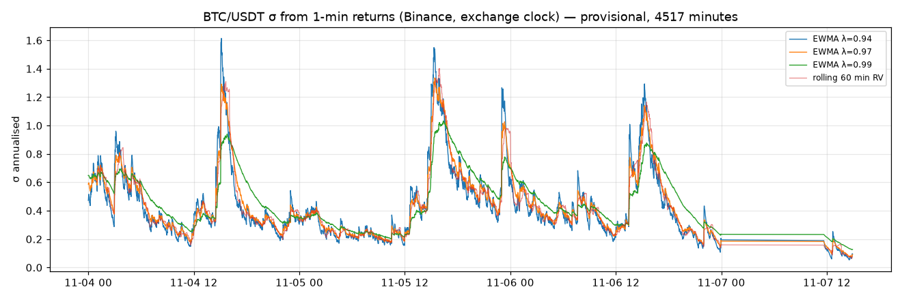
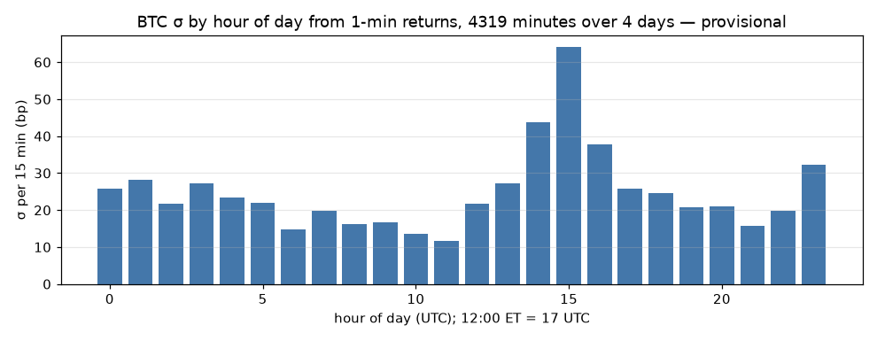
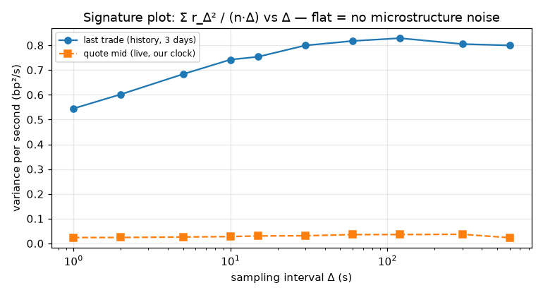
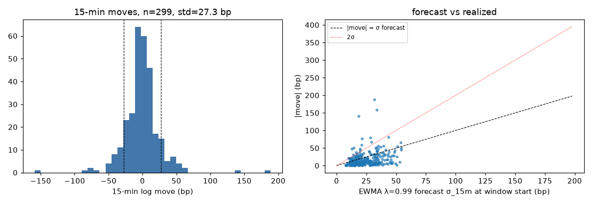
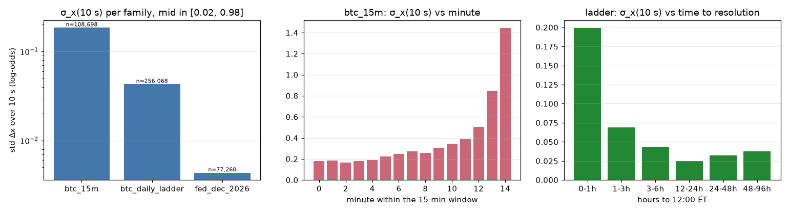
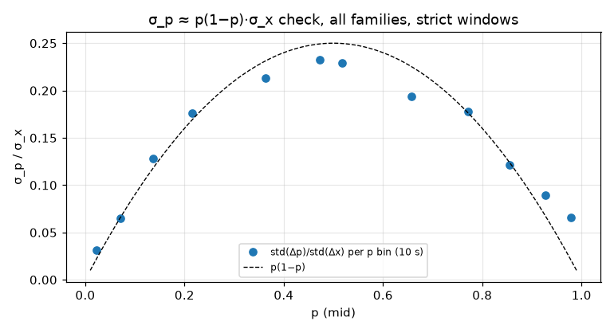

# Volatility — 2026-11-06

Generated 2026-11-07 15:19 UTC by `polymm vol`. Every number is provisional (three days of Binance history, one afternoon of joint Binance/Polymarket data). n is given with each table.

Formulas: σ_step = sqrt(mean r²); σ_ann = σ_step·sqrt(31 536 000/step_s) (365-day year); σ_15m = σ_step·sqrt(900/step_s); EWMA σ²_t = λσ²_{t−1} + (1−λ)r_t²; QLIKE = mean(r²/σ̂² − ln(r²/σ̂²) − 1); x = ln(p/(1−p)); σ_p ≈ p(1−p)σ_x; implied σ solves mid = Φ(ln(S_t/S_0)/(σ√τ)).

## BTC (Binance)

- history days: ['2026-11-04', '2026-11-05', '2026-11-06']; live trades 10697 s; quotes 11740 s
- chosen 15-min estimator: **EWMA λ=0.99 deseasonalised (LOO hour profile)** (QLIKE 1.651, n=299)

### btc · realized_by_day

| day | n_1s | sigma_1s_bp | ann_from_1s | n_1m | sigma_1m_bp | ann_from_1m | sigma_15m_from_1m_bp | parkinson_1m_bp | ann_parkinson | garman_klass_1m_bp | ann_garman_klass | n_bars |
|---|---|---|---|---|---|---|---|---|---|---|---|---|
| 2026-11-04 | 86399 | 0.7243 | 0.4067 | 1439 | 7.039 | 0.5103 | 27.26 | 5.93 | 0.4299 | 5.443 | 0.3946 | 1440 |
| 2026-11-05 | 86400 | 0.8252 | 0.4634 | 1440 | 7.546 | 0.547 | 29.22 | 6.572 | 0.4765 | 6.155 | 0.4462 | 1440 |
| 2026-11-06 | 86400 | 0.6544 | 0.3675 | 1440 | 6.365 | 0.4615 | 24.65 | 5.28 | 0.3828 | 4.796 | 0.3477 | 1440 |
| 2026-11-07 | 11815 | 0.2692 | 0.1512 | 196 | 1.521 | 0.1102 | 5.889 | 0.9745 | 0.07065 | 0.6541 | 0.04742 | 197 |
| all | 271014 | 0.7239 | 0.4065 | 4515 | 6.854 | 0.4969 | 26.54 | 5.823 | 0.4222 | 5.374 | 0.3896 | 4517 |

### btc · rolling_ewma

| estimator | n | p10_ann | p50_ann | p90_ann | p50_15m_bp |
|---|---|---|---|---|---|
| rolling 5 min on 1 s returns | 270954 | 0.119 | 0.2562 | 0.5784 | 13.68 |
| rolling 15 min on 1 s returns | 270954 | 0.1402 | 0.262 | 0.5578 | 13.99 |
| rolling 60 min on 1 s returns | 270954 | 0.1621 | 0.2744 | 0.5992 | 14.66 |
| EWMA λ=0.94 on 1 min returns | 4417 | 0.1955 | 0.3519 | 0.7474 | 18.80 |
| EWMA λ=0.97 on 1 min returns | 4417 | 0.2124 | 0.3656 | 0.7604 | 19.53 |
| EWMA λ=0.99 on 1 min returns | 4417 | 0.2383 | 0.4009 | 0.7599 | 21.42 |
| rolling 5 min on 1 min returns | 4417 | 0.127 | 0.3161 | 0.7471 | 16.89 |
| rolling 15 min on 1 min returns | 4417 | 0.1736 | 0.3363 | 0.7366 | 17.97 |
| rolling 60 min on 1 min returns | 4417 | 0.2099 | 0.3605 | 0.7394 | 19.26 |

### btc · by_hour_utc

| hour | n_1m | sigma_1m_bp | sigma_ann | sigma_15m_bp | hour_et_std |
|---|---|---|---|---|---|
| 0 | 179 | 6.663 | 0.4831 | 25.81 | -5 |
| 1 | 180 | 7.28 | 0.5278 | 28.19 | -4 |
| 2 | 180 | 5.604 | 0.4063 | 21.71 | -3 |
| 3 | 180 | 7.009 | 0.5081 | 27.14 | -2 |
| 4 | 180 | 6.032 | 0.4373 | 23.36 | -1 |
| 5 | 180 | 5.692 | 0.4126 | 22.04 | 0 |
| 6 | 180 | 3.839 | 0.2783 | 14.87 | 1 |
| 7 | 180 | 5.114 | 0.3708 | 19.81 | 2 |
| 8 | 180 | 4.158 | 0.3014 | 16.10 | 3 |
| 9 | 180 | 4.328 | 0.3138 | 16.76 | 4 |
| 10 | 180 | 3.5 | 0.2537 | 13.55 | 5 |
| 11 | 180 | 3.002 | 0.2176 | 11.63 | 6 |
| 12 | 180 | 5.6 | 0.406 | 21.69 | 7 |
| 13 | 180 | 7.058 | 0.5117 | 27.34 | 8 |
| 14 | 180 | 11.27 | 0.8171 | 43.65 | 9 |
| 15 | 180 | 16.53 | 1.199 | 64.04 | 10 |
| 16 | 180 | 9.752 | 0.707 | 37.77 | 11 |
| 17 | 180 | 6.629 | 0.4806 | 25.67 | 12 |
| 18 | 180 | 6.356 | 0.4608 | 24.62 | 13 |
| 19 | 180 | 5.357 | 0.3884 | 20.75 | 14 |
| 20 | 180 | 5.439 | 0.3943 | 21.06 | 15 |
| 21 | 180 | 4.075 | 0.2954 | 15.78 | 16 |
| 22 | 180 | 5.113 | 0.3707 | 19.80 | 17 |
| 23 | 180 | 8.307 | 0.6023 | 32.17 | 18 |

### btc · by_day

| day | n_1m | weekday | sigma_1m_bp | sigma_ann |
|---|---|---|---|---|
| 2026-11-04 | 1439 | Wed | 7.039 | 0.5103 |
| 2026-11-05 | 1440 | Thu | 7.546 | 0.547 |
| 2026-11-06 | 1440 | Fri | 6.365 | 0.4615 |
| 2026-11-07 | 196 | Sat | 1.521 | 0.1102 |

### btc · signature

| delta_s | var_per_s_trades_bp2 | n_trades | ann_trades | var_per_s_quotes_bp2 | n_quotes | ann_quotes | ratio_to_300s_trades | ratio_to_300s_quotes |
|---|---|---|---|---|---|---|---|---|
| 1 | 0.5446 | 259197 | 0.4144 | 0.02372 | 11755 | 0.08649 | 0.6765 | 0.6438 |
| 2 | 0.6018 | 129597 | 0.4356 | 0.024 | 5877 | 0.087 | 0.7476 | 0.6514 |
| 5 | 0.6836 | 51837 | 0.4643 | 0.02589 | 2351 | 0.09036 | 0.8493 | 0.7026 |
| 10 | 0.7419 | 25917 | 0.4837 | 0.02758 | 1175 | 0.09327 | 0.9217 | 0.7486 |
| 15 | 0.7536 | 17277 | 0.4875 | 0.03023 | 783 | 0.09763 | 0.9362 | 0.8203 |
| 30 | 0.7993 | 8637 | 0.5021 | 0.03098 | 391 | 0.09885 | 0.9929 | 0.8409 |
| 60 | 0.8173 | 4317 | 0.5077 | 0.03557 | 195 | 0.1059 | 1.015 | 0.9653 |
| 120 | 0.8286 | 2157 | 0.5112 | 0.03578 | 97 | 0.1062 | 1.029 | 0.9712 |
| 300 | 0.8049 | 861 | 0.5038 | 0.03685 | 39 | 0.1078 | 1 | 1 |
| 600 | 0.7994 | 429 | 0.5021 | 0.02308 | 19 | 0.08531 | 0.9931 | 0.6263 |

### btc · moves_15m_dist

| n_windows | std_move_bp | mean_abs_bp | p50_abs_bp | p90_abs_bp | p99_abs_bp | max_abs_bp | share_gt_5bp | share_gt_10bp | share_gt_20bp |
|---|---|---|---|---|---|---|---|---|---|
| 299 | 27.31 | 17.35 | 10.36 | 38.65 | 82.60 | 188.44 | 0.7492 | 0.5251 | 0.3043 |

### btc · moves_15m_by_hour

| hour | n | max_abs_bp | rms_move_bp |
|---|---|---|---|
| 0 | 11 | 42.59 | 23.93 |
| 1 | 12 | 43.71 | 21.06 |
| 2 | 12 | 66.52 | 21.52 |
| 3 | 12 | 56.63 | 22.75 |
| 4 | 12 | 52.11 | 25.57 |
| 5 | 12 | 49.59 | 17.84 |
| 6 | 12 | 29.79 | 15.62 |
| 7 | 12 | 47.92 | 21.25 |
| 8 | 12 | 35.77 | 13.37 |
| 9 | 12 | 58.59 | 19.48 |
| 10 | 12 | 20.95 | 12.09 |
| 11 | 13 | 24.72 | 9.946 |
| 12 | 16 | 49.96 | 22.77 |
| 13 | 16 | 38.59 | 14.35 |
| 14 | 15 | 140.64 | 48.77 |
| 15 | 12 | 188.44 | 79.21 |
| 16 | 12 | 65.92 | 35.62 |
| 17 | 12 | 37.64 | 20.40 |
| 18 | 12 | 30.39 | 15.91 |
| 19 | 12 | 53.00 | 23.00 |
| 20 | 12 | 32.76 | 12.89 |
| 21 | 12 | 25.58 | 13.03 |
| 22 | 12 | 34.01 | 22.02 |
| 23 | 12 | 55.85 | 25.78 |

### btc · forecast_scores

| estimator | n | qlike | mse_bp4 | mean_forecast_sigma_bp | realized_std_bp | bias_var_ratio | share_abs_gt_2sigma |
|---|---|---|---|---|---|---|---|
| hour-of-day (in-sample) | 299 | 1.61 | 6,898,112 | 27.23 | 27.32 | 0.9938 | 0.05351 |
| EWMA λ=0.99 deseasonalised (LOO hour profile) | 299 | 1.651 | 8,119,988 | 29.57 | 27.32 | 1.171 | 0.06689 |
| EWMA λ=0.97 deseasonalised (LOO hour profile) | 299 | 1.7 | 7,738,747 | 28.86 | 27.32 | 1.117 | 0.06689 |
| EWMA λ=0.97 | 299 | 1.826 | 7,863,061 | 26.45 | 27.32 | 0.9378 | 0.07023 |
| rolling 60 min RV | 296 | 1.88 | 8,182,861 | 26.67 | 27.22 | 0.9598 | 0.07095 |
| EWMA λ=0.94 | 299 | 1.9 | 7,693,328 | 26.08 | 27.32 | 0.9117 | 0.07358 |
| EWMA λ=0.99 | 299 | 1.928 | 8,127,357 | 26.98 | 27.32 | 0.9753 | 0.05017 |
| constant (in-sample) | 299 | 2.07 | 8,173,178 | 26.54 | 27.32 | 0.9443 | 0.04013 |
| rolling 15 min RV | 299 | 5.873 | 7,983,669 | 26.63 | 27.32 | 0.9503 | 0.08361 |
| rolling 5 min RV | 299 | 98,743 | 7,601,510 | 24.49 | 27.32 | 0.8037 | 0.1706 |

### btc · hour_profile_used

| hour | var_ratio | sigma_mult |
|---|---|---|
| 0 | 0.9732 | 0.9865 |
| 1 | 1.069 | 1.034 |
| 2 | 0.5973 | 0.7729 |
| 3 | 1.242 | 1.114 |
| 4 | 0.9115 | 0.9547 |
| 5 | 0.6105 | 0.7814 |
| 6 | 0.2645 | 0.5143 |
| 7 | 0.3216 | 0.5671 |
| 8 | 0.2512 | 0.5012 |
| 9 | 0.2182 | 0.4671 |
| 10 | 0.2332 | 0.4829 |
| 11 | 0.1501 | 0.3874 |
| 12 | 0.5443 | 0.7378 |
| 13 | 0.406 | 0.6372 |
| 14 | 1.567 | 1.252 |
| 15 | 6.45 | 2.54 |
| 16 | 2.016 | 1.42 |
| 17 | 0.9769 | 0.9884 |
| 18 | 0.9864 | 0.9932 |
| 19 | 0.7587 | 0.871 |
| 20 | 0.7635 | 0.8738 |
| 21 | 0.4587 | 0.6773 |
| 22 | 0.6114 | 0.7819 |
| 23 | 2.022 | 1.422 |

### btc · jumps_1m_by_day

| day | n_jumps_gt4sigma | max_abs_bp |
|---|---|---|
| 2026-11-04 | 6 | 71.09 |
| 2026-11-05 | 6 | 54.38 |
| 2026-11-06 | 5 | 38.61 |
| 2026-11-07 | 1 | 13.00 |

### btc · jumps_1m

| minute | r_bp | z | hour | day | utc |
|---|---|---|---|---|---|
| 1793971800 | -38.61 | 8.791 | 13 | 2026-11-06 | 2026-11-06 13:30 |
| 1794055200 | -13.00 | 8.198 | 12 | 2026-11-07 | 2026-11-07 12:40 |
| 1794002520 | 21.03 | 8.072 | 22 | 2026-11-06 | 2026-11-06 22:02 |
| 1793802600 | 36.01 | 7.841 | 14 | 2026-11-04 | 2026-11-04 14:30 |
| 1793874660 | -18.56 | 7.474 | 10 | 2026-11-05 | 2026-11-05 10:31 |
| 1793950800 | 34.10 | 7.289 | 7 | 2026-11-06 | 2026-11-06 07:40 |
| 1793804640 | 71.09 | 6.666 | 15 | 2026-11-04 | 2026-11-04 15:04 |
| 1793761140 | -35.70 | 6.324 | 2 | 2026-11-04 | 2026-11-04 02:59 |
| 1793889360 | -38.58 | 6.308 | 14 | 2026-11-05 | 2026-11-05 14:36 |
| 1793919720 | 54.38 | 5.815 | 23 | 2026-11-05 | 2026-11-05 23:02 |
| 1793833200 | -24.85 | 5.718 | 23 | 2026-11-04 | 2026-11-04 23:00 |
| 1793919660 | -36.59 | 5.241 | 23 | 2026-11-05 | 2026-11-05 23:01 |
| 1793948520 | -21.35 | 5.162 | 7 | 2026-11-06 | 2026-11-06 07:02 |
| 1793880000 | -12.92 | 5.069 | 12 | 2026-11-05 | 2026-11-05 12:00 |
| 1793882340 | -23.20 | 4.863 | 12 | 2026-11-05 | 2026-11-05 12:39 |
| 1793803200 | 33.36 | 4.696 | 14 | 2026-11-04 | 2026-11-04 14:40 |
| 1793971920 | 34.22 | 4.362 | 13 | 2026-11-06 | 2026-11-06 13:32 |
| 1793830140 | 13.19 | 4.353 | 22 | 2026-11-04 | 2026-11-04 22:09 |

### btc · jumps_1m_by_hour

| hour | n |
|---|---|
| 2 | 1 |
| 7 | 2 |
| 10 | 1 |
| 12 | 3 |
| 13 | 2 |
| 14 | 3 |
| 15 | 1 |
| 22 | 2 |
| 23 | 3 |

### btc · jumps_1s_by_day

| day | n_1s_moves_ge10bp | max_abs_bp |
|---|---|---|
| 2026-11-04 | 4 | 13.76 |
| 2026-11-05 | 10 | 17.87 |
| 2026-11-06 | 6 | 59.33 |
| 2026-11-07 | 1 | 24.02 |

### btc · jumps_1s_top

| sec | r_bp | hour | day | utc |
|---|---|---|---|---|
| 1793971801 | -59.33 | 13 | 2026-11-06 | 2026-11-06 13:30:01 |
| 1794051556 | 24.02 | 11 | 2026-11-07 | 2026-11-07 11:39:16 |
| 1793919696 | -17.87 | 23 | 2026-11-05 | 2026-11-05 23:01:36 |
| 1793893931 | -14.36 | 15 | 2026-11-05 | 2026-11-05 15:52:11 |
| 1793804705 | 13.76 | 15 | 2026-11-04 | 2026-11-04 15:05:05 |
| 1793904462 | -11.99 | 18 | 2026-11-05 | 2026-11-05 18:47:42 |
| 1793874681 | -11.93 | 10 | 2026-11-05 | 2026-11-05 10:31:21 |
| 1793923020 | 11.84 | 23 | 2026-11-05 | 2026-11-05 23:57:00 |
| 1793771436 | 11.78 | 5 | 2026-11-04 | 2026-11-04 05:50:36 |
| 1793977493 | -11.35 | 15 | 2026-11-06 | 2026-11-06 15:04:53 |
| 1793976929 | -11.32 | 14 | 2026-11-06 | 2026-11-06 14:55:29 |
| 1793883216 | -11.25 | 12 | 2026-11-05 | 2026-11-05 12:53:36 |
| 1793804961 | 11.25 | 15 | 2026-11-04 | 2026-11-04 15:09:21 |
| 1793977429 | -11.03 | 15 | 2026-11-06 | 2026-11-06 15:03:49 |
| 1793887058 | -10.70 | 13 | 2026-11-05 | 2026-11-05 13:57:38 |

### btc · jumps_1s_quotes

| n_secs | n_moves_ge10bp | max_abs_bp | sigma_1s_quotes_bp | sigma_1s_trades_same_span_bp |
|---|---|---|---|---|
| 11749 | 0 | 0 | 0.1541 | 0.2699 |

## Polymarket (strict clean windows, outcome-0 tokens)

### poly · grid_coverage

| family | n_sec | n_tokens | n_windows |
|---|---|---|---|
| btc_15m | 116565 | 48 | 73 |
| btc_daily_ladder | 813315 | 29 | 214 |
| fed_dec_2026 | 192691 | 5 | 44 |

### poly · sigma_x_family

| family | n | sigma_x | share_zero | abs_dx_p99 | k_s | sigma_x_per_sqrt_s |
|---|---|---|---|---|---|---|
| btc_15m | 109417 | 0.05644 | 0.8793 | 0.2433 | 1 | 0.05644 |
| btc_15m | 108698 | 0.1852 | 0.7157 | 0.7457 | 10 | 0.05857 |
| btc_15m | 105222 | 0.3965 | 0.6449 | 1.7 | 60 | 0.05119 |
| btc_daily_ladder | 257273 | 0.02034 | 0.6576 | 0.08008 | 1 | 0.02034 |
| btc_daily_ladder | 256068 | 0.04294 | 0.3907 | 0.1646 | 10 | 0.01358 |
| btc_daily_ladder | 251072 | 0.09458 | 0.2214 | 0.3455 | 60 | 0.01221 |
| fed_dec_2026 | 77422 | 0.001669 | 0.9992 | 0 | 1 | 0.001669 |
| fed_dec_2026 | 77260 | 0.004353 | 0.9948 | 0 | 10 | 0.001376 |
| fed_dec_2026 | 76360 | 0.00948 | 0.9765 | 0.05828 | 60 | 0.001224 |

### poly · btc15_by_minute

| minute | n | sigma_x | share_zero | abs_dx_p99 | k_s | sigma_x_per_sqrt_s |
|---|---|---|---|---|---|---|
| 0 | 2690 | 0.1775 | 0.1732 | 0.4935 | 10 | 0.05614 |
| 1 | 2691 | 0.1828 | 0.1962 | 0.5351 | 10 | 0.05779 |
| 2 | 2700 | 0.1633 | 0.2137 | 0.5059 | 10 | 0.05164 |
| 3 | 2700 | 0.1798 | 0.1881 | 0.5213 | 10 | 0.05687 |
| 4 | 2686 | 0.1873 | 0.2059 | 0.5504 | 10 | 0.05924 |
| 5 | 2700 | 0.2211 | 0.1856 | 0.6657 | 10 | 0.06993 |
| 6 | 2678 | 0.2466 | 0.1964 | 0.6907 | 10 | 0.07798 |
| 7 | 2699 | 0.2725 | 0.1341 | 0.8197 | 10 | 0.08617 |
| 8 | 2599 | 0.2557 | 0.1685 | 0.7379 | 10 | 0.08085 |
| 9 | 2513 | 0.307 | 0.1214 | 0.9031 | 10 | 0.09707 |
| 10 | 2444 | 0.3456 | 0.1481 | 0.9685 | 10 | 0.1093 |
| 11 | 2129 | 0.3877 | 0.1226 | 1.053 | 10 | 0.1226 |
| 12 | 1752 | 0.5047 | 0.06621 | 1.388 | 10 | 0.1596 |
| 13 | 1149 | 0.8494 | 0.06353 | 2.481 | 10 | 0.2686 |
| 14 | 228 | 1.444 | 0.1009 | 4.465 | 10 | 0.4567 |

### poly · btc15_by_edge

| edge_bin | n | sigma_x | share_zero | abs_dx_p99 | k_s | sigma_x_per_sqrt_s |
|---|---|---|---|---|---|---|
| 0.0-0.1 | 11805 | 0.2568 | 0.1675 | 0.8369 | 10 | 0.0812 |
| 0.1-0.2 | 7751 | 0.3201 | 0.1355 | 1.067 | 10 | 0.1012 |
| 0.2-0.3 | 6257 | 0.3513 | 0.1283 | 1.48 | 10 | 0.1111 |
| 0.3-0.4 | 5587 | 0.367 | 0.1813 | 1.281 | 10 | 0.1161 |
| 0.4-0.5 | 2958 | 0.4525 | 0.2556 | 1.287 | 10 | 0.1431 |

### poly · btc15_pre_window

| phase | n | sigma_x | share_zero | abs_dx_p99 | k_s | sigma_x_per_sqrt_s |
|---|---|---|---|---|---|---|
| before start | 74255 | 0.01826 | 0.9711 | 0.08002 | 10 | 0.005775 |

### poly · ladder_by_hours_to_expiry

| h_bin | n | sigma_x | share_zero | abs_dx_p99 | k_s | sigma_x_per_sqrt_s |
|---|---|---|---|---|---|---|
| 0-1h | 3616 | 0.1993 | 0.02295 | 0.8197 | 10 | 0.06301 |
| 1-3h | 17094 | 0.06903 | 0.221 | 0.2575 | 10 | 0.02183 |
| 3-6h | 8171 | 0.04336 | 0.3911 | 0.1697 | 10 | 0.01371 |
| 12-24h | 51547 | 0.02487 | 0.3897 | 0.09735 | 10 | 0.007866 |
| 24-48h | 123598 | 0.03198 | 0.4075 | 0.1248 | 10 | 0.01011 |
| 48-96h | 52042 | 0.03751 | 0.4329 | 0.1512 | 10 | 0.01186 |

### poly · ladder_by_strike_distance

| dist_bin | n | sigma_x | share_zero | abs_dx_p99 | k_s | sigma_x_per_sqrt_s |
|---|---|---|---|---|---|---|
| <-5% | 10922 | 0.04539 | 0.5005 | 0.1945 | 10 | 0.01435 |
| -5..-2.5% | 33747 | 0.03365 | 0.4593 | 0.1346 | 10 | 0.01064 |
| -2.5..-1% | 46788 | 0.03734 | 0.2814 | 0.1356 | 10 | 0.01181 |
| -1..0% | 7525 | 0.07705 | 0.1923 | 0.374 | 10 | 0.02437 |
| 0..1% | 78854 | 0.04802 | 0.1461 | 0.182 | 10 | 0.01519 |
| 1..2.5% | 952 | 0.07626 | 0.1324 | 0.2468 | 10 | 0.02411 |
| 2.5..5% | 67471 | 0.0378 | 0.7064 | 0.1553 | 10 | 0.01195 |
| >5% | 5538 | 0.0524 | 0.6392 | 0.198 | 10 | 0.01657 |

### poly · ladder_by_distance_and_hours

| abs_dist | h_bin | n | sigma_x | share_zero | abs_dx_p99 | k_s | sigma_x_per_sqrt_s |
|---|---|---|---|---|---|---|---|
| <1% | 0-1h | 3616 | 0.1993 | 0.02295 | 0.8197 | 10 | 0.06301 |
| <1% | 1-3h | 6831 | 0.07465 | 0.02606 | 0.2297 | 10 | 0.02361 |
| <1% | 3-6h | 2611 | 0.0435 | 0.08426 | 0.1609 | 10 | 0.01375 |
| <1% | 12-24h | 24379 | 0.02068 | 0.2204 | 0.08208 | 10 | 0.006541 |
| <1% | 24-48h | 36610 | 0.02355 | 0.1518 | 0.08955 | 10 | 0.007448 |
| <1% | 48-96h | 12332 | 0.02729 | 0.126 | 0.08243 | 10 | 0.00863 |
| 1-2.5% | 1-3h | 6083 | 0.06755 | 0.2417 | 0.262 | 10 | 0.02136 |
| 1-2.5% | 3-6h | 991 | 0.04719 | 0.1292 | 0.2066 | 10 | 0.01492 |
| 1-2.5% | 12-24h | 9302 | 0.02984 | 0.4187 | 0.1057 | 10 | 0.009436 |
| 1-2.5% | 24-48h | 21560 | 0.03014 | 0.2687 | 0.1077 | 10 | 0.009532 |
| 1-2.5% | 48-96h | 9804 | 0.03635 | 0.2043 | 0.1219 | 10 | 0.01149 |
| 2.5-5% | 1-3h | 4180 | 0.06109 | 0.5096 | 0.2781 | 10 | 0.01932 |
| 2.5-5% | 3-6h | 4569 | 0.04242 | 0.6233 | 0.1693 | 10 | 0.01341 |
| 2.5-5% | 12-24h | 16768 | 0.02737 | 0.6393 | 0.1065 | 10 | 0.008655 |
| 2.5-5% | 24-48h | 56701 | 0.03487 | 0.6266 | 0.1377 | 10 | 0.01103 |
| 2.5-5% | 48-96h | 19000 | 0.03929 | 0.6283 | 0.1504 | 10 | 0.01242 |
| >5% | 24-48h | 5554 | 0.05371 | 0.3552 | 0.1704 | 10 | 0.01699 |
| >5% | 48-96h | 10906 | 0.04466 | 0.6449 | 0.2045 | 10 | 0.01412 |

### poly · sigma_p_check_all

| p_bin | n | p_mean | sigma_p | sigma_x | p(1-p) | sigma_p/sigma_x | ratio_to_p(1-p) |
|---|---|---|---|---|---|---|---|
| 0.01-0.05 | 108280 | 0.02335 | 0.001737 | 0.05603 | 0.0228 | 0.031 | 1.359 |
| 0.05-0.10 | 23198 | 0.07109 | 0.006644 | 0.1024 | 0.06603 | 0.0649 | 0.9829 |
| 0.10-0.20 | 11392 | 0.136 | 0.02323 | 0.1814 | 0.1175 | 0.1281 | 1.09 |
| 0.20-0.30 | 44014 | 0.2154 | 0.01924 | 0.1095 | 0.169 | 0.1757 | 1.04 |
| 0.30-0.40 | 17651 | 0.3635 | 0.03628 | 0.1703 | 0.2314 | 0.213 | 0.9207 |
| 0.40-0.50 | 117388 | 0.4721 | 0.01498 | 0.06441 | 0.2492 | 0.2326 | 0.9335 |
| 0.50-0.60 | 39051 | 0.517 | 0.02376 | 0.1038 | 0.2497 | 0.2289 | 0.9168 |
| 0.60-0.70 | 4857 | 0.6569 | 0.05918 | 0.305 | 0.2254 | 0.194 | 0.8609 |
| 0.70-0.80 | 42304 | 0.7716 | 0.01908 | 0.1071 | 0.1762 | 0.1781 | 1.011 |
| 0.80-0.90 | 26498 | 0.855 | 0.01816 | 0.1496 | 0.124 | 0.1214 | 0.9791 |
| 0.90-0.95 | 31733 | 0.9266 | 0.01036 | 0.1158 | 0.06799 | 0.08943 | 1.315 |
| 0.95-0.99 | 106091 | 0.9788 | 0.004562 | 0.06941 | 0.02074 | 0.06572 | 3.168 |

### poly · sigma_p_check_family

| family | p_bin | n | p_mean | sigma_p | sigma_x | p(1-p) | sigma_p/sigma_x | ratio_to_p(1-p) |
|---|---|---|---|---|---|---|---|---|
| btc_15m | 0.01-0.05 | 2551 | 0.02219 | 0.009428 | 0.2875 | 0.0217 | 0.03279 | 1.511 |
| btc_15m | 0.05-0.10 | 900 | 0.07441 | 0.02969 | 0.4535 | 0.06887 | 0.06546 | 0.9505 |
| btc_15m | 0.10-0.20 | 2586 | 0.1514 | 0.04562 | 0.3586 | 0.1285 | 0.1272 | 0.9902 |
| btc_15m | 0.20-0.30 | 3000 | 0.251 | 0.07152 | 0.4101 | 0.188 | 0.1744 | 0.9278 |
| btc_15m | 0.30-0.40 | 3947 | 0.3518 | 0.07221 | 0.3426 | 0.228 | 0.2108 | 0.9242 |
| btc_15m | 0.40-0.50 | 59297 | 0.4905 | 0.01946 | 0.08428 | 0.2499 | 0.2308 | 0.9237 |
| btc_15m | 0.50-0.60 | 26749 | 0.5161 | 0.02778 | 0.1216 | 0.2497 | 0.2285 | 0.9151 |
| btc_15m | 0.60-0.70 | 3823 | 0.6479 | 0.06523 | 0.3333 | 0.2281 | 0.1957 | 0.8579 |
| btc_15m | 0.70-0.80 | 3282 | 0.7524 | 0.06759 | 0.372 | 0.1863 | 0.1817 | 0.9754 |
| btc_15m | 0.80-0.90 | 3021 | 0.8466 | 0.05232 | 0.4295 | 0.1299 | 0.1218 | 0.938 |
| btc_15m | 0.90-0.95 | 1180 | 0.9254 | 0.05218 | 0.5563 | 0.06905 | 0.09379 | 1.358 |
| btc_15m | 0.95-0.99 | 3352 | 0.9814 | 0.02476 | 0.3102 | 0.01825 | 0.07982 | 4.374 |
| btc_daily_ladder | 0.01-0.05 | 102426 | 0.02378 | 0.0009871 | 0.03513 | 0.02321 | 0.0281 | 1.21 |
| btc_daily_ladder | 0.05-0.10 | 22298 | 0.07095 | 0.003201 | 0.04561 | 0.06592 | 0.07018 | 1.065 |
| btc_daily_ladder | 0.10-0.20 | 8806 | 0.1314 | 0.009252 | 0.06897 | 0.1142 | 0.1342 | 1.175 |
| btc_daily_ladder | 0.20-0.30 | 2463 | 0.2538 | 0.01833 | 0.09666 | 0.1894 | 0.1896 | 1.001 |
| btc_daily_ladder | 0.30-0.40 | 13704 | 0.3669 | 0.01376 | 0.0595 | 0.2323 | 0.2313 | 0.9956 |
| btc_daily_ladder | 0.40-0.50 | 58091 | 0.4533 | 0.0082 | 0.03362 | 0.2478 | 0.2439 | 0.9842 |
| btc_daily_ladder | 0.50-0.60 | 12302 | 0.5189 | 0.01068 | 0.04543 | 0.2496 | 0.2352 | 0.942 |
| btc_daily_ladder | 0.60-0.70 | 92 | 0.638 | 0.08668 | 0.5393 | 0.2309 | 0.1607 | 0.6959 |
| btc_daily_ladder | 0.70-0.80 | 1255 | 0.7767 | 0.01702 | 0.1528 | 0.1734 | 0.1113 | 0.642 |
| btc_daily_ladder | 0.80-0.90 | 23477 | 0.8561 | 0.004497 | 0.03565 | 0.1232 | 0.1261 | 1.024 |
| btc_daily_ladder | 0.90-0.95 | 30553 | 0.9267 | 0.002512 | 0.03916 | 0.06795 | 0.06416 | 0.9443 |
| btc_daily_ladder | 0.95-0.99 | 102739 | 0.9787 | 0.001215 | 0.04268 | 0.02083 | 0.02847 | 1.367 |
| fed_dec_2026 | 0.01-0.05 | 3303 | 0.01077 | 0.0001074 | 0.009219 | 0.01066 | 0.01165 | 1.093 |
| fed_dec_2026 | 0.20-0.30 | 38551 | 0.2101 | 0.0006742 | 0.00381 | 0.166 | 0.177 | 1.066 |
| fed_dec_2026 | 0.60-0.70 | 942 | 0.695 | 0.001025 | 0.004883 | 0.212 | 0.21 | 0.9906 |
| fed_dec_2026 | 0.70-0.80 | 37767 | 0.7731 | 0.0008444 | 0.004831 | 0.1754 | 0.1748 | 0.9962 |

### poly · jumps_x

| family | grid_hours | n_x | n_dx_ge_0.2 | n_dx_ge_0.5 | n_dx_ge_1.0 | n_p | n_dp_ge_0.02 | n_dp_ge_0.05 | n_dp_ge_0.1 | per_h_dx_ge_0.2 | per_h_dx_ge_0.5 | per_h_dx_ge_1.0 | per_h_dp_ge_0.02 | per_h_dp_ge_0.05 | per_h_dp_ge_0.1 |
|---|---|---|---|---|---|---|---|---|---|---|---|---|---|---|---|
| btc_15m | 32.36 | 109417 | 1758 | 182 | 27 | 116492 | 5329 | 763 | 114 | 57.84 | 5.988 | 0.8883 | 164.68 | 23.58 | 3.523 |
| btc_daily_ladder | 225.86 | 257273 | 214 | 22 | 4 | 813101 | 450 | 101 | 31 | 2.994 | 0.3078 | 0.05597 | 1.992 | 0.4472 | 0.1373 |
| fed_dec_2026 | 53.51 | 77422 | 1 | 0 | 0 | 192647 | 3 | 0 | 0 | 0.0465 | 0 | 0 | 0.05606 | 0 | 0 |

### poly · btc15_jumps_by_minute

| minute | n | n_dp_ge_0.02 | n_dp_ge_0.05 | max_abs_dp |
|---|---|---|---|---|
| 0 | 2697 | 392 | 23 | 0.245 |
| 1 | 2696 | 344 | 18 | 0.11 |
| 2 | 2700 | 251 | 17 | 0.08 |
| 3 | 2700 | 256 | 20 | 0.145 |
| 4 | 2695 | 254 | 27 | 0.14 |
| 5 | 2700 | 301 | 26 | 0.11 |
| 6 | 2687 | 323 | 27 | 0.15 |
| 7 | 2699 | 365 | 43 | 0.17 |
| 8 | 2694 | 384 | 41 | 0.12 |
| 9 | 2684 | 398 | 65 | 0.24 |
| 10 | 2668 | 468 | 70 | 0.14 |
| 11 | 2695 | 408 | 66 | 0.16 |
| 12 | 2700 | 452 | 83 | 0.155 |
| 13 | 2691 | 486 | 150 | 0.36 |
| 14 | 2325 | 186 | 82 | 0.735 |

### poly · implied_15m

_(empty)_

## Plots

