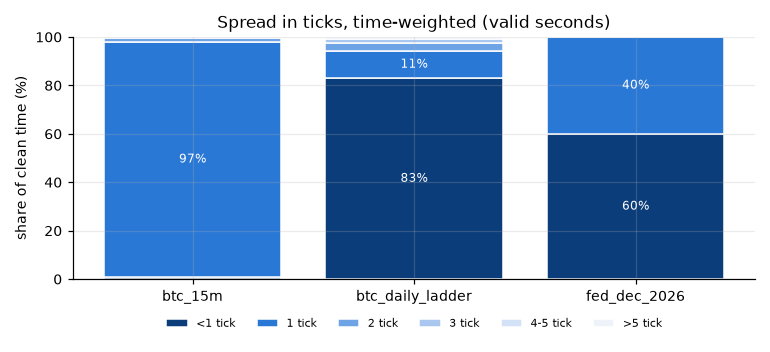
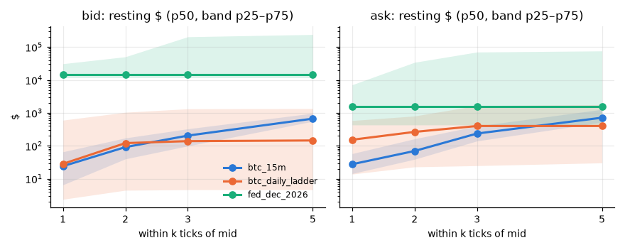
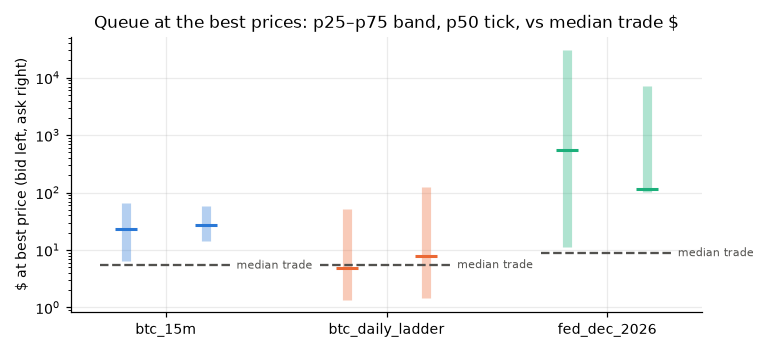
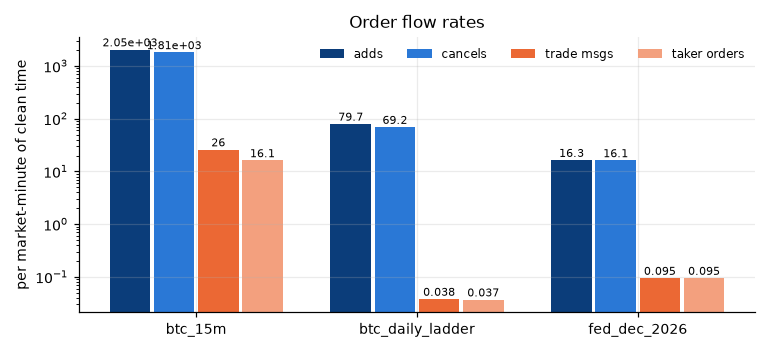
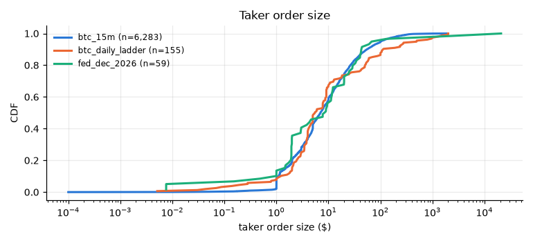
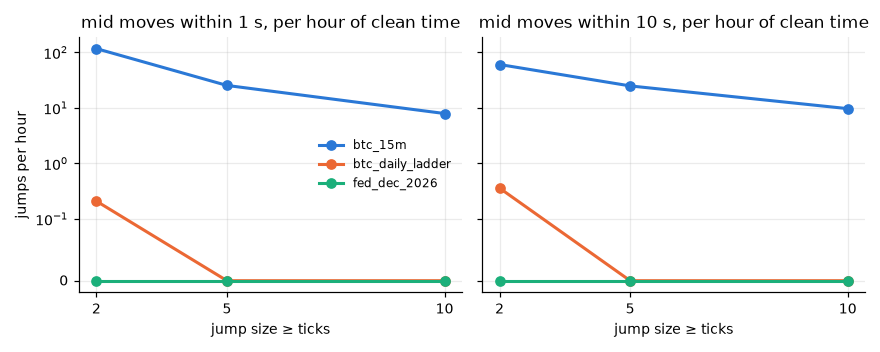
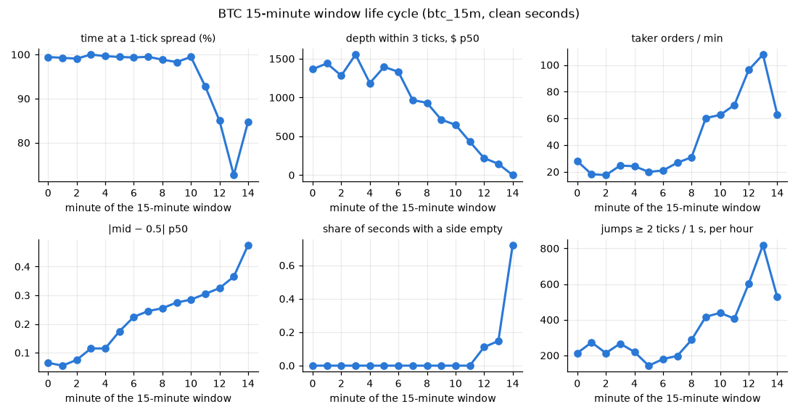
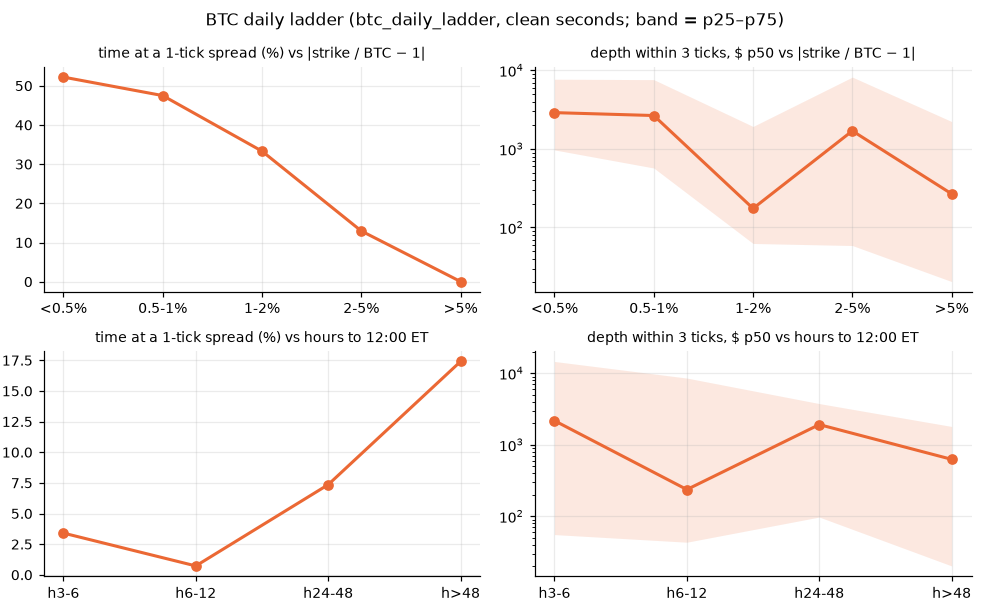

# Shape of the market — 2026-11-07

Data root `/Users/macbook/Desktop/POLY MM/data_vps`; window 2026-11-07 00:00 → 2026-11-08 00:00 UTC; statistics only inside strict clean windows (`clean_windows_strict.parquet`), outcome-0 (Yes/Up) books, 1-second as-of grid (each second weighs the same). Ticks are cents. **All numbers are provisional: one day of data.** Ran in 78 s.

- Replay reused from `/Users/macbook/Desktop/POLY MM/.claude/worktrees/quality-checks-5dddd8/reports/2026-11-07/replay`, strict windows from `reports/2026-11-07/clean_windows_strict.parquet`.
- Binance spot: present; BTC reference minutes: 197 Binance, 124 ladder-implied.

## 1. Spread (time-weighted)

Share of valid seconds by spread bin, quantiles in ticks, and share of all clean seconds with one side empty. n_s = clean seconds, n_tokens = outcome-0 tokens.

| family | n_s | n_s (all) | n_tokens | <1 % | 1 % | 2 % | 3 % | 4-5 % | >5 % | p50_ticks | p90_ticks | mean_ticks | empty side % |
|---|---|---|---|---|---|---|---|---|---|---|---|---|---|
| btc_15m | 22,212 | 23,352 | 12 | 1 | 96.9 | 1.6 | 0.4 | 0 | 0 | 1 | 1 | 1.02 | 4.9 |
| btc_daily_ladder | 168,339 | 253,228 | 25 | 83 | 11.3 | 3.3 | 1.8 | 0.5 | 0.1 | 0.1 | 1 | 0.48 | 33.5 |
| fed_dec_2026 | 37,371 | 37,371 | 5 | 60 | 40 | 0 | 0 | 0 | 0 | 0.1 | 1 | 0.46 | 0 |

### Spread vs time to expiry

| family | bucket | n_s | n_tokens | <1 % | 1 tick % | >5 % | p50_ticks | p90_ticks | empty side % |
|---|---|---|---|---|---|---|---|---|---|
| btc_15m | pre | 14,407 | 11 | 0 | 97.3 | 0 | 1 | 1 | 0 |
| btc_15m | m00 | 540 | 9 | 0 | 99.4 | 0 | 1 | 1 | 0 |
| btc_15m | m01 | 540 | 9 | 0 | 99.3 | 0 | 1 | 1 | 0 |
| btc_15m | m02 | 540 | 9 | 0 | 99.1 | 0 | 1 | 1 | 0 |
| btc_15m | m03 | 540 | 9 | 0 | 100 | 0 | 1 | 1 | 0 |
| btc_15m | m04 | 540 | 9 | 0 | 99.6 | 0 | 1 | 1 | 0 |
| btc_15m | m05 | 553 | 10 | 0 | 99.5 | 0 | 1 | 1 | 0 |
| btc_15m | m06 | 600 | 10 | 0 | 99.3 | 0 | 1 | 1 | 0 |
| btc_15m | m07 | 600 | 10 | 0 | 99.5 | 0 | 1 | 1 | 0 |
| btc_15m | m08 | 600 | 10 | 0 | 98.8 | 0 | 1 | 1 | 0 |
| btc_15m | m09 | 587 | 10 | 0 | 98.3 | 0 | 1 | 1 | 0 |
| btc_15m | m10 | 557 | 10 | 0 | 99.5 | 0 | 1 | 1 | 0 |
| btc_15m | m11 | 540 | 9 | 5.7 | 92.8 | 0 | 1 | 1 | 0 |
| btc_15m | m12 | 480 | 8 | 12.5 | 85 | 0 | 1 | 1 | 11.1 |
| btc_15m | m13 | 457 | 9 | 24.1 | 72.6 | 0 | 1 | 1 | 14.7 |
| btc_15m | m14 | 131 | 7 | 13.7 | 84.7 | 0 | 1 | 1 | 72.1 |
| btc_daily_ladder | h3-6 | 8,879 | 4 | 71 | 3.4 | 0.5 | 0.3 | 2.7 | 71.2 |
| btc_daily_ladder | h6-12 | 18,329 | 5 | 73.2 | 0.7 | 0.5 | 0.1 | 3.3 | 66.9 |
| btc_daily_ladder | h24-48 | 58,936 | 9 | 90.7 | 7.4 | 0 | 0.1 | 0.9 | 30.5 |
| btc_daily_ladder | h>48 | 82,195 | 11 | 80.9 | 17.4 | 0 | 0.2 | 1 | 0 |
| fed_dec_2026 | flat | 37,371 | 5 | 60 | 40 | 0 | 0.1 | 1 | 0 |

### Ladder: spread vs moneyness (|strike / BTC − 1|)

| mny | n_s | n_tokens | <1 % | 1 tick % | >5 % | p50_ticks | p90_ticks | empty side % |
|---|---|---|---|---|---|---|---|---|
| <0.5% | 17,914 | 3 | 12.9 | 52.2 | 0.6 | 1.1 | 3.5 | 0 |
| 0.5-1% | 4,719 | 3 | 4.6 | 47.5 | 0.6 | 1.9 | 3.3 | 0 |
| 1-2% | 1,800 | 3 | 66.7 | 33.3 | 0 | 0.4 | 1 | 0 |
| 2-5% | 52,738 | 10 | 85 | 13 | 0 | 0.2 | 1 | 1.5 |
| >5% | 91,168 | 17 | 100 | 0 | 0 | 0.1 | 0.5 | 48 |

## 2. Depth within k ticks of mid (time-weighted, valid seconds)

Cumulative resting size on each side whose price is within k ticks of the mid; $ = shares × price. 5 stored levels, so k = 5 is a lower bound in dense books.

| family | side | k | n_s | sh_p25 | sh_p50 | sh_p75 | usd_p25 | usd_p50 | usd_p75 |
|---|---|---|---|---|---|---|---|---|---|
| btc_15m | ask | 1 | 22,212 | 28 | 54.07 | 123.4 | 14.28 | 27.54 | 57.63 |
| btc_15m | ask | 2 | 22,212 | 79.02 | 143.1 | 357.8 | 38.83 | 69.53 | 162.7 |
| btc_15m | ask | 3 | 22,212 | 306.4 | 491.1 | 931.5 | 139.8 | 235.8 | 396.9 |
| btc_15m | ask | 5 | 22,212 | 1,066 | 1,395 | 2,372 | 517 | 714.2 | 1,272 |
| btc_15m | bid | 1 | 22,212 | 13 | 60 | 140 | 6.5 | 24 | 65.53 |
| btc_15m | bid | 2 | 22,212 | 96 | 213.6 | 373.7 | 39.9 | 91.16 | 172.5 |
| btc_15m | bid | 3 | 22,212 | 270.7 | 489.1 | 745.5 | 98.62 | 203.9 | 327.2 |
| btc_15m | bid | 5 | 22,212 | 1,173 | 1,425 | 2,238 | 552.3 | 668.1 | 971 |
| btc_daily_ladder | ask | 1 | 168,339 | 218.1 | 647.8 | 4,820 | 13.75 | 152.6 | 582.8 |
| btc_daily_ladder | ask | 2 | 168,339 | 470.9 | 1,718 | 5,751 | 22.84 | 264.3 | 800.6 |
| btc_daily_ladder | ask | 3 | 168,339 | 486.1 | 2,192 | 6,299 | 24.86 | 399.6 | 1,659 |
| btc_daily_ladder | ask | 5 | 168,339 | 515 | 2,473 | 7,656 | 30.22 | 399.6 | 1,774 |
| btc_daily_ladder | bid | 1 | 168,339 | 159.2 | 606.2 | 2,235 | 2.36 | 28.22 | 598.9 |
| btc_daily_ladder | bid | 2 | 168,339 | 230 | 898 | 3,998 | 4.45 | 120.6 | 1,041 |
| btc_daily_ladder | bid | 3 | 168,339 | 246.7 | 946.1 | 4,058 | 4.62 | 138.7 | 1,328 |
| btc_daily_ladder | bid | 5 | 168,339 | 251.2 | 946.3 | 4,068 | 4.62 | 145.1 | 1,351 |
| fed_dec_2026 | ask | 1 | 37,371 | 43,152 | 47,989 | 196,412 | 430.5 | 1,563 | 7,092 |
| fed_dec_2026 | ask | 2 | 37,371 | 45,789 | 149,531 | 196,412 | 430.5 | 1,563 | 34,228 |
| fed_dec_2026 | ask | 3 | 37,371 | 45,789 | 175,002 | 300,228 | 430.5 | 1,563 | 70,250 |
| fed_dec_2026 | ask | 5 | 37,371 | 45,789 | 175,002 | 323,155 | 430.5 | 1,563 | 76,037 |
| fed_dec_2026 | bid | 1 | 37,371 | 505,602 | 1,805,964 | 5,018,290 | 11,683 | 14,354 | 30,995 |
| fed_dec_2026 | bid | 2 | 37,371 | 1,016,004 | 1,805,964 | 5,018,290 | 11,683 | 14,354 | 50,393 |
| fed_dec_2026 | bid | 3 | 37,371 | 1,803,464 | 2,047,336 | 5,018,290 | 11,683 | 14,354 | 204,572 |
| fed_dec_2026 | bid | 5 | 37,371 | 1,803,464 | 2,142,386 | 5,018,290 | 11,683 | 14,354 | 239,820 |

### Depth within 3 ticks vs time to expiry (p50, bid + ask)

| family | bucket | n_s | sh_p50 | usd_p50 | usd_p25 | usd_p75 |
|---|---|---|---|---|---|---|
| btc_15m | pre | 14,407 | 836.6 | 430.9 | 384.1 | 478.2 |
| btc_15m | m00 | 540 | 2,683 | 1,366 | 1,077 | 1,820 |
| btc_15m | m01 | 540 | 2,694 | 1,440 | 978.1 | 1,952 |
| btc_15m | m02 | 540 | 2,512 | 1,282 | 1,008 | 1,935 |
| btc_15m | m03 | 540 | 3,000 | 1,554 | 1,077 | 1,979 |
| btc_15m | m04 | 540 | 2,539 | 1,186 | 804.4 | 1,652 |
| btc_15m | m05 | 553 | 2,891 | 1,395 | 974.6 | 2,158 |
| btc_15m | m06 | 600 | 2,994 | 1,331 | 839.8 | 2,264 |
| btc_15m | m07 | 600 | 2,963 | 967.2 | 657.7 | 2,320 |
| btc_15m | m08 | 600 | 2,782 | 932.1 | 566.7 | 1,860 |
| btc_15m | m09 | 587 | 2,515 | 715.3 | 401.4 | 1,682 |
| btc_15m | m10 | 557 | 2,082 | 647.7 | 362.3 | 1,166 |
| btc_15m | m11 | 540 | 1,578 | 431.3 | 207 | 1,016 |
| btc_15m | m12 | 480 | 1,211 | 239.5 | 141.8 | 383.1 |
| btc_15m | m13 | 457 | 1,451 | 182.5 | 105.8 | 331.6 |
| btc_15m | m14 | 131 | 2,104 | 152.3 | 60.46 | 2,065 |
| btc_daily_ladder | h3-6 | 8,879 | 14,193 | 2,169 | 55.46 | 14,612 |
| btc_daily_ladder | h6-12 | 18,329 | 4,978 | 236.4 | 43.38 | 8,560 |
| btc_daily_ladder | h24-48 | 58,936 | 4,375 | 1,914 | 97.49 | 3,766 |
| btc_daily_ladder | h>48 | 82,195 | 5,432 | 625.4 | 20.21 | 1,802 |
| fed_dec_2026 | flat | 37,371 | 2,428,291 | 14,734 | 12,184 | 473,253 |

### Ladder: depth within 3 ticks vs moneyness (p50, bid + ask)

| mny | n_s | sh_p50 | usd_p50 | usd_p25 | usd_p75 |
|---|---|---|---|---|---|
| <0.5% | 17,914 | 5,641 | 2,898 | 971.4 | 7,721 |
| 0.5-1% | 4,719 | 4,827 | 2,661 | 571.7 | 7,622 |
| 1-2% | 1,800 | 5,608 | 174.6 | 62.54 | 1,931 |
| 2-5% | 52,738 | 9,061 | 1,696 | 58.89 | 8,212 |
| >5% | 91,168 | 3,213 | 267.8 | 20.48 | 2,232 |

### Depth imbalance (bid − ask) / (bid + ask) within 3 ticks

| family | n_s | imb_p10 | imb_p25 | imb_p50 | imb_p75 | imb_p90 | |imb| > 0.5 % |
|---|---|---|---|---|---|---|---|
| btc_15m | 22,212 | -0.8 | -0.55 | -0.01 | 0.42 | 0.68 | 48.2 |
| btc_daily_ladder | 168,322 | -0.93 | -0.69 | -0.15 | 0.27 | 0.76 | 54.4 |
| fed_dec_2026 | 37,371 | -0.77 | 0.74 | 0.91 | 0.98 | 0.98 | 100 |

## 3. Queue at the best prices

Size resting at the best bid / ask, time-weighted quantiles.

| family | side | n_s | sh_p10 | sh_p25 | sh_p50 | sh_p75 | sh_p90 | usd_p25 | usd_p50 | usd_p75 |
|---|---|---|---|---|---|---|---|---|---|---|
| btc_15m | ask | 22,212 | 18.19 | 28 | 54.05 | 118.5 | 386.1 | 14.28 | 27.54 | 57.63 |
| btc_15m | bid | 22,212 | 10 | 13 | 59 | 133.7 | 377.1 | 6.5 | 23.37 | 65.05 |
| btc_daily_ladder | ask | 168,339 | 5 | 10.05 | 178 | 435 | 1,117 | 1.46 | 7.99 | 124.3 |
| btc_daily_ladder | bid | 168,339 | 5 | 20 | 50 | 500 | 1,440 | 1.37 | 4.95 | 52.81 |
| fed_dec_2026 | ask | 37,371 | 10,458 | 14,257 | 17,103 | 32,238 | 378,704 | 102.6 | 117.6 | 7,092 |
| fed_dec_2026 | bid | 37,371 | 861.8 | 1,892 | 40,971 | 260,574 | 507,782 | 11.35 | 558.8 | 30,995 |

Trade vs queue: each trade message matched with the nearest size decrease at its price on the consumed side (±1 s); `frac` = trade size / queue at that level before the trade; `sh_level_wiped` = share of trades that took the whole level.

| family | n_trades | n_matched | matched % | queue_hit_p50_sh | frac_p25 | frac_p50 | frac_p75 | level wiped % |
|---|---|---|---|---|---|---|---|---|
| btc_15m | 10,110 | 10,098 | 99.9 | 60.3 | 0.048 | 0.242 | 1 | 28.5 |
| btc_daily_ladder | 161 | 157 | 97.5 | 65 | 0.285 | 0.954 | 1 | 45.2 |
| fed_dec_2026 | 59 | 58 | 98.3 | 40,790 | 0 | 0 | 0.003 | 3.4 |

## 4. Order flow (per market-minute of clean time)

| family | market_min | n_add | n_cancel | adds_per_min | cancels_per_min | add_sh_per_min | cancel_sh_per_min |
|---|---|---|---|---|---|---|---|
| btc_15m | 389.2 | 796,600 | 702,848 | 2,047 | 1,806 | 103,863 | 99,871 |
| btc_daily_ladder | 4,220 | 336,234 | 292,168 | 79.67 | 69.23 | 27,269 | 27,301 |
| fed_dec_2026 | 622.8 | 10,178 | 10,061 | 16.34 | 16.15 | 86,012 | 86,230 |

Taker orders per minute (trade messages grouped into orders by a 50 ms gap) and trade messages per minute:

| family | n_s | n_msgs | n_orders | msgs_per_min | orders_per_min |
|---|---|---|---|---|---|
| btc_15m | 23,352 | 10,110 | 6,283 | 25.98 | 16.14 |
| btc_daily_ladder | 253,228 | 161 | 155 | 0.038 | 0.037 |
| fed_dec_2026 | 37,371 | 59 | 59 | 0.095 | 0.095 |

Resting-time proxy (upper bound): share of added size cancelled at the same level within 1 / 10 / 60 s.

| family | n_adds | added_sh | ≤1 s % | ≤10 s % | ≤60 s % |
|---|---|---|---|---|---|
| btc_15m | 796,600 | 40,423,521 | 64.6 | 91.6 | 94.7 |
| btc_daily_ladder | 336,234 | 115,088,911 | 26.6 | 64.1 | 75.6 |
| fed_dec_2026 | 10,178 | 53,572,470 | 8.4 | 15.6 | 33 |

### Flow vs time to expiry

| family | bucket | market_min | adds_per_min | cancels_per_min | orders_per_min | order_usd_p50 | yes_buy_sh | sh_multi_level |
|---|---|---|---|---|---|---|---|---|
| btc_15m | pre | 240.1 | 53.44 | 43.7 | 0.683 | 3 | 0.665 | 0.006 |
| btc_15m | m00 | 9 | 5,346 | 4,607 | 28 | 5.91 | 0.567 | 0.052 |
| btc_15m | m01 | 9 | 5,564 | 5,346 | 18.22 | 5 | 0.494 | 0.055 |
| btc_15m | m02 | 9 | 5,355 | 5,140 | 17.56 | 5 | 0.468 | 0.044 |
| btc_15m | m03 | 9 | 5,507 | 5,161 | 24.67 | 7.49 | 0.486 | 0.077 |
| btc_15m | m04 | 9 | 5,356 | 5,007 | 24.22 | 4.43 | 0.537 | 0.046 |
| btc_15m | m05 | 9.2 | 4,866 | 4,603 | 19.96 | 5.16 | 0.554 | 0.038 |
| btc_15m | m06 | 10 | 4,984 | 4,670 | 21 | 5.29 | 0.505 | 0.067 |
| btc_15m | m07 | 10 | 5,228 | 4,896 | 26.8 | 5 | 0.519 | 0.037 |
| btc_15m | m08 | 10 | 6,071 | 5,596 | 30.9 | 7.74 | 0.54 | 0.052 |
| btc_15m | m09 | 9.8 | 7,253 | 5,936 | 60.31 | 8 | 0.746 | 0.11 |
| btc_15m | m10 | 9.3 | 6,393 | 5,274 | 62.59 | 8.45 | 0.597 | 0.102 |
| btc_15m | m11 | 9 | 6,558 | 5,528 | 70 | 8.92 | 0.514 | 0.16 |
| btc_15m | m12 | 9 | 7,345 | 5,962 | 96.22 | 9.5 | 0.465 | 0.154 |
| btc_15m | m13 | 8.9 | 6,902 | 5,515 | 107.8 | 7.35 | 0.461 | 0.11 |
| btc_15m | m14 | 7.8 | 1,811 | 1,335 | 63.06 | 7.32 | 0.417 | 0.069 |
| btc_15m | post | 11 | 60.63 | 72.05 | 0.906 | 4.1 | 1 | 0 |
| btc_daily_ladder | h3-6 | 514.3 | 97.57 | 79.2 | 0.132 | 7.76 | 0.5 | 0 |
| btc_daily_ladder | h6-12 | 922.7 | 164.8 | 159.6 | 0.065 | 4.97 | 0.433 | 0 |
| btc_daily_ladder | h24-48 | 1,414 | 73.51 | 52.69 | 0.011 | 7.46 | 0.25 | 0 |
| btc_daily_ladder | h>48 | 1,370 | 21.98 | 21.7 | 0.008 | 12.46 | 0.364 | 0 |
| fed_dec_2026 | flat | 622.8 | 16.34 | 16.15 | 0.095 | 8.89 | 0.627 | 0 |

## 5. Trades

Per trade message (one per maker hit) and per taker order (messages of one token+side within 50 ms). `yes_buy` = taker bought the Yes/Up token (or sold the No/Down one). Sweep = order that walked ≥ 2 price levels; `sweep_ticks` = levels spanned.

| family | n_msgs | msg_sh_p25 | msg_sh_p50 | msg_sh_p75 | msg_sh_p90 | msg_usd_p50 | msg_usd_p90 | volume_sh | volume_usd | yes buy % (count) | yes buy % (volume) |
|---|---|---|---|---|---|---|---|---|---|---|---|
| btc_15m | 10,110 | 5 | 10.8 | 30 | 74.5 | 5.4 | 32.16 | 316,652 | 155,187 | 52.8 | 51.6 |
| btc_daily_ladder | 161 | 7.6 | 24 | 180 | 661.4 | 5.51 | 105.8 | 43,632 | 14,263 | 42.2 | 73.4 |
| fed_dec_2026 | 59 | 5.9 | 15.9 | 93.1 | 248 | 8.89 | 42.96 | 26,448 | 23,573 | 62.7 | 11.5 |

| family | n_orders | order_sh_p50 | order_sh_p90 | order_usd_p50 | order_usd_p90 | order_usd_p99 | multi-maker % | sweep % | volume in sweeps % | sweep_ticks_p50 | sweep_ticks_p90 | sweep_ticks_max |
|---|---|---|---|---|---|---|---|---|---|---|---|---|
| btc_15m | 6,283 | 16.7 | 116.2 | 7 | 55.07 | 289 | 20.5 | 9.6 | 31.8 | 2 | 6 | 38 |
| btc_daily_ladder | 155 | 24 | 661.4 | 5.51 | 112.4 | 1,730 | 1.9 | 0 | 0 | – | – | 1 |
| fed_dec_2026 | 59 | 15.9 | 248 | 8.89 | 42.96 | 9,826 | 0 | 0 | 0 | – | – | 1 |

## 6. Jumps of the mid (outcome-0 tokens, valid seconds)

Moves of the 1-s grid mid over 1 s (consecutive seconds) and over 10 s (aligned, non-overlapping), per hour of clean time.

| family | hours | n_pairs_1s | ≥2t/1s per h | ≥5t/1s per h | ≥10t/1s per h | ≥2t/10s per h | ≥5t/10s per h | ≥10t/10s per h | jump_ticks_p50 | jump_ticks_p90 | jump_ticks_max |
|---|---|---|---|---|---|---|---|---|---|---|---|
| btc_15m | 6.17 | 22,191 | 117.2 | 25.45 | 7.94 | 60.62 | 24.96 | 9.72 | 3 | 7 | 32 |
| btc_daily_ladder | 46.76 | 168,262 | 0.21 | 0 | 0 | 0.36 | 0 | 0 | 2 | 2 | 2 |
| fed_dec_2026 | 10.38 | 37,354 | 0 | 0 | 0 | 0 | 0 | 0 | – | – | – |

### Jumps vs time to expiry (1 s moves per hour)

| family | bucket | hours | per_h_1s_ge2 | per_h_1s_ge5 | per_h_1s_ge10 | per_h_10s_ge5 |
|---|---|---|---|---|---|---|
| btc_15m | pre | 4.002 | 3 | 0.25 | 0.25 | 0 |
| btc_15m | m00 | 0.15 | 213.3 | 33.33 | 6.67 | 66.67 |
| btc_15m | m01 | 0.15 | 273.3 | 66.67 | 13.33 | 60 |
| btc_15m | m02 | 0.15 | 213.3 | 46.67 | 0 | 53.33 |
| btc_15m | m03 | 0.15 | 266.7 | 53.33 | 6.67 | 73.33 |
| btc_15m | m04 | 0.15 | 220 | 60 | 6.67 | 66.67 |
| btc_15m | m05 | 0.154 | 142.9 | 19.48 | 6.49 | 45.45 |
| btc_15m | m06 | 0.167 | 179.6 | 35.93 | 5.99 | 41.92 |
| btc_15m | m07 | 0.167 | 197.6 | 41.92 | 11.98 | 59.88 |
| btc_15m | m08 | 0.167 | 287.4 | 71.86 | 17.96 | 95.81 |
| btc_15m | m09 | 0.163 | 417.2 | 128.8 | 55.21 | 49.08 |
| btc_15m | m10 | 0.155 | 438.7 | 45.16 | 12.9 | 77.42 |
| btc_15m | m11 | 0.15 | 406.7 | 73.33 | 33.33 | 73.33 |
| btc_15m | m12 | 0.133 | 601.5 | 165.4 | 60.15 | 112.8 |
| btc_15m | m13 | 0.127 | 818.9 | 204.7 | 86.61 | 118.1 |
| btc_15m | m14 | 0.036 | 527.8 | 55.56 | 27.78 | 138.9 |
| btc_daily_ladder | h3-6 | 2.466 | 2.84 | 0 | 0 | 0 |
| btc_daily_ladder | h6-12 | 5.091 | 0.59 | 0 | 0 | 0 |
| btc_daily_ladder | h24-48 | 16.37 | 0 | 0 | 0 | 0 |
| btc_daily_ladder | h>48 | 22.83 | 0 | 0 | 0 | 0 |
| fed_dec_2026 | flat | 10.38 | 0 | 0 | 0 | 0 |

### Binance coincidence (VPS data)

Share of 1 s jumps ≥ 2 ticks preceded by a Binance BTC/USDT range move ≥ 0.05 % (and ≥ 0.01 %) in the previous 10 s, vs the base rate over all clean seconds with spot data; `range` = (max − min) / min of the Binance mid over those 10 s, in %.

| family | clean s with spot | base ≥0.05 % (%) | base ≥0.01 % (%) | base range p50 | base range p90 | n_jumps | jumps ≥0.05 % (%) | jumps ≥0.01 % (%) | jump range p50 | jump range p90 |
|---|---|---|---|---|---|---|---|---|---|---|
| btc_15m | 1,890 | 0 | 2.2 | 0 | 0.0006 | 70 | 0 | 18.6 | 0 | 0.0135 |
| btc_daily_ladder | 15,766 | 0 | 1.7 | 0 | 0.0009 | – | – | – | – | – |

## 7. BTC 15-minute life cycle (per minute of the window)

| bucket | n_s | n_windows | spread_p50_ticks | 1 tick % | depth3_usd_p50 | best_queue_usd_p50 | orders_per_min | order_usd_p50 | abs_mid_minus_half_p50 | empty side % | per_h_1s_ge2 | per_h_1s_ge5 | per_h_10s_ge5 |
|---|---|---|---|---|---|---|---|---|---|---|---|---|---|
| pre | 14,407 | 11 | 1 | 97.3 | 431 | 47 | 0.683 | 3 | 0.005 | 0 | 3 | 0.25 | 0 |
| m00 | 540 | 9 | 1 | 99.4 | 1,366 | 268 | 28 | 5.9 | 0.065 | 0 | 213.3 | 33.33 | 66.67 |
| m01 | 540 | 9 | 1 | 99.3 | 1,440 | 273 | 18.22 | 5 | 0.055 | 0 | 273.3 | 66.67 | 60 |
| m02 | 540 | 9 | 1 | 99.1 | 1,282 | 268 | 17.56 | 5 | 0.075 | 0 | 213.3 | 46.67 | 53.33 |
| m03 | 540 | 9 | 1 | 100 | 1,554 | 307 | 24.67 | 7.5 | 0.115 | 0 | 266.7 | 53.33 | 73.33 |
| m04 | 540 | 9 | 1 | 99.6 | 1,186 | 264 | 24.22 | 4.4 | 0.115 | 0 | 220 | 60 | 66.67 |
| m05 | 553 | 10 | 1 | 99.5 | 1,395 | 312 | 19.96 | 5.2 | 0.175 | 0 | 142.9 | 19.48 | 45.45 |
| m06 | 600 | 10 | 1 | 99.3 | 1,331 | 319 | 21 | 5.3 | 0.225 | 0 | 179.6 | 35.93 | 41.92 |
| m07 | 600 | 10 | 1 | 99.5 | 967 | 208 | 26.8 | 5 | 0.245 | 0 | 197.6 | 41.92 | 59.88 |
| m08 | 600 | 10 | 1 | 98.8 | 932 | 192 | 30.9 | 7.7 | 0.255 | 0 | 287.4 | 71.86 | 95.81 |
| m09 | 587 | 10 | 1 | 98.3 | 715 | 134 | 60.31 | 8 | 0.275 | 0 | 417.2 | 128.8 | 49.08 |
| m10 | 557 | 10 | 1 | 99.5 | 648 | 170 | 62.59 | 8.5 | 0.285 | 0 | 438.7 | 45.16 | 77.42 |
| m11 | 540 | 9 | 1 | 92.8 | 431 | 101 | 70 | 8.9 | 0.305 | 0 | 406.7 | 73.33 | 73.33 |
| m12 | 540 | 9 | 1 | 85 | 219 | 54 | 96.22 | 9.5 | 0.325 | 11.1 | 601.5 | 165.4 | 112.8 |
| m13 | 536 | 9 | 1 | 72.6 | 145 | 32 | 107.8 | 7.4 | 0.365 | 14.7 | 818.9 | 204.7 | 118.1 |
| m14 | 470 | 9 | 1 | 84.7 | 0 | 35 | 63.06 | 7.3 | 0.475 | 72.1 | 527.8 | 55.56 | 138.9 |

## 8. Fed December 2026: per market

The five markets of the neg-risk event sit at very different prices; pooled numbers hide that. `rate_per_day` = daily reward pool ($), `rewards_max_spread` = max distance from mid (¢) to qualify.

| market | n_s | mid_p50 | spread_p50_ticks | 1 tick % | <1 tick % | depth3_bid_usd_p50 | depth3_ask_usd_p50 | best_bid_usd_p50 | best_ask_usd_p50 | orders_per_min | order_usd_p50 | rate_per_day | rewards_max_spread | rewards_min_size |
|---|---|---|---|---|---|---|---|---|---|---|---|---|---|---|
| will-the-fed-increase-interest-rates-by-25-bps-a | 7,587 | 0.765 | 1 | 100 | 0 | 203,036 | 1,683,970 | 30,942 | 291,602 | 0.301 | 9.5 | 500 | 4.5 | 50 |
| will-there-be-no-change-in-fed-interest-rates-af | 7,371 | 0.215 | 1 | 100 | 0 | 402,547 | 69,810 | 106,658 | 6,961 | 0.057 | 20 | 200 | 4.5 | 200 |
| will-the-fed-decrease-interest-rates-by-50-bps-a | 7,471 | 0.008 | 0.1 | 0 | 100 | 5,882 | 426 | 6 | 112 | 0.024 | 2 | – | 4.5 | 50 |
| will-the-fed-increase-interest-rates-by-50-bps-a | 7,471 | 0.007 | 0.1 | 0 | 100 | 9,422 | 1,563 | 11 | 75 | 0.048 | 7.8 | – | 4.5 | 50 |
| will-the-fed-decrease-interest-rates-by-25-bps-a | 7,471 | 0.007 | 0.1 | 0 | 100 | 14,354 | 379 | 559 | 118 | 0.04 | 1.9 | – | 4.5 | 50 |

## Definitions

- Clean time: strict windows `[t_start, last_verified]` from `polymm quality`; every table reads only inside them.
- Grid: `depth_1s` as-of rows (book state at every whole second). A share of rows is a time share; quantiles are time-weighted.
- Valid second: both sides quoted and not crossed. Spread/depth/queue use valid seconds; the empty-side share uses all clean seconds.
- Bucket: btc_15m = minute within the live window (`pre` = subscribed before the window opened); ladder = hours to the 12:00 ET resolution; fed = flat.
- Moneyness: |strike / BTC − 1| with BTC from Binance where recorded, else implied by the ladder (strike where the Yes mid crosses 0.5).
- Taker order: trade messages of one token and taker side within 50 ms of each other (hashes are per message in this feed).
- Jump: |mid(t) − mid(t − h)| in ticks on the grid, h = 1 s (every second) or 10 s (aligned blocks).
- Resting proxy: cancels at the add's level within h s, capped at the add size; an upper bound (L2 book, no order ids).
