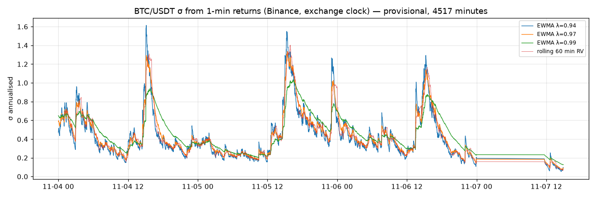
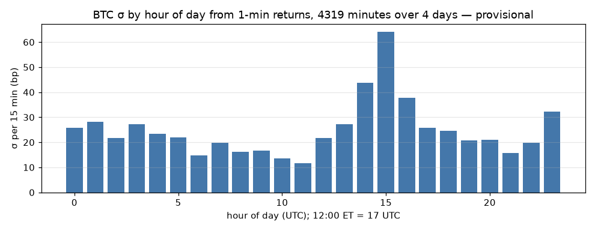
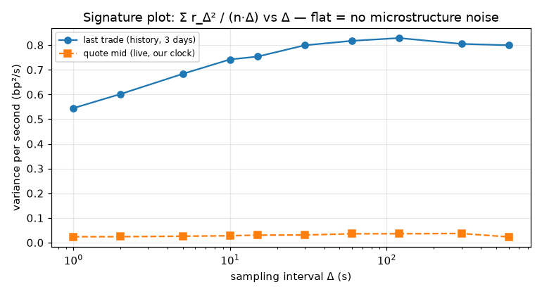
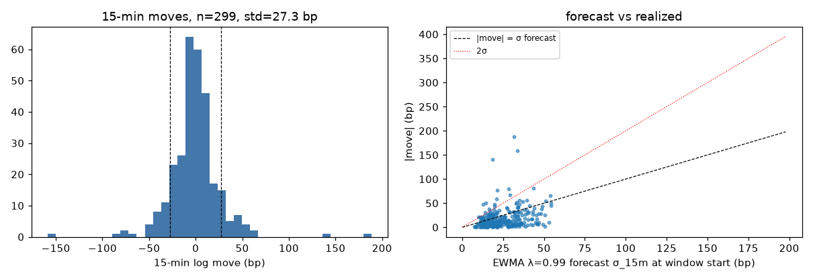
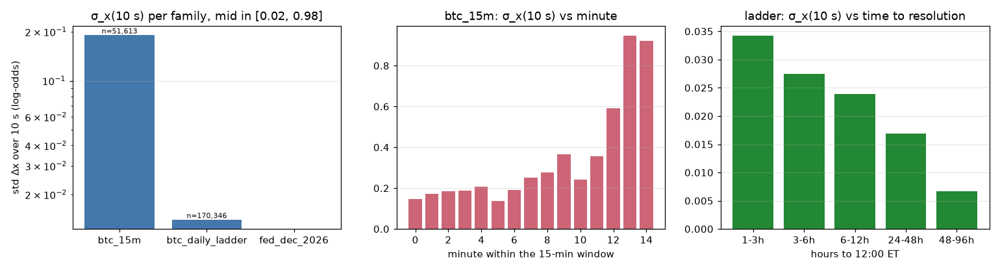
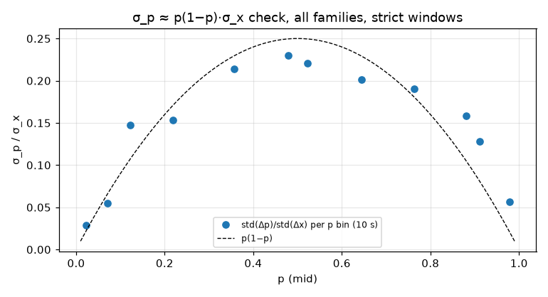
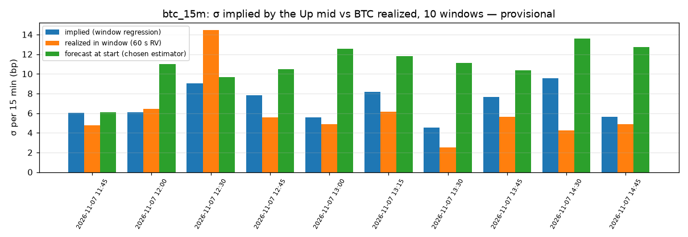

# Volatility — 2026-11-07

Generated 2026-11-07 15:34 UTC by `polymm vol`. Every number is provisional (three days of Binance history, one afternoon of joint Binance/Polymarket data). n is given with each table.

Formulas: σ_step = sqrt(mean r²); σ_ann = σ_step·sqrt(31 536 000/step_s) (365-day year); σ_15m = σ_step·sqrt(900/step_s); EWMA σ²_t = λσ²_{t−1} + (1−λ)r_t²; QLIKE = mean(r²/σ̂² − ln(r²/σ̂²) − 1); x = ln(p/(1−p)); σ_p ≈ p(1−p)σ_x; implied σ solves mid = Φ(ln(S_t/S_0)/(σ√τ)).

## BTC (Binance)

- history days: ['2026-11-04', '2026-11-05', '2026-11-06']; live trades 10697 s; quotes 11740 s
- chosen 15-min estimator: **EWMA λ=0.99 deseasonalised (LOO hour profile)** (QLIKE 1.651, n=299)

### btc · realized_by_day

| day | n_1s | sigma_1s_bp | ann_from_1s | n_1m | sigma_1m_bp | ann_from_1m | sigma_15m_from_1m_bp | parkinson_1m_bp | ann_parkinson | garman_klass_1m_bp | ann_garman_klass | n_bars |
|---|---|---|---|---|---|---|---|---|---|---|---|---|
| 2026-11-04 | 86399 | 0.7243 | 0.4067 | 1439 | 7.039 | 0.5103 | 27.26 | 5.93 | 0.4299 | 5.443 | 0.3946 | 1440 |
| 2026-11-05 | 86400 | 0.8252 | 0.4634 | 1440 | 7.546 | 0.547 | 29.22 | 6.572 | 0.4765 | 6.155 | 0.4462 | 1440 |
| 2026-11-06 | 86400 | 0.6544 | 0.3675 | 1440 | 6.365 | 0.4615 | 24.65 | 5.28 | 0.3828 | 4.796 | 0.3477 | 1440 |
| 2026-11-07 | 11815 | 0.2692 | 0.1512 | 196 | 1.521 | 0.1102 | 5.889 | 0.9745 | 0.07065 | 0.6541 | 0.04742 | 197 |
| all | 271014 | 0.7239 | 0.4065 | 4515 | 6.854 | 0.4969 | 26.54 | 5.823 | 0.4222 | 5.374 | 0.3896 | 4517 |

### btc · rolling_ewma

| estimator | n | p10_ann | p50_ann | p90_ann | p50_15m_bp |
|---|---|---|---|---|---|
| rolling 5 min on 1 s returns | 270954 | 0.119 | 0.2562 | 0.5784 | 13.68 |
| rolling 15 min on 1 s returns | 270954 | 0.1402 | 0.262 | 0.5578 | 13.99 |
| rolling 60 min on 1 s returns | 270954 | 0.1621 | 0.2744 | 0.5992 | 14.66 |
| EWMA λ=0.94 on 1 min returns | 4417 | 0.1955 | 0.3519 | 0.7474 | 18.80 |
| EWMA λ=0.97 on 1 min returns | 4417 | 0.2124 | 0.3656 | 0.7604 | 19.53 |
| EWMA λ=0.99 on 1 min returns | 4417 | 0.2383 | 0.4009 | 0.7599 | 21.42 |
| rolling 5 min on 1 min returns | 4417 | 0.127 | 0.3161 | 0.7471 | 16.89 |
| rolling 15 min on 1 min returns | 4417 | 0.1736 | 0.3363 | 0.7366 | 17.97 |
| rolling 60 min on 1 min returns | 4417 | 0.2099 | 0.3605 | 0.7394 | 19.26 |

### btc · by_hour_utc

| hour | n_1m | sigma_1m_bp | sigma_ann | sigma_15m_bp | hour_et_std |
|---|---|---|---|---|---|
| 0 | 179 | 6.663 | 0.4831 | 25.81 | -5 |
| 1 | 180 | 7.28 | 0.5278 | 28.19 | -4 |
| 2 | 180 | 5.604 | 0.4063 | 21.71 | -3 |
| 3 | 180 | 7.009 | 0.5081 | 27.14 | -2 |
| 4 | 180 | 6.032 | 0.4373 | 23.36 | -1 |
| 5 | 180 | 5.692 | 0.4126 | 22.04 | 0 |
| 6 | 180 | 3.839 | 0.2783 | 14.87 | 1 |
| 7 | 180 | 5.114 | 0.3708 | 19.81 | 2 |
| 8 | 180 | 4.158 | 0.3014 | 16.10 | 3 |
| 9 | 180 | 4.328 | 0.3138 | 16.76 | 4 |
| 10 | 180 | 3.5 | 0.2537 | 13.55 | 5 |
| 11 | 180 | 3.002 | 0.2176 | 11.63 | 6 |
| 12 | 180 | 5.6 | 0.406 | 21.69 | 7 |
| 13 | 180 | 7.058 | 0.5117 | 27.34 | 8 |
| 14 | 180 | 11.27 | 0.8171 | 43.65 | 9 |
| 15 | 180 | 16.53 | 1.199 | 64.04 | 10 |
| 16 | 180 | 9.752 | 0.707 | 37.77 | 11 |
| 17 | 180 | 6.629 | 0.4806 | 25.67 | 12 |
| 18 | 180 | 6.356 | 0.4608 | 24.62 | 13 |
| 19 | 180 | 5.357 | 0.3884 | 20.75 | 14 |
| 20 | 180 | 5.439 | 0.3943 | 21.06 | 15 |
| 21 | 180 | 4.075 | 0.2954 | 15.78 | 16 |
| 22 | 180 | 5.113 | 0.3707 | 19.80 | 17 |
| 23 | 180 | 8.307 | 0.6023 | 32.17 | 18 |

### btc · by_day

| day | n_1m | weekday | sigma_1m_bp | sigma_ann |
|---|---|---|---|---|
| 2026-11-04 | 1439 | Wed | 7.039 | 0.5103 |
| 2026-11-05 | 1440 | Thu | 7.546 | 0.547 |
| 2026-11-06 | 1440 | Fri | 6.365 | 0.4615 |
| 2026-11-07 | 196 | Sat | 1.521 | 0.1102 |

### btc · signature

| delta_s | var_per_s_trades_bp2 | n_trades | ann_trades | var_per_s_quotes_bp2 | n_quotes | ann_quotes | ratio_to_300s_trades | ratio_to_300s_quotes |
|---|---|---|---|---|---|---|---|---|
| 1 | 0.5446 | 259197 | 0.4144 | 0.02372 | 11755 | 0.08649 | 0.6765 | 0.6438 |
| 2 | 0.6018 | 129597 | 0.4356 | 0.024 | 5877 | 0.087 | 0.7476 | 0.6514 |
| 5 | 0.6836 | 51837 | 0.4643 | 0.02589 | 2351 | 0.09036 | 0.8493 | 0.7026 |
| 10 | 0.7419 | 25917 | 0.4837 | 0.02758 | 1175 | 0.09327 | 0.9217 | 0.7486 |
| 15 | 0.7536 | 17277 | 0.4875 | 0.03023 | 783 | 0.09763 | 0.9362 | 0.8203 |
| 30 | 0.7993 | 8637 | 0.5021 | 0.03098 | 391 | 0.09885 | 0.9929 | 0.8409 |
| 60 | 0.8173 | 4317 | 0.5077 | 0.03557 | 195 | 0.1059 | 1.015 | 0.9653 |
| 120 | 0.8286 | 2157 | 0.5112 | 0.03578 | 97 | 0.1062 | 1.029 | 0.9712 |
| 300 | 0.8049 | 861 | 0.5038 | 0.03685 | 39 | 0.1078 | 1 | 1 |
| 600 | 0.7994 | 429 | 0.5021 | 0.02308 | 19 | 0.08531 | 0.9931 | 0.6263 |

### btc · moves_15m_dist

| n_windows | std_move_bp | mean_abs_bp | p50_abs_bp | p90_abs_bp | p99_abs_bp | max_abs_bp | share_gt_5bp | share_gt_10bp | share_gt_20bp |
|---|---|---|---|---|---|---|---|---|---|
| 299 | 27.31 | 17.35 | 10.36 | 38.65 | 82.60 | 188.44 | 0.7492 | 0.5251 | 0.3043 |

### btc · moves_15m_by_hour

| hour | n | max_abs_bp | rms_move_bp |
|---|---|---|---|
| 0 | 11 | 42.59 | 23.93 |
| 1 | 12 | 43.71 | 21.06 |
| 2 | 12 | 66.52 | 21.52 |
| 3 | 12 | 56.63 | 22.75 |
| 4 | 12 | 52.11 | 25.57 |
| 5 | 12 | 49.59 | 17.84 |
| 6 | 12 | 29.79 | 15.62 |
| 7 | 12 | 47.92 | 21.25 |
| 8 | 12 | 35.77 | 13.37 |
| 9 | 12 | 58.59 | 19.48 |
| 10 | 12 | 20.95 | 12.09 |
| 11 | 13 | 24.72 | 9.946 |
| 12 | 16 | 49.96 | 22.77 |
| 13 | 16 | 38.59 | 14.35 |
| 14 | 15 | 140.64 | 48.77 |
| 15 | 12 | 188.44 | 79.21 |
| 16 | 12 | 65.92 | 35.62 |
| 17 | 12 | 37.64 | 20.40 |
| 18 | 12 | 30.39 | 15.91 |
| 19 | 12 | 53.00 | 23.00 |
| 20 | 12 | 32.76 | 12.89 |
| 21 | 12 | 25.58 | 13.03 |
| 22 | 12 | 34.01 | 22.02 |
| 23 | 12 | 55.85 | 25.78 |

### btc · forecast_scores

| estimator | n | qlike | mse_bp4 | mean_forecast_sigma_bp | realized_std_bp | bias_var_ratio | share_abs_gt_2sigma |
|---|---|---|---|---|---|---|---|
| hour-of-day (in-sample) | 299 | 1.61 | 6,898,112 | 27.23 | 27.32 | 0.9938 | 0.05351 |
| EWMA λ=0.99 deseasonalised (LOO hour profile) | 299 | 1.651 | 8,119,988 | 29.57 | 27.32 | 1.171 | 0.06689 |
| EWMA λ=0.97 deseasonalised (LOO hour profile) | 299 | 1.7 | 7,738,747 | 28.86 | 27.32 | 1.117 | 0.06689 |
| EWMA λ=0.97 | 299 | 1.826 | 7,863,061 | 26.45 | 27.32 | 0.9378 | 0.07023 |
| rolling 60 min RV | 296 | 1.88 | 8,182,861 | 26.67 | 27.22 | 0.9598 | 0.07095 |
| EWMA λ=0.94 | 299 | 1.9 | 7,693,328 | 26.08 | 27.32 | 0.9117 | 0.07358 |
| EWMA λ=0.99 | 299 | 1.928 | 8,127,357 | 26.98 | 27.32 | 0.9753 | 0.05017 |
| constant (in-sample) | 299 | 2.07 | 8,173,178 | 26.54 | 27.32 | 0.9443 | 0.04013 |
| rolling 15 min RV | 299 | 5.873 | 7,983,669 | 26.63 | 27.32 | 0.9503 | 0.08361 |
| rolling 5 min RV | 299 | 98,743 | 7,601,510 | 24.49 | 27.32 | 0.8037 | 0.1706 |

### btc · hour_profile_used

| hour | var_ratio | sigma_mult |
|---|---|---|
| 0 | 0.9061 | 0.9519 |
| 1 | 1.082 | 1.04 |
| 2 | 0.641 | 0.8006 |
| 3 | 1.002 | 1.001 |
| 4 | 0.7425 | 0.8617 |
| 5 | 0.6611 | 0.8131 |
| 6 | 0.3008 | 0.5484 |
| 7 | 0.5338 | 0.7306 |
| 8 | 0.3528 | 0.594 |
| 9 | 0.3824 | 0.6184 |
| 10 | 0.2499 | 0.4999 |
| 11 | 0.1839 | 0.4288 |
| 12 | 0.6399 | 0.8 |
| 13 | 1.017 | 1.008 |
| 14 | 2.593 | 1.61 |
| 15 | 5.58 | 2.362 |
| 16 | 1.941 | 1.393 |
| 17 | 0.8967 | 0.9469 |
| 18 | 0.8245 | 0.908 |
| 19 | 0.5857 | 0.7653 |
| 20 | 0.6037 | 0.777 |
| 21 | 0.3389 | 0.5822 |
| 22 | 0.5335 | 0.7304 |
| 23 | 1.408 | 1.187 |

### btc · jumps_1m_by_day

| day | n_jumps_gt4sigma | max_abs_bp |
|---|---|---|
| 2026-11-04 | 6 | 71.09 |
| 2026-11-05 | 6 | 54.38 |
| 2026-11-06 | 5 | 38.61 |
| 2026-11-07 | 1 | 13.00 |

### btc · jumps_1m

| minute | r_bp | z | hour | day | utc |
|---|---|---|---|---|---|
| 1793971800 | -38.61 | 8.791 | 13 | 2026-11-06 | 2026-11-06 13:30 |
| 1794055200 | -13.00 | 8.198 | 12 | 2026-11-07 | 2026-11-07 12:40 |
| 1794002520 | 21.03 | 8.072 | 22 | 2026-11-06 | 2026-11-06 22:02 |
| 1793802600 | 36.01 | 7.841 | 14 | 2026-11-04 | 2026-11-04 14:30 |
| 1793874660 | -18.56 | 7.474 | 10 | 2026-11-05 | 2026-11-05 10:31 |
| 1793950800 | 34.10 | 7.289 | 7 | 2026-11-06 | 2026-11-06 07:40 |
| 1793804640 | 71.09 | 6.666 | 15 | 2026-11-04 | 2026-11-04 15:04 |
| 1793761140 | -35.70 | 6.324 | 2 | 2026-11-04 | 2026-11-04 02:59 |
| 1793889360 | -38.58 | 6.308 | 14 | 2026-11-05 | 2026-11-05 14:36 |
| 1793919720 | 54.38 | 5.815 | 23 | 2026-11-05 | 2026-11-05 23:02 |
| 1793833200 | -24.85 | 5.718 | 23 | 2026-11-04 | 2026-11-04 23:00 |
| 1793919660 | -36.59 | 5.241 | 23 | 2026-11-05 | 2026-11-05 23:01 |
| 1793948520 | -21.35 | 5.162 | 7 | 2026-11-06 | 2026-11-06 07:02 |
| 1793880000 | -12.92 | 5.069 | 12 | 2026-11-05 | 2026-11-05 12:00 |
| 1793882340 | -23.20 | 4.863 | 12 | 2026-11-05 | 2026-11-05 12:39 |
| 1793803200 | 33.36 | 4.696 | 14 | 2026-11-04 | 2026-11-04 14:40 |
| 1793971920 | 34.22 | 4.362 | 13 | 2026-11-06 | 2026-11-06 13:32 |
| 1793830140 | 13.19 | 4.353 | 22 | 2026-11-04 | 2026-11-04 22:09 |

### btc · jumps_1m_by_hour

| hour | n |
|---|---|
| 2 | 1 |
| 7 | 2 |
| 10 | 1 |
| 12 | 3 |
| 13 | 2 |
| 14 | 3 |
| 15 | 1 |
| 22 | 2 |
| 23 | 3 |

### btc · jumps_1s_by_day

| day | n_1s_moves_ge10bp | max_abs_bp |
|---|---|---|
| 2026-11-04 | 4 | 13.76 |
| 2026-11-05 | 10 | 17.87 |
| 2026-11-06 | 6 | 59.33 |
| 2026-11-07 | 1 | 24.02 |

### btc · jumps_1s_top

| sec | r_bp | hour | day | utc |
|---|---|---|---|---|
| 1793971801 | -59.33 | 13 | 2026-11-06 | 2026-11-06 13:30:01 |
| 1794051556 | 24.02 | 11 | 2026-11-07 | 2026-11-07 11:39:16 |
| 1793919696 | -17.87 | 23 | 2026-11-05 | 2026-11-05 23:01:36 |
| 1793893931 | -14.36 | 15 | 2026-11-05 | 2026-11-05 15:52:11 |
| 1793804705 | 13.76 | 15 | 2026-11-04 | 2026-11-04 15:05:05 |
| 1793904462 | -11.99 | 18 | 2026-11-05 | 2026-11-05 18:47:42 |
| 1793874681 | -11.93 | 10 | 2026-11-05 | 2026-11-05 10:31:21 |
| 1793923020 | 11.84 | 23 | 2026-11-05 | 2026-11-05 23:57:00 |
| 1793771436 | 11.78 | 5 | 2026-11-04 | 2026-11-04 05:50:36 |
| 1793977493 | -11.35 | 15 | 2026-11-06 | 2026-11-06 15:04:53 |
| 1793976929 | -11.32 | 14 | 2026-11-06 | 2026-11-06 14:55:29 |
| 1793883216 | -11.25 | 12 | 2026-11-05 | 2026-11-05 12:53:36 |
| 1793804961 | 11.25 | 15 | 2026-11-04 | 2026-11-04 15:09:21 |
| 1793977429 | -11.03 | 15 | 2026-11-06 | 2026-11-06 15:03:49 |
| 1793887058 | -10.70 | 13 | 2026-11-05 | 2026-11-05 13:57:38 |

### btc · jumps_1s_quotes

| n_secs | n_moves_ge10bp | max_abs_bp | sigma_1s_quotes_bp | sigma_1s_trades_same_span_bp |
|---|---|---|---|---|
| 11749 | 0 | 0 | 0.1541 | 0.2699 |

## Polymarket (strict clean windows, outcome-0 tokens)

### poly · grid_coverage

| family | n_sec | n_tokens | n_windows |
|---|---|---|---|
| btc_15m | 55188 | 24 | 40 |
| btc_daily_ladder | 414044 | 25 | 136 |
| fed_dec_2026 | 88874 | 5 | 28 |

### poly · sigma_x_family

| family | n | sigma_x | share_zero | abs_dx_p99 | k_s | sigma_x_per_sqrt_s |
|---|---|---|---|---|---|---|
| btc_15m | 51977 | 0.05175 | 0.9285 | 0.2215 | 1 | 0.05175 |
| btc_15m | 51613 | 0.1907 | 0.7549 | 0.8164 | 10 | 0.06029 |
| btc_15m | 49837 | 0.4109 | 0.6264 | 1.779 | 60 | 0.05305 |
| btc_daily_ladder | 171000 | 0.00692 | 0.9178 | 0.02632 | 1 | 0.00692 |
| btc_daily_ladder | 170346 | 0.01399 | 0.8314 | 0.06114 | 10 | 0.004424 |
| btc_daily_ladder | 166985 | 0.03031 | 0.6849 | 0.1382 | 60 | 0.003913 |
| fed_dec_2026 | 35379 | 0 | 1 | 0 | 1 | 0 |
| fed_dec_2026 | 35262 | 0 | 1 | 0 | 10 | 0 |
| fed_dec_2026 | 34659 | 0 | 1 | 0 | 60 | 0 |

### poly · btc15_by_minute

| minute | n | sigma_x | share_zero | abs_dx_p99 | k_s | sigma_x_per_sqrt_s |
|---|---|---|---|---|---|---|
| 0 | 1260 | 0.1461 | 0.3556 | 0.6171 | 10 | 0.04621 |
| 1 | 1260 | 0.1725 | 0.3262 | 0.6171 | 10 | 0.05455 |
| 2 | 1260 | 0.1847 | 0.3198 | 0.6989 | 10 | 0.0584 |
| 3 | 1233 | 0.1868 | 0.3755 | 0.7707 | 10 | 0.05906 |
| 4 | 1245 | 0.207 | 0.3454 | 0.687 | 10 | 0.06547 |
| 5 | 1273 | 0.1372 | 0.4918 | 0.5279 | 10 | 0.04339 |
| 6 | 1307 | 0.1901 | 0.4277 | 0.7656 | 10 | 0.06012 |
| 7 | 1320 | 0.2526 | 0.3136 | 0.9864 | 10 | 0.07987 |
| 8 | 1312 | 0.2772 | 0.2439 | 1.017 | 10 | 0.08767 |
| 9 | 1290 | 0.3643 | 0.262 | 1.276 | 10 | 0.1152 |
| 10 | 1168 | 0.243 | 0.2577 | 0.8478 | 10 | 0.07685 |
| 11 | 1103 | 0.3551 | 0.2557 | 1.151 | 10 | 0.1123 |
| 12 | 913 | 0.5923 | 0.1566 | 2.543 | 10 | 0.1873 |
| 13 | 645 | 0.9473 | 0.06202 | 2.933 | 10 | 0.2996 |
| 14 | 123 | 0.9218 | 0.05691 | 2.141 | 10 | 0.2915 |

### poly · btc15_by_edge

| edge_bin | n | sigma_x | share_zero | abs_dx_p99 | k_s | sigma_x_per_sqrt_s |
|---|---|---|---|---|---|---|
| 0.0-0.1 | 6156 | 0.2418 | 0.3234 | 0.9384 | 10 | 0.07646 |
| 0.1-0.2 | 3846 | 0.2937 | 0.2982 | 1.199 | 10 | 0.09289 |
| 0.2-0.3 | 2876 | 0.4032 | 0.2305 | 2.121 | 10 | 0.1275 |
| 0.3-0.4 | 2409 | 0.4151 | 0.3171 | 1.636 | 10 | 0.1313 |
| 0.4-0.5 | 1425 | 0.4422 | 0.4351 | 1.911 | 10 | 0.1398 |

### poly · btc15_pre_window

| phase | n | sigma_x | share_zero | abs_dx_p99 | k_s | sigma_x_per_sqrt_s |
|---|---|---|---|---|---|---|
| before start | 34901 | 0.01953 | 0.9678 | 0.04041 | 10 | 0.006177 |

### poly · ladder_by_hours_to_expiry

| h_bin | n | sigma_x | share_zero | abs_dx_p99 | k_s | sigma_x_per_sqrt_s |
|---|---|---|---|---|---|---|
| 1-3h | 3129 | 0.03425 | 0.2416 | 0.1396 | 10 | 0.01083 |
| 3-6h | 10629 | 0.02747 | 0.4382 | 0.1229 | 10 | 0.008687 |
| 6-12h | 4931 | 0.02384 | 0.3521 | 0.1045 | 10 | 0.00754 |
| 24-48h | 50024 | 0.01689 | 0.7392 | 0.07215 | 10 | 0.00534 |
| 48-96h | 101633 | 0.006714 | 0.9594 | 0.02712 | 10 | 0.002123 |

### poly · ladder_by_strike_distance

| dist_bin | n | sigma_x | share_zero | abs_dx_p99 | k_s | sigma_x_per_sqrt_s |
|---|---|---|---|---|---|---|
| <-5% | 11171 | 0.002203 | 0.991 | 0 | 10 | 0.0006965 |
| -5..-2.5% | 19022 | 0.01003 | 0.8895 | 0.046 | 10 | 0.003172 |
| -2.5..-1% | 2304 | 0.02427 | 0.8815 | 0.1343 | 10 | 0.007676 |
| -1..0% | 7869 | 0.01012 | 0.6082 | 0.04002 | 10 | 0.0032 |
| 0..1% | 25160 | 0.02015 | 0.6264 | 0.09412 | 10 | 0.006373 |
| 2.5..5% | 21093 | 0.02184 | 0.8972 | 0.1037 | 10 | 0.006906 |
| >5% | 18826 | 0.008576 | 0.9698 | 0.02113 | 10 | 0.002712 |

### poly · ladder_by_distance_and_hours

| abs_dist | h_bin | n | sigma_x | share_zero | abs_dx_p99 | k_s | sigma_x_per_sqrt_s |
|---|---|---|---|---|---|---|---|
| <1% | 1-3h | 3129 | 0.03425 | 0.2416 | 0.1396 | 10 | 0.01083 |
| <1% | 3-6h | 8375 | 0.02714 | 0.4061 | 0.1215 | 10 | 0.008582 |
| <1% | 24-48h | 10890 | 0.008337 | 0.5833 | 0.03465 | 10 | 0.002636 |
| <1% | 48-96h | 10635 | 0.006372 | 0.9437 | 0.04002 | 10 | 0.002015 |
| 1-2.5% | 24-48h | 1152 | 0.02897 | 0.8646 | 0.1343 | 10 | 0.00916 |
| 1-2.5% | 48-96h | 1152 | 0.01838 | 0.8984 | 0.04407 | 10 | 0.005813 |
| 2.5-5% | 24-48h | 19967 | 0.02356 | 0.8393 | 0.1143 | 10 | 0.00745 |
| 2.5-5% | 48-96h | 20148 | 0.006655 | 0.9473 | 0.04652 | 10 | 0.002105 |
| >5% | 48-96h | 29997 | 0.006926 | 0.9777 | 0.02113 | 10 | 0.00219 |

### poly · sigma_p_check_all

| p_bin | n | p_mean | sigma_p | sigma_x | p(1-p) | sigma_p/sigma_x | ratio_to_p(1-p) |
|---|---|---|---|---|---|---|---|
| 0.01-0.05 | 59391 | 0.0223 | 0.001124 | 0.03906 | 0.0218 | 0.02879 | 1.321 |
| 0.05-0.10 | 216 | 0.07058 | 0.02461 | 0.4454 | 0.0656 | 0.05525 | 0.8423 |
| 0.10-0.20 | 18214 | 0.1225 | 0.01419 | 0.09646 | 0.1075 | 0.1471 | 1.368 |
| 0.20-0.30 | 18693 | 0.2185 | 0.01706 | 0.1113 | 0.1708 | 0.1532 | 0.8972 |
| 0.30-0.40 | 5577 | 0.3563 | 0.03581 | 0.1671 | 0.2293 | 0.2143 | 0.9343 |
| 0.40-0.50 | 44079 | 0.4789 | 0.01344 | 0.05847 | 0.2496 | 0.2298 | 0.9208 |
| 0.50-0.60 | 43956 | 0.5217 | 0.01673 | 0.07576 | 0.2495 | 0.2208 | 0.8849 |
| 0.60-0.70 | 4363 | 0.6443 | 0.04499 | 0.2235 | 0.2292 | 0.2013 | 0.8783 |
| 0.70-0.80 | 19912 | 0.7634 | 0.02419 | 0.1271 | 0.1806 | 0.1903 | 1.054 |
| 0.80-0.90 | 17418 | 0.8814 | 0.02025 | 0.1275 | 0.1045 | 0.1587 | 1.518 |
| 0.90-0.95 | 1906 | 0.9108 | 0.04456 | 0.348 | 0.08126 | 0.1281 | 1.576 |
| 0.95-0.99 | 54099 | 0.9795 | 0.002324 | 0.04096 | 0.02012 | 0.05675 | 2.82 |

### poly · sigma_p_check_family

| family | p_bin | n | p_mean | sigma_p | sigma_x | p(1-p) | sigma_p/sigma_x | ratio_to_p(1-p) |
|---|---|---|---|---|---|---|---|---|
| btc_15m | 0.01-0.05 | 1812 | 0.02115 | 0.006033 | 0.1974 | 0.02071 | 0.03057 | 1.476 |
| btc_15m | 0.05-0.10 | 216 | 0.07058 | 0.02461 | 0.4454 | 0.0656 | 0.05525 | 0.8423 |
| btc_15m | 0.10-0.20 | 961 | 0.1584 | 0.06155 | 0.4183 | 0.1333 | 0.1471 | 1.104 |
| btc_15m | 0.20-0.30 | 954 | 0.2499 | 0.07537 | 0.4881 | 0.1875 | 0.1544 | 0.8236 |
| btc_15m | 0.30-0.40 | 1149 | 0.3535 | 0.07824 | 0.3656 | 0.2285 | 0.214 | 0.9365 |
| btc_15m | 0.40-0.50 | 17449 | 0.49 | 0.0207 | 0.09044 | 0.2499 | 0.2289 | 0.9159 |
| btc_15m | 0.50-0.60 | 23598 | 0.5143 | 0.02254 | 0.1024 | 0.2498 | 0.2203 | 0.8818 |
| btc_15m | 0.60-0.70 | 2709 | 0.6461 | 0.05683 | 0.2828 | 0.2286 | 0.201 | 0.8789 |
| btc_15m | 0.70-0.80 | 1935 | 0.7486 | 0.07739 | 0.4077 | 0.1882 | 0.1898 | 1.009 |
| btc_15m | 0.80-0.90 | 1451 | 0.842 | 0.0698 | 0.4414 | 0.133 | 0.1581 | 1.189 |
| btc_15m | 0.90-0.95 | 521 | 0.9246 | 0.08458 | 0.6657 | 0.06973 | 0.127 | 1.822 |
| btc_15m | 0.95-0.99 | 1197 | 0.9797 | 0.01554 | 0.2644 | 0.01987 | 0.05876 | 2.957 |
| btc_daily_ladder | 0.01-0.05 | 57579 | 0.02233 | 0.0003697 | 0.01696 | 0.02184 | 0.02181 | 0.9986 |
| btc_daily_ladder | 0.10-0.20 | 17253 | 0.1205 | 0.0008879 | 0.008459 | 0.106 | 0.105 | 0.9901 |
| btc_daily_ladder | 0.20-0.30 | 454 | 0.2862 | 0.005197 | 0.02511 | 0.2043 | 0.207 | 1.013 |
| btc_daily_ladder | 0.30-0.40 | 4428 | 0.357 | 0.005088 | 0.02264 | 0.2295 | 0.2247 | 0.979 |
| btc_daily_ladder | 0.40-0.50 | 26630 | 0.4716 | 0.004215 | 0.01721 | 0.2492 | 0.2448 | 0.9826 |
| btc_daily_ladder | 0.50-0.60 | 20358 | 0.5304 | 0.003785 | 0.01527 | 0.2491 | 0.2478 | 0.9948 |
| btc_daily_ladder | 0.60-0.70 | 1654 | 0.6414 | 0.006884 | 0.02955 | 0.23 | 0.233 | 1.013 |
| btc_daily_ladder | 0.80-0.90 | 15967 | 0.885 | 0.0007406 | 0.006985 | 0.1018 | 0.106 | 1.041 |
| btc_daily_ladder | 0.90-0.95 | 1385 | 0.9056 | 0.0005459 | 0.006253 | 0.0855 | 0.0873 | 1.021 |
| btc_daily_ladder | 0.95-0.99 | 52902 | 0.9795 | 0.0002585 | 0.01032 | 0.02013 | 0.02505 | 1.245 |
| fed_dec_2026 | 0.20-0.30 | 17285 | 0.215 | 0 | 0 | 0.1688 | nan | nan |
| fed_dec_2026 | 0.70-0.80 | 17977 | 0.765 | 0 | 0 | 0.1798 | nan | nan |

### poly · jumps_x

| family | grid_hours | n_x | n_dx_ge_0.2 | n_dx_ge_0.5 | n_dx_ge_1.0 | n_p | n_dp_ge_0.02 | n_dp_ge_0.05 | n_dp_ge_0.1 | per_h_dx_ge_0.2 | per_h_dx_ge_0.5 | per_h_dx_ge_1.0 | per_h_dp_ge_0.02 | per_h_dp_ge_0.05 | per_h_dp_ge_0.1 |
|---|---|---|---|---|---|---|---|---|---|---|---|---|---|---|---|
| btc_15m | 15.32 | 51977 | 634 | 105 | 18 | 55148 | 1452 | 315 | 82 | 43.91 | 7.272 | 1.247 | 94.78 | 20.56 | 5.353 |
| btc_daily_ladder | 114.97 | 171000 | 11 | 0 | 0 | 413908 | 72 | 1 | 0 | 0.2316 | 0 | 0 | 0.6262 | 0.008698 | 0 |
| fed_dec_2026 | 24.68 | 35379 | 0 | 0 | 0 | 88846 | 0 | 0 | 0 | 0 | 0 | 0 | 0 | 0 | 0 |

### poly · btc15_jumps_by_minute

| minute | n | n_dp_ge_0.02 | n_dp_ge_0.05 | max_abs_dp |
|---|---|---|---|---|
| 0 | 1260 | 53 | 8 | 0.14 |
| 1 | 1260 | 63 | 13 | 0.14 |
| 2 | 1260 | 74 | 15 | 0.13 |
| 3 | 1242 | 69 | 16 | 0.21 |
| 4 | 1254 | 84 | 24 | 0.135 |
| 5 | 1273 | 42 | 10 | 0.13 |
| 6 | 1316 | 62 | 11 | 0.11 |
| 7 | 1320 | 78 | 21 | 0.25 |
| 8 | 1320 | 101 | 22 | 0.28 |
| 9 | 1306 | 130 | 34 | 0.26 |
| 10 | 1261 | 124 | 13 | 0.19 |
| 11 | 1260 | 130 | 20 | 0.15 |
| 12 | 1260 | 123 | 26 | 0.32 |
| 13 | 1255 | 226 | 61 | 0.335 |
| 14 | 1140 | 72 | 17 | 0.31 |

### poly · implied_15m

| window_start_utc | start_s | n_sec | n_fit | s_0 | move_bp | sigma_impl_15m_bp | sigma_impl_ann | intercept | r2 | point_median_15m_bp | n_points | realized_1s_15m_bp | realized_60s_15m_bp | share_sign_disagree_ge3bp | n_ge3bp | ewma_fc_15m_bp | season_fc_15m_bp | impl_over_realized_1s | impl_over_realized_60s | impl_over_fc |
|---|---|---|---|---|---|---|---|---|---|---|---|---|---|---|---|---|---|---|---|---|
| 2026-11-07 11:45 | 1794051900 | 900 | 725 | 76,019 | -3.723 | 6.022 | 0.1127 | -0.9697 | 0.5423 | 5.323 | 134 | 4.097 | 4.778 | 0 | 232 | 12.12 | 6.092 | 1.47 | 1.26 | 0.9885 |
| 2026-11-07 12:00 | 1794052800 | 900 | 751 | 75,991 | 2.174 | 6.102 | 0.1142 | 5.027 | 0.8113 | 4.254 | 448 | 4.896 | 6.419 | 0 | 1 | 11.37 | 11.01 | 1.246 | 0.9507 | 0.5543 |
| 2026-11-07 12:15 | 1794053700 | 900 | 650 | 76,007 | -0.03421 | nan | nan | 3.801 | nan | nan | 0 | 0.6244 | 0.6249 | nan | 0 | 10.73 | 10.40 | nan | nan | nan |
| 2026-11-07 12:30 | 1794054600 | 886 | 469 | 76,007 | -21.33 | 9.036 | 0.1691 | -6.377 | 0.9633 | 7.171 | 319 | 10.32 | 14.48 | 0 | 634 | 9.95 | 9.644 | 0.8757 | 0.6239 | 0.9369 |
| 2026-11-07 12:45 | 1794055500 | 869 | 608 | 75,845 | 7.191 | 7.81 | 0.1462 | 3.912 | 0.9507 | 6.28 | 561 | 3.508 | 5.57 | 0 | 688 | 10.73 | 10.49 | 2.226 | 1.402 | 0.7449 |
| 2026-11-07 13:00 | 1794056400 | 900 | 741 | 75,900 | -7.339 | 5.55 | 0.1039 | -0.3223 | 0.9502 | 5.419 | 510 | 3.85 | 4.869 | 0 | 218 | 10.17 | 12.54 | 1.441 | 1.14 | 0.4426 |
| 2026-11-07 13:15 | 1794057300 | 900 | 738 | 75,844 | 7.619 | 8.164 | 0.1528 | 1.383 | 0.7431 | 7.05 | 564 | 5.325 | 6.142 | 0 | 623 | 9.611 | 11.78 | 1.533 | 1.329 | 0.6933 |
| 2026-11-07 13:30 | 1794058200 | 900 | 685 | 75,902 | 5.221 | 4.552 | 0.08521 | 0.518 | 0.8189 | 4.493 | 465 | 1.838 | 2.507 | 0 | 272 | 9.17 | 11.13 | 2.477 | 1.816 | 0.4089 |
| 2026-11-07 13:45 | 1794059100 | 892 | 791 | 75,941 | -0.7151 | 7.633 | 0.1429 | 2.662 | 0.8686 | 6.652 | 283 | 4.307 | 5.622 | 0 | 227 | 8.555 | 10.36 | 1.772 | 1.358 | 0.7365 |
| 2026-11-07 14:00 | 1794060000 | 900 | 707 | 75,936 | 1.288 | nan | nan | -4.345 | nan | 11.03 | 296 | 3.824 | 4.402 | nan | 0 | 8.193 | 15.69 | nan | nan | nan |
| 2026-11-07 14:15 | 1794060900 | 900 | 855 | 75,946 | -1.069 | nan | nan | 9.625 | nan | 15.54 | 174 | 1.704 | 2.19 | nan | 0 | 7.772 | 14.65 | nan | nan | nan |
| 2026-11-07 14:30 | 1794061800 | 900 | 809 | 75,938 | 2.414 | 9.565 | 0.179 | 5.217 | 0.4799 | 6.026 | 540 | 4.779 | 4.271 | 0.01474 | 407 | 7.253 | 13.61 | 2.001 | 2.24 | 0.703 |
| 2026-11-07 14:45 | 1794062700 | 590 | 501 | 75,956 | -0.5556 | 5.617 | 0.1051 | 1.211 | 0.918 | 5.127 | 213 | 3.589 | 4.884 | 0 | 91 | 6.915 | 12.72 | 1.565 | 1.15 | 0.4416 |

### poly · implied_15m_summary

| n_windows_fit | n_windows_total | median_implied_15m_bp | median_realized_1s_15m_bp | median_realized_60s_15m_bp | median_ratio_impl_over_realized_1s | median_ratio_impl_over_realized_60s | share_windows_impl_gt_realized_60s | median_ratio_impl_over_season_fc | median_point_sigma_15m_bp | share_sign_disagree_ge3bp |
|---|---|---|---|---|---|---|---|---|---|---|
| 10 | 13 | 6.868 | 4.202 | 5.227 | 1.549 | 1.295 | 0.8 | 0.6982 | 5.723 | 0.001474 |

## Plots

