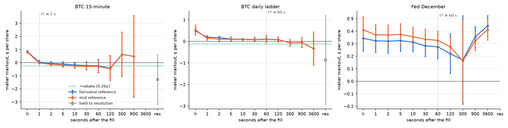
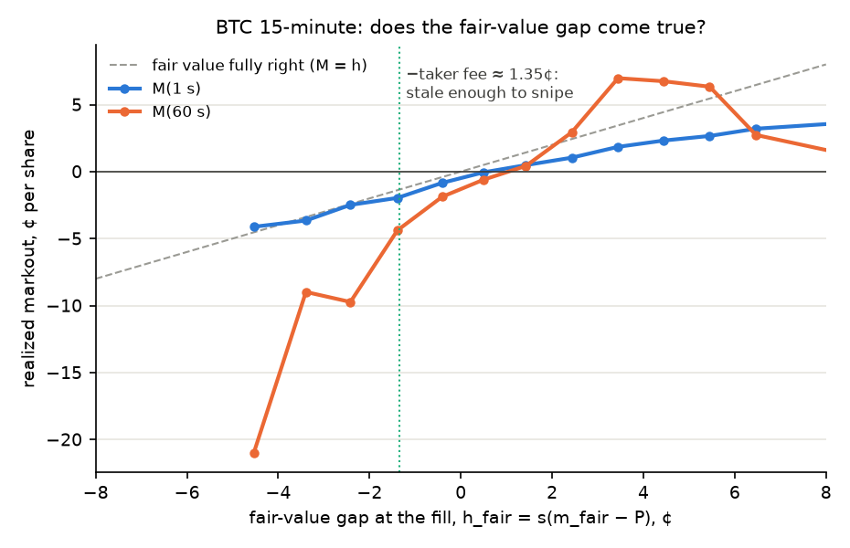
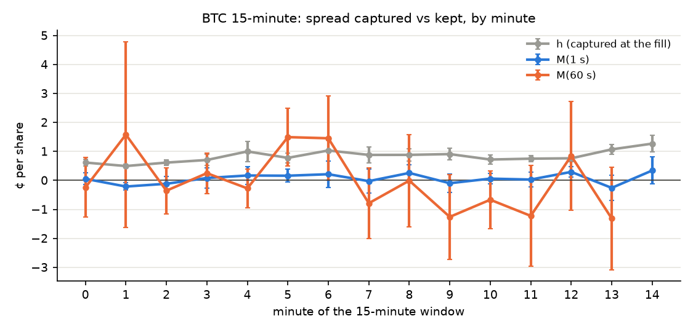
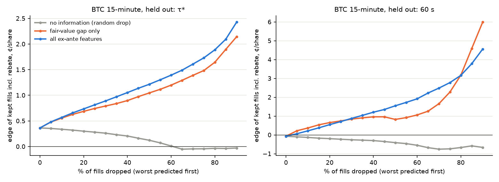

# Markouts and adverse selection v1 (stage 4)

Built 2026-11-08 by `polymm markouts 2026-11-06 2026-11-07 2026-11-08` (code `src/polymm/markouts/`, decision D-024).
11-06 is training only (it fixes τ* and the first model fold); 11-07 and 11-08 are held out.
Machine-generated tables: `reports/markouts/summary.md`. Plots: `research/adverse_selection/`. Parameters for later stages: `reports/markouts/as_params.json`.
An independent code audit ran before this version (§9).

## 1. Result in one paragraph

Every public trade is somebody's maker fill, so we measured the fills that an average resting order got: 233,202 fills, about 4.6 M USD notional, in three families.
In **BTC 15-minute**, the average maker captures **0.83 ¢** per share at the fill and gives **all of it back within one second**: $M(1\,\text{s}) = +0.04 \pm 0.07$ ¢. Weighted by size, it is $-0.29 \pm 0.14$ ¢ already at 1 s, because larger takers are more informed.
The maker rebate (0.26 ¢) is roughly what keeps the average maker at zero, and the sign changes from day to day (including the rebate: 11-07 $-0.05$ ¢, 11-08 $+0.60$ ¢).
The flow is not uniform. Features known **before** a fill separate good fills from bad ones out of sample: dropping the half of fills a ridge model likes least lifts the edge of the kept half from $+0.36$ to $+1.22$ ¢ per share at 1 s, and from $-0.07$ to $+1.55$ ¢ at 60 s.
**Gate A: GO (provisional) for BTC 15-minute, on one slice: quoted spread > 5 ¢.** It was chosen on the training day and was positive at 95 % on both held-out days, at 1 s and at 60 s.
The daily ladder and Fed are **inconclusive**: too few fills to fix τ*, and almost no decay inside 60 s.

## 2. What is measured

For maker fill $i$ with side $s_i$ ($+1$ maker bought YES), YES-equivalent price $P_i$, reference price $m$ just before the fill and $m^{\tau}$ τ seconds later, in cents per share:

$$
h_i = s_i\,(m_i - P_i), \qquad M_i(\tau) = s_i\,(m_i^{\tau} - P_i), \qquad a_i(\tau) = h_i - M_i(\tau) = -\,s_i\,(m_i^{\tau} - m_i)
$$

Gate A asks whether $\pi = \bar h - \bar a(\tau^*) = \bar M(\tau^*) > 0$ for any selection of fills we could choose *before* they happen.

**Two references, both evaluated at the exact instant.**
- `mid` is event-level from the replayed book.
- `fair` is that exact mid plus the stage-3 fair value's premium over the mid (D-023, rebuilt **walk-forward**, §6), taken from the last whole second at or before the instant:

$$
x^{\text{fair}}(t) = x^{\text{mid}}(t) + \left( x^{\text{fair}} - x^{\text{mid}} \right)_{\text{grid}}(\lfloor t \rfloor), \qquad x = \ln \frac{p}{1-p}
$$

**Horizon limits.** Horizons stop at the earlier of the clean-window end and the market's close.

**Clustered errors.** All SEs are cluster-robust by 15-minute window (BTC 15m) or market-hour (ladder, Fed). Fills in one window share one BTC path, so the naive SE would be about 5 to 10 times too small (`tests/test_markouts.py` plants an example).

## 3. The fill table (A0): signs and checks

| check | 11-06 | 11-07 | 11-08 |
|---|---|---|---|
| trades recorded | 59,978 | 65,902 | 115,108 |
| inside a strict clean window | 99.75 % | 99.84 % | 99.83 % |
| linked to the book decrease they consumed (D-020) | 84.5 % | 85.2 % | 79.8 % |
| print at or through the prior touch on their side | about 97 % | about 98 % | about 97 % |
| maker bought YES (after conversion) | 50 % | 52 % | 52 % |

- **YES-equivalent sign.** 94 % of raw WS trades are `BUY`, because traders sell YES by buying NO. After conversion, makers buy about half the time, as they should. A NO-token print at $q$ with taker side BUY is a maker *purchase* of YES at $1-q$.
- Each match prints on exactly one token (no double counting), and WS `tx_hash` is unique per message. A taker order is grouped by (token, exchange millisecond, direction).
- **Pre-trade book.** The book decrease a trade consumed usually arrives about 18 ms *before* the trade message. "The book at the trade's receive time" is therefore already post-trade: only 79 % of trades printed at its touch. Taking the book just before the **taker order's** earliest linked decrease raises this to about 98 %. Using the order's earliest instant also means the second level of a sweep is judged against the book before the sweep began.
- Trades that are not consistent with the prior book on their side (2 to 3 %) are excluded. Their sign is not trustworthy.
- `fee_rate_bps` is 0 on every recorded trade. Fees come from our Gamma snapshots: crypto 7 % · p(1−p) with a 20 % rebate share; Fed 5 % with 25 %.

## 4. Signature plots (A2)

| BTC 15-minute (balanced panel, about 200k fills, 165 windows) | h | M(1 s) | M(5 s) | M(30 s) | M(60 s) | held to resolution |
|---|---|---|---|---|---|---|
| fair reference, count-weighted | +0.83 | +0.04 | −0.11 | −0.22 | −0.25 ± 0.26 | −1.30 ± 0.97 |
| mid reference, count-weighted | +0.79 | −0.02 | −0.20 | −0.28 | −0.30 ± 0.25 | |
| fair reference, size-weighted | +1.09 | −0.29 | −0.36 | – | −0.38 ± 0.28 | +0.04 ± 0.51 |

- **The whole half-spread disappears within one second**, and after that the markout only drifts down slightly and gets noisier.
- **How τ* was fixed (on 11-06).** τ* is the first horizon whose *remaining* decay to 60 s, $M(\tau) - M(60)$, is no longer significant: **τ* = 1 s**.
- Adverse selection here is a **latency** phenomenon, which matches the fair-value finding that BTC leads the book by about a second.
- **Daily ladder:** $h = 0.48$ → $M(1) = 0.19$ → $0.10$ at 60 s → $-0.34 \pm 0.39$ at 1 h; $-0.87 \pm 1.05$ ¢ held to resolution (136 clusters).
- **Fed:** about +0.3 ¢, flat out to an hour. The book barely moves on these days, and there is no resolution yet.

> **Note (skill 3, reading a signature plot):** a desk reads three things here. The height at $h$ is what the spread pays, the drop to the plateau is the toxicity $\bar a$, and where the drop ends is τ*, the information horizon. Here they are 0.83 ¢, about 0.8 ¢ and 1 s. A one-second horizon means the losses come from **stale quotes being picked off**, not from slow informed drift. The defence is speed and cancel rules, not wider spreads alone. A common mistake is reading the plateau off a different sample at each horizon. We use one balanced panel up to 60 s and flag the longer horizons as their own samples.

## 5. Where the toxicity is (A3)

BTC 15-minute at τ* = 1 s, fair reference, count-weighted, ¢ per share (± cluster SE). *Ex-ante* means known while the quote is resting.

| slice (ex-ante) | worse | better |
|---|---|---|
| fair-value gap at the fill $h_{\text{fair}}$ | ≤ −1.75 ¢: **−2.66** ± 0.44 (n 4.8k); −1.75…−0.5: −1.40 | > 1.5 ¢: **+1.38** ± 0.19 |
| queue imbalance against the maker (`imb_adv`) | ≥ 0.8: **−0.80** ± 0.09 | < 0.2: **+1.00** ± 0.09 |
| quoted spread | 1 ¢ (85 % of fills): −0.07 ± 0.05 | > 5 ¢: **+2.92** ± 0.41; 3–5 ¢: +1.01 |
| BTC move in the last 5 s, signed against the maker | > 1 σ: −0.49 ± 0.18 | < −1 σ: +0.72 ± 0.19 |
| taker flow in the last 5 s | against the maker: −0.17 ± 0.08 | for the maker: +0.44 ± 0.09 |
| hour (UTC) | 12–20: −0.27 | 04–12: +0.31 to +0.36 |

| slice (fill characteristic, *not* usable to avoid) | worse | better |
|---|---|---|
| taker size vs the queue at the touch | larger than the touch: −0.68 ± 0.12 | < 25 % of it: +0.40 ± 0.07 |
| taker size | 50–200 shares: −0.41 ± 0.11 | < 10 shares: +0.31 ± 0.09 |

**The fair-value gap comes true and then overshoots.**
- At 1 s, fills whose quote fair value already called stale lose about what the gap said: on the negative side, $M(1)$ sits on the 45° line.
- By 60 s they lose **much more**: −4 ¢ just past the taker fee, and −9 to −21 ¢ further out.
- The fair value under-reacts, as the stage-3 slope $b > 1$ at 60 s already showed. Its gap is the right *direction* but too *small*.
- The curve steepens right past the taker-fee line (about 1.35 ¢). That is consistent with snipers acting only once a quote is stale by more than the fee they pay, but it isn't proven here (§10).

## 6. Predicting the cost (A4)

The target is the edge of a fill, $\hat M(\tau \mid z)$, equivalently $\hat a = h - \hat M$.
- **Features: ex-ante only** (the quote's own price and place, the book, BTC, recent flow, the clock). The taker's size is excluded, because a resting quote cannot choose who hits it.
- **Fitting:** walk-forward (11-06 → 11-07; 11-06 and 11-07 → 11-08).
- **Baselines:** *const* (no information) and *gap* (the fair-value gap alone).

| BTC 15-minute, held out, edge incl. rebate (¢) | all fills | drop the worst 25 % | drop the worst 50 % |
|---|---|---|---|
| τ* = 1 s, random drop | +0.36 | +0.28 | +0.12 |
| τ* = 1 s, fair-value gap only | +0.36 | +0.74 | +1.05 |
| τ* = 1 s, ridge (12 features) | +0.36 | +0.81 | **+1.22** |
| 60 s, fair-value gap only | −0.07 | +0.74 | +0.82 |
| 60 s, ridge | −0.07 | +0.71 | **+1.55** |

- **Out-of-sample fit:** at 1 s, correlation 0.27 and $R^2 = 0.079$ against the constant (gap alone: 0.19 / 0.040). At 60 s, 0.10 to 0.11 / 0.010.
- **Largest coefficients (per SD):** queue imbalance (about −0.8 ¢), then flow in the last 5 s, spread, distance from 0.5, and the BTC move. All are in `summary.md` and `as_params.json`.
- **Reading the curves:** low $R^2$ is normal for markouts, because the noise per fill is large. The decision curve is the measure that matters: *if we had refused the fills the model disliked, what would the rest have earned?*

**Leakage check.** The fair-value file from stage 3 (`reports/fair/<date>/fair.parquet`) is the *final* fit on all three days. Run with it, the 60 s gap scorer looked much better: dropping half the fills gave +2.13 ¢ instead of +0.82 ¢ (correlation 0.13 instead of 0.11). This stage therefore rebuilds the fair series walk-forward (`markouts/fair_oos.py`); `--in-sample-fair` reproduces the leaky version for comparison.

> **Note (skill 2, honest backtests):** this is the classic "fit on all days, score some of them" leak. It's small per parameter but large in the tail that the decision curve selects. Every number here labelled held-out uses only parameters fitted before that day, including the upstream stage's parameters.

## 7. Gate A (A5)

| BTC 15-minute, π (¢), ± SE | 11-07 at 1 s / 60 s | 11-08 at 1 s / 60 s | confirmed? |
|---|---|---|---|
| all fills (incl. rebate at 1 s) | −0.30 ± 0.06 (−0.05) / −0.99 ± 0.51 | +0.33 ± 0.08 (+0.60) / −0.03 ± 0.41 | no |
| **spread > 5 ¢** | **+2.12 ± 0.87 / +2.70 ± 1.00** | **+3.41 ± 0.28 / +3.60 ± 0.71** | **yes** |
| `imb_adv` < 0.2 | +0.74 ± 0.16 / +0.22 ± 0.78 | +1.09 ± 0.08 / +1.03 ± 0.46 | no: 60 s on 11-07 |
| fills the ridge keeps (51 %) | +0.35 ± 0.09 / +0.24 ± 0.84 | +1.28 ± 0.11 / +1.87 ± 0.90 | no: 60 s on 11-07 |

**The rule.** A slice is selected on training days ($\pi - 2\,\text{SE} > 0$, n ≥ 300). It must then be positive at 95 % on **every** held-out day, **both at τ* and at 60 s**, with at least 10 clusters.
- Selecting first and confirming on unseen days protects against the roughly 50 slice values × 3 families tested.
- The 60 s condition was added after the audit: at τ* = 1 s the markout is mostly the half-spread itself, so a selection only counts if it still pays once the price has had a minute to move.

**Verdict: GO (provisional) for BTC 15-minute; INCONCLUSIVE for the ladder and Fed.**

What the GO does **not** say:
1. **It is the average resting order, not us.** Wide spreads are rare and short-lived: 4.4k of 225k fills, mostly at window edges and after jumps. Whether *we* can post into them before they close is a queue and latency question, which is stage 5.
2. **Two held-out days.** One of them (11-07) was a losing day for the average maker. Re-run as days accumulate (`polymm markouts <dates…>`).
3. **Queue imbalance and the ridge-kept set are very likely real** (large on both days at 1 s), but they did not survive 60 s on 11-07 at 95 %. More days will settle it.
4. **Liquidity rewards (stage 6) are not included.** They can only add to π.

## 8. What later stages read

- `reports/markouts/as_params.json`: τ* per family, and the ridge and gap coefficients (with their standardisation) for $\hat M(\tau \mid z)$ at τ* and at 60 s. The quote rule becomes: quote a side only if $\hat M_{\text{side}}(z) + \text{rebate} > c$.
- `reports/markouts/<date>/markouts.parquet`: one row per fill, with the book before it, the features, and $h$, $M$, $a$ for both references and all horizons. Stage 5 conditions this on queue position.

## 9. Audit (2026-11-08) and what changed

An independent review of the code found **no sign error and no lookahead**. It did find four issues, all fixed before this version:
1. **Gate horizon.** The GO rested on a 1 s markout, with only a point estimate at 60 s. Now the gate requires 95 % at 60 s too, and τ* uses a cumulative rule. `imb_adv` < 0.2 dropped out of the GO.
2. **Stale fair value at the fill.** The fair value was the grid value up to 1 s before the fill, which added up to about 0.2 ¢ of spurious $h$. It is now the exact mid plus the grid premium.
3. **Mid markouts after the close.** In 15m books, mid markouts were read after the market closed: 5.6k fills on 11-08, with books pinned at 0.01 / 0.99. Horizons now stop at the close.
4. **Sweeps leaking into features.** Second-level sweep fills saw a half-swept book, and own-order flow counted as "prior" flow. The pre-trade instant is now per taker order.

Also fixed: constant slices (BTC features on Fed) are skipped, and fallback τ* is now an explicit flag.

## 10. Limits

- **Three days, two held out.** BTC 15m has 165 windows in total. The ladder has 3 to 4 resolutions and the Fed none. Ladder and Fed adverse selection need hours to resolution, which is beyond what this data can test.
- **Inherited from the fair value:** day 1 of the walk-forward fair series is fitted in-sample (it is training only), and `fit_tau` = 30 s is reused from stage 3.
- **Dropped rows:** about 2 to 3 % of trades are dropped as sign-inconsistent, and about 1 to 2 % have no fair value (one-sided books).
- **Not yet tested:** whether snipers cluster just beyond the taker fee. Section 5's steepening is a hint. The proper test is fill *frequency* by gap, around the fee line, per price level, because the fee depends on p.
