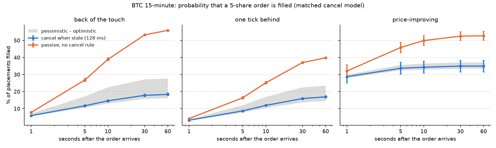
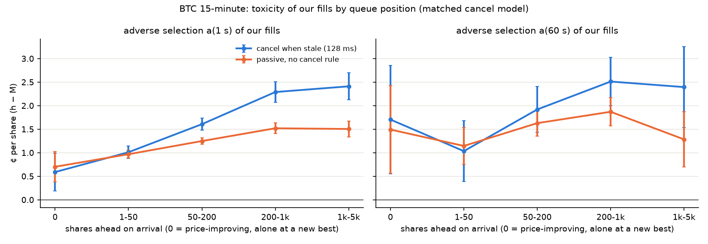
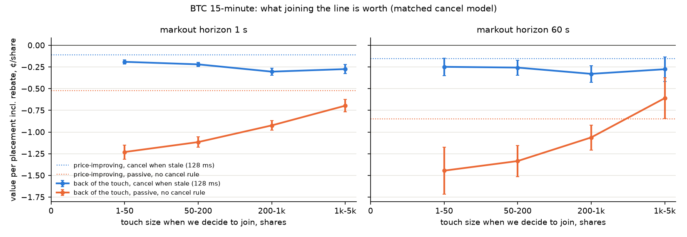
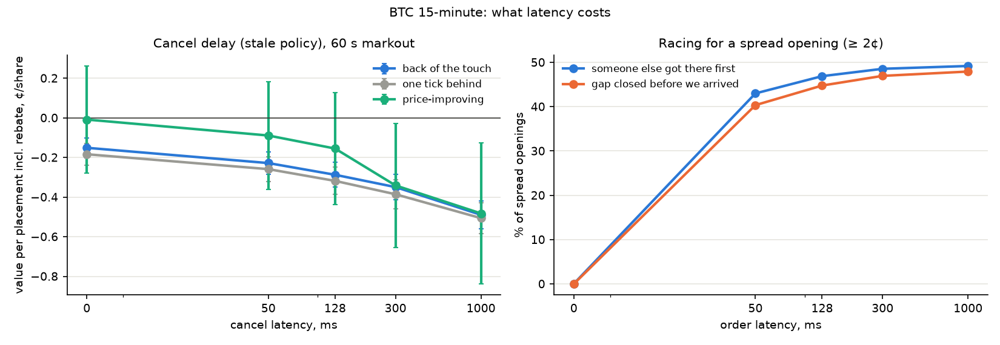

# Queue and fill model v1 (stage 5)

Built 2026-11-09 by `polymm queue 2026-11-06 2026-11-07 2026-11-08` (code `src/polymm/queue/`, decision D-026).
11-06 is training only (it fits the first fill-model fold); 11-07 and 11-08 are held out.
Machine-written tables: `reports/queue/summary.md`. Plots: `research/queue_fill/`. Parameters for the simulator: `reports/queue/queue_params.json`.

## 1. Result in one paragraph

> **Status: v1 floor, not a verdict (D-027).** These numbers are what a blind quoter gets: orders on a fixed grid, no selection model, a 1 s fair-value grid as the stale signal, an assumed 128 ms latency. They bound a naive strategy from below; whether a selective, Binance-driven quoter can do better is tested after the simulator exists.

We dropped 1.9 M virtual 5-share orders ("probes") into the replayed books of 11-06 to 11-08 and followed each one's place in the queue until it was filled or would have been pulled. **On BTC 15-minute, no placement we can make at 128 ms has positive value.** A passive order at the back of the touch is filled 56 % of the time within 60 s, and each placement loses 1.16 ¢ per share (including the rebate), because most of its fills come from the price running *through* it after everyone else has left. Cancelling when the order goes stale (the rest of the book moved through our price, or the fair value crossed it) cuts the loss to 0.29 ¢, and to 0.15 ¢ with an instant cancel, but never above zero. Our fills are worse than the average maker's of stage 4 (adverse selection 1.3 to 2.0 ¢ at 1 s against 0.8 ¢) and get worse the further back we join: from 0.6 ¢ for a price-improving order alone at a new best price to 2.3 to 2.4 ¢ behind 200+ shares. **Gate A's slice (step into a > 5 ¢ spread) fails for our own orders** under every policy and cancel model; stage 4's GO described the average resting maker, not a 128 ms newcomer. Every result holds across the four cancel models.

## 1a. Numbers

Live window of BTC 15m, grid placements, matched cancel model, 128 ms, cents per share, SE clustered by window.

**Fill probability within 60 s**

| Placement | passive | cancel when stale | bracket (stale, pess – opt) |
|---|---|---|---|
| back of the touch | 56 % | 18 % | 16 – 28 % |
| one tick behind | 40 % | 17 % | 15 – 24 % |
| price-improving (1 tick inside) | 53 % | 35 % | 34 – 37 % |

Most touch placements end by being left behind (59 %; one tick behind: 71 %): the price moves away and a quoter would re-price. 29 % of price-improving placements are rejected on arrival because the gap closed during the 128 ms.

**Value of one placement V (incl. rebate)**

| Placement | passive, 1 s | passive, 60 s | stale, 1 s | stale, 60 s |
|---|---|---|---|---|
| back of the touch | −1.01 | −1.16 | −0.26 ± 0.01 | −0.29 ± 0.03 |
| one tick behind | −0.76 | −0.84 | −0.27 ± 0.01 | −0.32 ± 0.04 |
| price-improving | −0.53 | −0.85 | −0.11 ± 0.05 | −0.16 ± 0.15 |

Without the rebate every number is 0.03 to 0.15 ¢ lower. Under the stale policy the four cancel models span −0.18 to −0.29 (touch, 60 s): the conclusion does not depend on the unknown θ.

**Where the losses come from (stale policy, fills)**

| Fill | n | h | M(1 s) | M(60 s) | a(1 s) |
|---|---|---|---|---|---|
| touch, at our level | 14,584 | +0.55 | −0.63 | −0.91 | 1.18 |
| touch, price traded through us | 11,003 | −0.25 | −3.00 | −3.09 | 2.76 |
| improving, at our level | 303 | +0.69 | +0.31 | +0.91 | 0.38 |
| improving, through us | 531 | +0.08 | −0.92 | −2.48 | 1.00 |

Stage-4 average maker fill: h +0.80, M(1 s) +0.02, M(60 s) −0.28. The fills that hurt are the ones where the price ran through our level: 43 % of touch fills even with the cancel rule, because the 128 ms cancel loses the race. The only good fills are a price-improving order hit *at its own price* (+0.91 ¢ at 60 s, few of them).

**Toxicity by queue position (back-of-queue penalty, stale policy)**

| Position taken | n fills | a(1 s) | D(1 s) = a(x) − a(0) |
|---|---|---|---|
| 0: improving, alone at a new best price | 543 | 0.59 ± 0.20 | 0 |
| touch, 1–50 ahead | 3,944 | 1.01 | +0.42 |
| touch, 50–200 ahead | 8,080 | 1.61 | +1.02 |
| touch, 200–1k ahead | 10,287 | 2.29 | +1.70 |
| touch, 1k–5k ahead | 2,247 | 2.41 | +1.82 |

The deeper the line, the more toxic the fill: only a taker larger than everything ahead of you reaches you, and large takers are the informed ones (stage 4).

**Is any place in line worth having?** No. Grouped by the touch size at the decision (known in advance, unlike the queue on arrival), the stale-policy value at 60 s is −0.25 (1–50 shares), −0.26 (50–200), −0.33 (200–1k) and −0.28 (1k–5k), all at least 5 SE below zero. x* is the front: there is no queue position whose value is positive.

**Latency**

| Cancel latency (stale policy) | 0 ms | 50 ms | 128 ms | 300 ms | 1000 ms |
|---|---|---|---|---|---|
| back of the touch, V(60 s) | −0.15 | −0.23 | −0.29 | −0.35 | −0.49 |
| price-improving, V(60 s) | −0.01 | −0.09 | −0.16 | −0.34 | −0.48 |

Racing for a spread opening (≥ 2 ¢): at 50 ms someone else is already there 43 % of the time and the gap has closed 40 % of the time; at 128 ms, 47 % and 45 %.

**Gate A slice for our orders** (improving into a > 5 ¢ spread, 128 ms, stale policy, matched, no rebate): 1 s: −0.17 ± 0.11 (11-06), −0.21 ± 0.20 (11-07), +0.06 ± 0.09 (11-08); 60 s: −0.12, −0.22, +0.35 ± 0.41. **FAIL** under every policy and cancel model.

**Fill rate and model.** $\lambda(\delta) = A e^{-k\delta}$ with $A$ = 3.8 fills per resting minute at the fair value and $k$ = 0.20 per cent (passive): the fill rate halves every 3.4 ¢ inside the fair value, until spreads above 3 ¢ where it rises again (wide-spread moments). The walk-forward fill model (P(fill ≤ 10 s) from decision-time features) has a held-out AUC of 0.68 on both days (Brier 0.197 against 0.213 for the base rate).

**Ladder and Fed (descriptive).** A touch order on the ladder fills 2 % of the time within 60 s, on Fed 0.3 %; placement values are within 0.01 ¢ of zero. Their queues are too deep and slow to matter for spread capture: their value, if any, is the reward programme (stage 6).

**Hypotheses from the plan.**
- H1 (back of the 1 ¢ touch loses after the rebate): **confirmed**, under every policy.
- H2 (price-improving orders carry the edge, latency decides): **half**. Improving is the least bad and the only placement whose fills at its own price are good, but at 128 ms its value is −0.16; at 0 ms it is −0.01 ± 0.14. Latency decides, and we lose the race about half the time.
- H3 (most cancels are behind us): **supported**. Pseudo-L3 matches 92–95 % of cancels by count; the matched model's fill probability (18.4 %) sits close to the pessimistic one (16.3 %), far from the optimistic (27.8 %).
- H4 (ladder and Fed queues too deep to fill): **confirmed**.

**What it means.** Joining the BTC 15m queue as a 128 ms quoter with a 1 s fair value is a losing game at every price and queue position; the edge stage 4 saw in the average maker belongs to faster, earlier participants. The levers, in order of size: (1) cancel speed and a faster stale signal (Binance leads Polymarket by about 1 s; our stale trigger uses a 1 s grid): half of the touch loss disappears between 128 ms and 0 ms; (2) placement: only improve into fresh gaps, never join the back; (3) rewards (stage 6), which this stage does not count. Before the simulator, the cheapest next test is a sub-second BTC-move cancel trigger in this same engine.

## 2. Method

### What a probe is

A probe is an order that never existed. At decision time $t$ it reads the replayed book, picks a price $p$ on one side, and reaches the book at $t + L$ (latency $L$, 128 ms by default, the median WebSocket lag measured on the VPS). It joins the **back** of the queue at $p$ and changes nothing in the book (small-order assumption: 5 shares, the minimum order size).

From then on, at its level, every book update changes $x$, the shares ahead of it:

| Book update at our level | Shares ahead $x$ | Volume reaching us $E$ |
|---|---|---|
| a taker consumes $v$ from the front | $x \leftarrow \max(x - v, 0)$ | $E \mathrel{+}= \max(v - x, 0)$ |
| someone joins | unchanged (behind us) | – |
| someone cancels $c$ | $x \leftarrow x - \theta c$ (cancel model) | – |
| after every update | $x \leftarrow \min(x, L)$ | – |
| a trade at a price worse than $p$ on our side | $x \leftarrow 0$ | $E \mathrel{+}= v$ |

A $q$-share order has filled $\min(q, E)$ shares. The consumption $v$ is the trade volume D-020 linked to the book decrease, applied at the decrease, because 80 % of decreases arrive about 18 ms before their trade message.

**Cancel models.** L2 data does not say whether a cancel came from ahead of us or behind. Four models bracket it:

| Model | Share of a cancel that was ahead of us |
|---|---|
| pessimistic | none |
| proportional | $x / L$ |
| matched (realistic) | pseudo-L3: a cancel that removes exactly the size of an earlier add at that level (most recent unmatched one, within 60 s) was that order; ahead if it joined before us, behind if after. Unmatched cancels: proportional |
| optimistic | all of it, up to $x$ |

**Placements.** BTC 15m: every 2 s on each side, at the back of the touch, one tick behind, and price-improving (one tick inside the spread, $x_0 = 0$) when the spread is 2 ¢ or more; a latency sweep (0, 50, 300, 1000 ms) every 10 s; and every instant the spread opens to 2 ¢ or more ("openings", all latencies). Daily ladder and Fed: every 10 s at 128 ms, descriptive only. Probes only where the tick is 1 ¢ (prices 0.05–0.95) and inside strict clean windows.

**Stops.** 60 s horizon; end of the clean window or of the market; *left behind* (the best price on our side moved 2 ticks past us: a quoter would re-price, so this counts as "not filled", not as missing data); *rejected* on arrival if the price would cross the opposite best (post-only).

**Policies: what the order does when it goes stale.**

| Policy | Cancel trigger | Cancel lands |
|---|---|---|
| passive | none (the order rests until it stops) | – |
| alone | the rest of our side moved through our price (for a bid: the real best bid fell below $p$) | 128 ms later |
| stale | *alone*, or the fair value crossed our price (1 s grid) | 128 ms later |

A fill counts if it happens before the cancel lands. This is exact after the fact: until the cancel lands, the queue path is the passive probe's. The two cancel policies were added **after** the first run showed that 58 % of passive fills came from the price trading through the order (§1); they are the obvious rule every quoter runs, not a tuned filter, but they were not pre-registered.

### What is measured

$$
P_{\text{fill}}(T) = \Pr(\text{filled within } T \text{ seconds of arrival})
$$

$$
a(x) = E[h - M(\tau) \mid \text{fill}, x_0 = x], \qquad D(x) = a(x) - a(0)
$$

$$
V = \mathbf{1}\{\text{filled}\} \cdot \big(M(\tau) + \text{rebate}\big)
$$

$h$ and $M(\tau)$ are the stage-4 quantities measured on our fill: $h = 100\,s\,(m - P)$ with $m$ the fair value just before the fill and $P$ our price, and $M(\tau)$ the same τ seconds later. $V$ is the value of one placement in cents per share; an unfilled placement is worth 0. SEs are clustered by market window.

**Fill rate against distance.** $\lambda(\delta) = A e^{-k\delta}$, fitted as $\ln\lambda = \ln A - k\delta$ on fills per resting minute by distance $\delta$ inside the fair value at the decision.

**Walk-forward fill model.** Logistic regression of "filled within 10 s" on the decision-time features (log queue ahead, placement type, spread, imbalance, touch size, minute, distance from fair), fitted on earlier days and scored on the next.

## 3. Data checks (Q0)

| Check | 11-06 | 11-07 | 11-08 |
|---|---|---|---|
| level updates | 20.7 M | 11.7 M | 24.7 M |
| continuity breaks (size before ≠ previous size after) | 0.017 % | 0.019 % | 0.012 % |
| traded volume linked to a book decrease | 98.9 % | 99.0 % | 98.4 % |
| level size = replayed top-of-book size | 99.97 % | 99.97 % | 99.9 % |
| pseudo-L3: cancels matched to an add, by count / volume | 95 % / 77 % | 93 % / 59 % | 92 % / 59 % |
| matched orders' life, median | 370 ms | 684 ms | 434 ms |
| shares added : shares traded | 550 : 1 | 510 : 1 | 500 : 1 |

The book is a flicker: about 500 shares are added and cancelled for every share traded. That is why θ (where a cancel sat) could have mattered, and why it is reassuring that the conclusions hold across all four cancel models.

## 4. Audit (before commit)

An independent review of the code found, and this version fixes:
1. **70 % of BTC 15m probes sat before the market's 15-minute window** (listed early, flat at 0.50, no fair value). They diluted every number toward zero. Probes now start at the window.
2. **Trades through our price were timed at the trade message**, about 18 ms after the book decrease. A sweep already under way when we landed filled us (phantom fills: 7 % of opening probes at 0 ms latency were filled this way), a cancel triggered by the sweep's first decrease "beat" the sweep's own fill, and h was read after the sweep had moved the mid. Trades are now timed at their taker order's start (stage 4's rule), orders that started before we landed are skipped, and h is read at that instant.
3. **"x0 = 0" at the touch meant "our level was swept while we were in flight"**, not the front of the queue, and x0 is read 128 ms after the decision (lookahead if used to decide). The front is now the price-improving order alone at a new best price; decisions use the touch size at the decision; x0 left the fill model (its held-out AUC fell from 0.90 to 0.68; part of the old number came from x0 and from the easy pre-window probes).
4. Capacity used passive fill amounts under cancel policies: now passive only.
5. V dropped fills without a markout (end of window) but kept unfilled probes: now a placement counts only if its whole horizon fits in the window.
6. Policy cancels before T are now "not filled", not missing.
7. Smaller: a tie in the pseudo-L3 comparison, left-behind on the arrival snapshot, empty-data guards.

## 5. Limitations

- **Virtual orders change nothing.** Other bots would react to our quote; 5 shares is small, but price-improving orders are seen by everyone.
- **θ cannot be verified from public data.** Pseudo-L3 is a size coincidence; bots reposting the same size could fool it. The bracket is the honest answer; the live pilot (stage 8) measures it.
- **The stale trigger uses a 1 s fair-value grid.** A real quoter would watch Binance tick by tick; this stage's cancel numbers are therefore an upper bound on the loss of a better-informed quoter.
- **Three days, two held out.** The value numbers are many SEs from zero, but the regime could change (11-07 was the toxic day in stage 4 too).
- **Capacity is approximate** (filled amount of the passive path, one markout per fill).
- **Rewards are not counted.** Stage 6.

