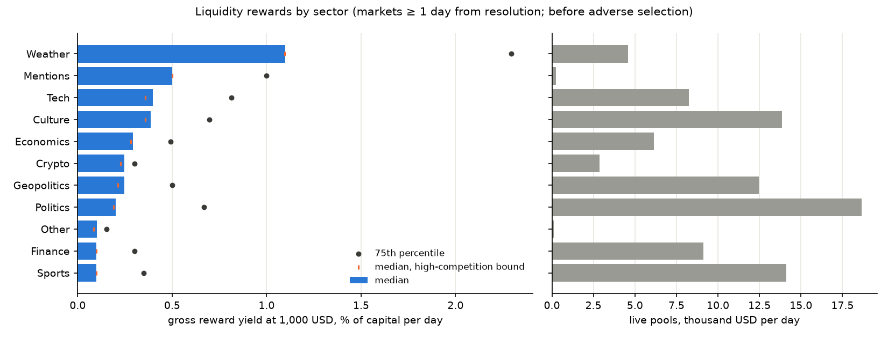
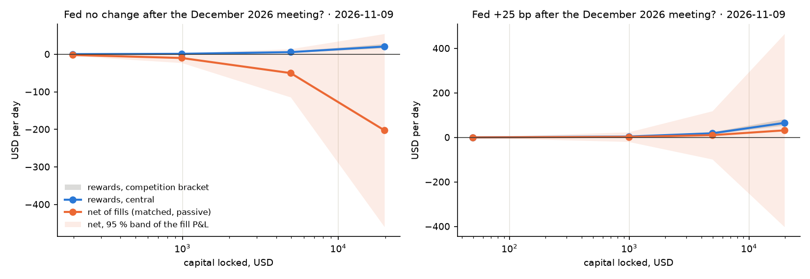
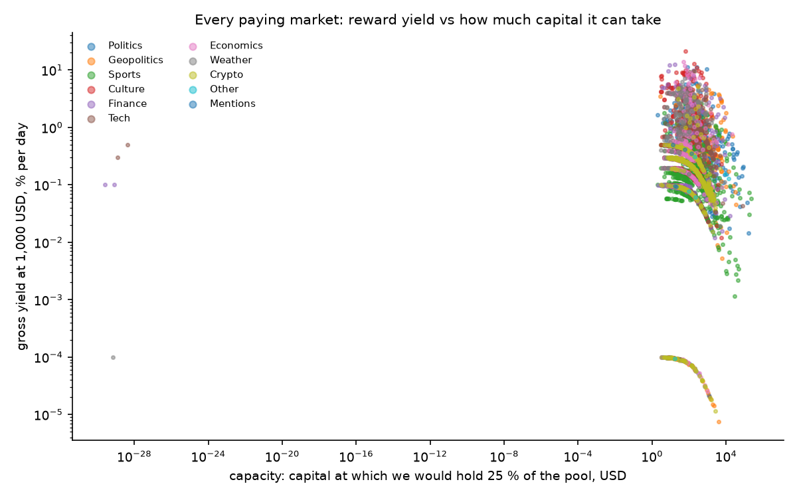

# Rewards and fees v1 (stage 6)

Built 2026-11-10 by `polymm rewards 2026-11-06 2026-11-07 2026-11-08 2026-11-09` on 9 book snapshots of every paying market (10-minute spacing) (code `src/polymm/rewards/`, decision D-029).
Rules read from the Polymarket docs on 2026-11-10. Machine-written tables: `reports/rewards/summary.md`. Plots: `research/rewards/`. Parameters for the simulator: `reports/rewards/rewards_params.json`.

> **Status: v1 (D-027).** Pools and books are today's; the recorded days are scored with today's pools; adverse selection is measured only where we record full books (the Fed markets). The screen ranks where to look, not what we would earn.

## 1. Result in one paragraph

Polymarket pays **113,000 USD a day** in liquidity rewards across **11,360 markets**, plus maker rebates of 15–25 % of taker fees. Almost none of it is in our recorded families: **BTC 15-minute and the daily ladder have no pool** (their only extra income is the rebate, at most 0.35¢ per filled share), and the two Fed December pools pay 700 USD a day. There, a two-sided quote at the best price earned **0.19¢ per share and side per day** on 11-09 in "+25 bp" (0.39 % of capital a day, gross) and 0.06¢ in "no change", against a fill P&L of resting there of **−0.08 ± 0.55¢** and **−0.56 ± 0.33¢**. The reward is smaller than the uncertainty of the fill P&L, and no quote is positive at its 95 % bound. Across the universe, the median gross reward yield at 1,000 USD of capital runs from **1.1 % a day (weather, ~1.5 days to resolution) to 0.1 % (sports, finance)**, and falls about tenfold at 10,000 USD: most pools are thin, saturating at a few hundred dollars of capital. These are gross yields; adverse selection, the term that decides them, is measured only where we record books.

## 1a. Numbers

**Pools by sector (live on 2026-11-10)**

| Sector | Markets | Pools USD/day | Median pool | Largest |
|---|---|---|---|---|
| Politics | 2,119 | 27,012 | 2 | 510 |
| Culture | 1,085 | 15,632 | 5 | 400 |
| Sports | 3,286 | 14,866 | 2 | 406 |
| Geopolitics (fee-free) | 703 | 14,535 | 3 | 555 |
| Weather | 817 | 12,888 | 11 | 100 |
| Finance | 1,115 | 9,624 | 1 | 500 |
| Tech | 718 | 8,479 | 5 | 153 |
| Economics | 503 | 6,277 | 3 | 500 |
| Crypto | 884 | 2,905 | 3 | 97 |

**Our recorded pools: reward vs fill P&L** (two-sided at the best price, 1,000 shares, ¢ per share and side per day; 11-09)

| Market | Competing score | Reward | Fill P&L, passive (matched) | Fill P&L, cancel when stale (matched) | Cancel-model range |
|---|---|---|---|---|---|
| Fed +25 bp (500 USD/day) | 129,000 | 0.19 | −0.08 ± 0.55 | +0.61 ± 0.35 | −0.05 to +1.70 |
| Fed no change (200 USD/day) | 153,000 | 0.06 | −0.56 ± 0.33 | −0.22 ± 0.13 | −0.56 to +0.16 |

The competition moves a lot day to day: "+25 bp" had 333,000 on 11-08 and 129,000 on 11-09, so the reward per share nearly tripled. Joining the best price beats sitting further out (the score is quadratic and the best price is 0.5¢ from the mid on a 1¢ spread): 1,000 shares two-sided earn 3.85 USD a day on 990 USD in "+25 bp" (0.39 % a day), 1.15 USD in "no change" (0.12 %). With the fill P&L at its 95 % lower bound and the high-competition bracket, every candidate is negative. "No change" looks costly to rest in (−0.56 ± 0.33¢); "+25 bp" is undecided. Three more weeks of data shrink the fill SE about 2.5-fold (it falls with the square root of the days), which is roughly what it takes to resolve 0.19¢.

**The screen: sector grid** (9,564 markets at least one day from resolution; standard quote; yields in % of capital per day, gross of adverse selection)

| Sector | Markets | Pools USD/day | Median at 1k | 75th pct | High-competition median | Median at 10k | Markets > 0.2 %/day (cons.) | Capacity, USD | Days to end |
|---|---|---|---|---|---|---|---|---|---|
| Weather | 255 | 4,577 | 1.10 | 2.30 | 1.10 | 0.11 | 204 | 36,512 | 1.5 |
| Mentions | 37 | 247 | 0.50 | 1.00 | 0.50 | 0.05 | 30 | 252 | 5.5 |
| Tech | 693 | 8,249 | 0.40 | 0.81 | 0.36 | 0.05 | 461 | 206,075 | 51 |
| Culture | 1,046 | 13,855 | 0.39 | 0.70 | 0.36 | 0.05 | 649 | 133,773 | 82 |
| Economics | 492 | 6,147 | 0.29 | 0.49 | 0.28 | 0.03 | 323 | 104,723 | 51 |
| Crypto | 875 | 2,868 | 0.25 | 0.30 | 0.23 | 0.03 | 481 | 162,009 | 141 |
| Geopolitics | 675 | 12,459 | 0.25 | 0.50 | 0.21 | 0.03 | 353 | 499,256 | 51 |
| Politics | 1,315 | 18,652 | 0.20 | 0.67 | 0.19 | 0.03 | 622 | 1,422,115 | 54 |
| Sports | 3,153 | 14,106 | 0.10 | 0.35 | 0.10 | 0.02 | 1,129 | 1,795,512 | 97 |
| Finance | 1,017 | 9,123 | 0.10 | 0.30 | 0.10 | 0.01 | 304 | 182,702 | 20 |

Capacity = the capital at which we would hold a quarter of each pool, summed over the sector. 4,557 markets clear 0.2 % a day at 1,000 USD under the high-competition bound, 1,602 clear 0.5 % and 1,025 clear 1 %; the 1,602 together hold 444,000 USD of capacity.

**What these yields are not.** They are rewards on a quote, before any fill. Three things make them look better than they are:
1. **Uncontested pools are uncontested for a reason.** 2,640 markets have no qualifying competition at all, mostly because their spreads are 10–38¢ wide; the standard quote steps inside such a spread and takes the whole pool. Nobody else does this because whoever trades with you there is likely to know more (the stage-5 lesson: you are filled when it hurts). The top of the ranking is dominated by such markets (an AI-model release, a Bank of England decision, an IPO valuation) and by niche events (reality-show weigh-ins, Rotten Tomatoes scores) where informed takers are likely.
2. **Weather leads because it resolves in a day and a half.** Short-dated markets have thin competition and fast-moving information (forecasts update hourly); their adverse selection is the open question.
3. **Thin pools saturate.** The median capacity per market is 20–200 USD; at 10,000 USD the median yield drops about tenfold in every sector. A strategy has to spread over many markets, each with its own adverse selection, to deploy real capital.

**Not scored.** 399 paying markets (3,409 USD/day) had no qualifying book on either side (most have no bid at all, so the reward midpoint is undefined); 831 (9,659 USD/day) returned no book to the sampler (ended or halted); 49 have no end date and are not ranked.

**Gate A context (stage 4, rerun with 11-09).** With 11-09 as a third held-out day, `polymm markouts` gives BTC 15m **NO-GO**: the > 5¢-spread slice is still positive at 1 s on 11-09 (+2.78 ± 0.99¢) but, on only 203 fills, not at 60 s (−1.05 ± 3.53¢). Stage 5 had already shown the slice fails for our own orders. Rewards do not change this: BTC 15m has no pool.

## 2. The rules as implemented

**Fees.** A taker pays $C \cdot f \cdot p(1-p)$ per trade ($f$ = 0.07 crypto, 0.05 sports/economics/culture/weather, 0.04 finance/politics/tech, 0 geopolitics). Makers never pay.

**Maker rebate.** The pool is a share $r$ (15–25 %) of the market's taker fees, split by each maker's fee equivalent $C f p(1-p)$. Every trade's taker fee equals its makers' fee equivalents, so the totals cancel and each filled share earns exactly

$$
\text{rebate per share} = r \, f \, p(1-p)
$$

(stages 4 and 5 already add it per fill).

**Liquidity rewards.** Once a minute, at a random second, each resting order of at least the market's minimum size scores

$$
S(v, s) = \left(\frac{v - s}{v}\right)^2
$$

where $v$ is the market's maximum qualifying spread in cents and $s$ the order's distance from the size-cutoff-adjusted midpoint. A maker's two sides (on the YES book, which holds the NO orders mirrored) are $Q_{\text{one}} = \sum S \cdot \text{size}$ over bids and $Q_{\text{two}}$ over asks, and

$$
Q_{\min} = \max\!\left(\min(Q_{\text{one}}, Q_{\text{two}}),\ \frac{\max(Q_{\text{one}}, Q_{\text{two}})}{3}\right)
$$

when the midpoint is in 0.10–0.90; outside that band only two-sided quotes count, $Q_{\min} = \min(Q_{\text{one}}, Q_{\text{two}})$. Each minute is normalised across makers, then the day; a maker's daily share is the mean of its per-minute shares, paid at midnight UTC from the market's daily pool (minimum 1 USD).

## 3. Method

**R0 configuration.** `GET /rewards/markets/current` (every market with a live pool) joined to `GET /sampling-markets` (question, tokens, tags). Tags map to Polymarket's fee categories, which also gives each market its fee and rebate rate. A spot check of `GET /fee-rate` agrees: base fee 0 for geopolitics, positive elsewhere. Only the current configuration is published, so the snapshot (`data/reference/rewards/dt=…`) is taken daily from now on.

**R1 the book's score.** For our recorded markets with a pool, one random second per minute inside strict clean windows: level sizes from the stage-5 level stream, the size-cutoff mid, both sides' scores. L2 hides which maker owns which side, so the competing $\sum Q_{\min}$ is **bracketed**. For one maker with sides $a \ge b$, $Q_{\min} = \max(b, a/3)$, smallest at $b = a/3$ (a quarter of $a + b$) and largest at $a = b$ (a half). So

$$
\frac{Q_{\text{one}} + Q_{\text{two}}}{4} \;\le\; \sum_n Q_{\min, n} \;\le\; \frac{Q_{\text{one}} + Q_{\text{two}}}{2}
$$

with a central estimate that counts the matched two-sided part in full and the heavier side's excess at a third. (The plan said a factor 3; the bound is a factor 2.)

**R2 our share.** A candidate quote (join the best price, or 1–3¢ from the mid; one or two sides; minimum size to 20,000 shares) is inserted into the minute's book (it can move the size-cutoff mid), scored exactly, and divided by our score plus the competition. Reward per day = pool × mean share. Capital: $q \cdot p_{\text{bid}}$ for the bid plus $q(1 - p_{\text{ask}})$ for the ask (held as a NO bid).

**R3 cost of resting.** From the stage-5 probes on the same markets: per one-minute placement of a 200-share order, the shares filled and their 60 s markout including the rebate; × 1440 for a day, scaled by size and sides. Clusters are market × hour (the Fed family has too few markets for per-market clusters). "Best" quotes map to the touch probes, deeper quotes to one tick behind.

**R4 net value.** Rewards under the three competition bounds against the fill P&L under the four cancel models and two policies (passive; cancel when stale), per market and candidate.

**R5 the screen.** Every paying market's YES book over REST (`POST /books`, 500 per call, about 20 s per pass over ~10,500 books), sampled every 10 minutes. A standard two-sided quote (join the best price inside the max spread, else step in to half of it) is scored against the bracketed competition, and the yield is computed **at a fixed capital** of 1,000 and 10,000 USD, so that a tiny or crowded pool saturates as it would for us. Capacity = the capital at which we would hold 25 % of the pool. Markets resolving within a day are excluded from rankings.

## 4. Audit (before commit)

An independent review found, and this version fixes:
1. **The competition bracket was wrong.** My "central" value was really the tight upper bound, and the "high" end (half the side total) overstated competition by ~32 % on the lopsided Fed books. Now: low = max(T/4, x/3), high = m + (x − m)/3 (m, x the smaller and larger side totals), central = their midpoint; a property test checks the true total stays inside on random maker splits.
2. **Today's pool on a much thinner 11-06 book doubled the pooled share.** Results are now per day, headlined on the latest day.
3. **Linear scaling of a noisy, positive fill P&L** made bigger quotes look better. Rankings now use the reward yield; the fill P&L is shown with its 95 % bound; conservative = high competition + worst cancel model − 1.96 SE.
4. **Fees from tags were wrong for some markets** (48 "Geopolitics" markets charge fees). Each market's own `taker_base_fee` now says whether it charges; the sector only picks the rate.
5. **The rebuilt book had ghosts** (snapshot loads are not in the level stream): minutes whose rebuilt best bid/ask differ from the recorded top of book are dropped (11-06 "+25 bp": all but 15 minutes).
6. **Screen:** capacity is unbounded, not zero, with no competition; the mid is recomputed after a step-in; drop-outs are counted; time to resolution is taken at the snapshot; the 1 USD payout floor is flagged; a fallback when the best qualifying price lies beyond the stored levels (v1 dropped 2,915 markets).
7. Smaller: post-only checked against any-size levels; fills without a markout dropped, not set to 0.

## 5. Limitations

- **One day of configuration and books.** Pools and competition change daily (the Fed competition fell by 60 % between 11-08 and 11-09). The daily refresh now snapshots the configuration and three book samples a day; rankings firm up over weeks.
- **Adverse selection outside our recorded markets is unknown.** The screen's yields are gross. Before quoting any screened market, record its book (stage 5's engine needs the full event stream) and measure the fill P&L.
- **L2 cannot attribute sides to makers.** Our share is bracketed (factor ≤ 2); the level-size cutoff counts small orders inside big levels, which overstates the competition (our share is conservative).
- **Rules read from the docs.** Unpublished details (the exact size-cutoff midpoint, sponsored vs native rates, sports in-game multipliers) could move the numbers; the first live day's `rewards/user/total` is the check.
- **Event risk is not modelled.** The Fed markets jump on 2026-12-09; quotes have to come off before.

